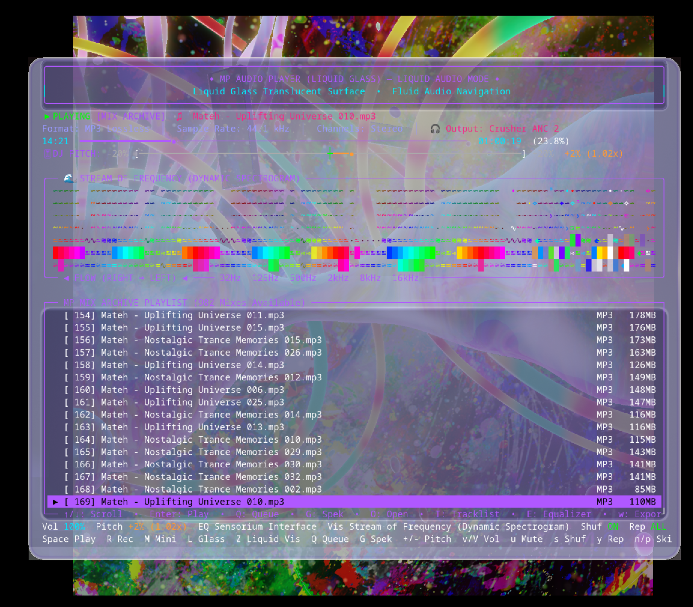
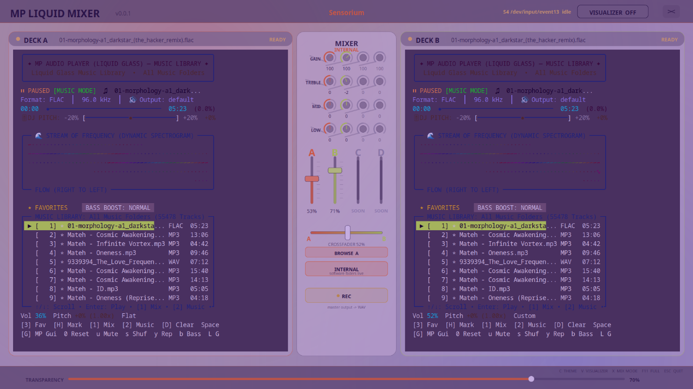
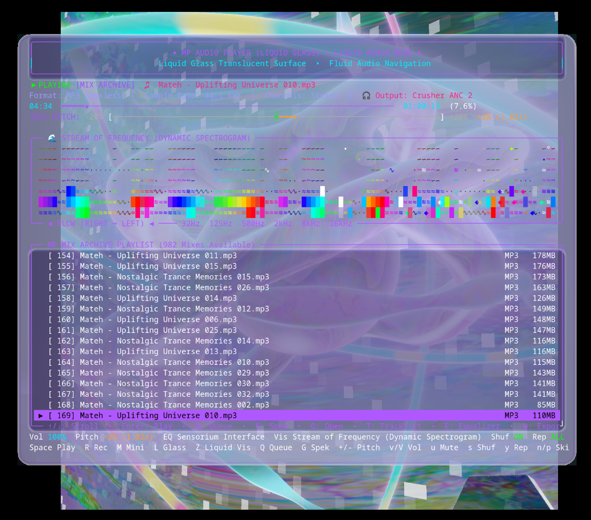
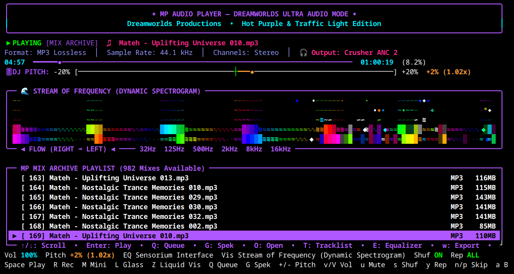

<p align="center">
  
</p>

> [!IMPORTANT]
> ## 🎉 MP Mix Manager 0.5.4 (Sensorium) - [Dreamworlds Productions / MPlanetarian ] - Stable Release: Mac, Windows 10/11, Linux 7.x (Ubuntu, Fedora, Bazzite, SuSE, Arch), FreeBSD, Ras Pie
>
> **MP Mix Manager 0.5.4 was released on the 19th of November 2026 by MPlanetarian / Dreamworlds Productions.**
>  Download Packages Here: 
   [
   [
   [
   [
   
>  
>
> Welcome to **Sensorium**, the Next Generation of Audio Mixing and Mix Archive Management & Audio Workflow, with many new Features Added — including a brand new **MP Liquid Mixer** and new **3D Visualizations** for **OpenGL, Vulkan & Metal**. See the full list of new features added and fixes below.
>
> This is the follow-up to 0.5.3, and it is a release built from things you told me about — plus one big new window. Nothing here is a rewrite: every fix below is a real bug that was reproduced on a real machine, fixed at the cause, and then pinned by a test so it cannot come back. The console menu, controllers, the clickable deck and the intro movie all shipped in 0.5.3 and are described there, not here.
>
> 0.5.4 also brings a brand-new window. **MP Liquid Mixer** is two real MP Liquid Player decks around a four-channel mixer with trim, three-band EQ, equal-power crossfader, tempo faders and BPM-aware Sync, with a locked MP Liquid Visualizer behind it. It plays the Kontrol S4 natively through evdev **and** maps a DJ in MIDI mode automatically — and only a DJ: a generic controller is never touched. Its master output records to **4 GiB WAV or FLAC parts**, past the old 2 GiB wall, and the new **EXPORT MIXES** button files them into your primary `MIX_ARCHIVE`. Press **`X`** in any MP window to open it; pressing `X` again raises the mixer that is already running instead of starting a second one.
>
> The suite also gained a second kind of window. **`W`** opens an **MP Black Glass** pane at exactly the size of the window that opened it — up to eight, with **Rainbow Mode** and a transparency slider that fades in only under the pointer. The tray can now **rescan the archive**, **rescan the music folders** and **mute the player** without opening the console, and the Windows tray's Close path finally matches Linux. A full uninstall also removes the OS integration it used to leave behind.
>
> The two other headlines are ones you will notice immediately. **The manager now opens instantly** — the startup logo plays once per login instead of on every launch, and the screen-span retry was cut from roughly six seconds to about one, so a cold start reaches the menu in about 2.3 s instead of 13.5 s. And **the Web Companion starts the mix by itself**: opening `http://<host>:8888/` on your phone is now the engage, with no button to press first, while Safari and iOS still get a single tap invitation only when the browser genuinely refuses.
>
> The MP Liquid Player gained a **VISUALIZATION button that really hides and shows** the visualizer behind it — the same window comes back, same preset, still bonded — plus arrow keys that **always seek** instead of stepping presets, and a **now-playing title** that is pure black or pure white depending on the pane behind it. Closing a window now destroys it **before** the exit movie plays, so the player no longer sits frozen underneath the clip.
>
> The theming finally settled: **Sensorium's pane is light coral** with deep maroon ink so it is readable at last, **Retro Linux Memories** moved to a dark gray pane, and seven themes whose accent fell below the WCAG floor now clear **4.5:1**. The console's oversized-window lock screen is gone for good, and the `Extreme` bass setting was removed because it was squashing the top end rather than adding bass.
>
> There are also deep reliability fixes: **a theme switch no longer leaves the old palette in the header banner**, **Music Folders skips an offline share** and **the mixer mounts it before it plays** instead of failing in a traceback or a silent deck, **the tree imports on Ubuntu 20.04's Python 3.8**, **the MP Harmony Agent no longer restart-loops** when its Ollama tag is missing, and **MP Reporter stops emailing empty briefings**. A Bluetooth **headset play button now pauses the mix** instead of opening a video, announcements **no longer talk over each other**, and an **iPhone keeps the dashboard open** instead of reloading it until iOS kills the page. On top of that, there is a new **boot-death ledger** that finally tells a power cut apart from a kernel panic, and `oops=panic` no longer turns a survivable driver fault into a reboot.
>
> Finally, **Dreamworlds Ultra** is the fresh-install default with light purple text, and three Liquid Glass skins were retired so the picker is easier to scan.
>
>
> Please see the rest of this page to discover even more — there are simply too many fixes to list for a short introduction.
>
> **- MPlanetarian (Dreamworlds Productions)**
> **November 19th, 2026**

# MP Mix Manager 0.5.4 Stable (Sensorium) by Dreamworlds Productions (MPlanetarian)

> 📅 **Last Updated:** November 19, 2026 • **Latest Release:** `v0.5.4 Stable (Sensorium)` — released **November 19, 2026**

[]()
[-f72585.svg)](VERSION)
[](MP_Audio_Player_Liquid_Glass_OpenGL.py)
[](MP_Liquid_Visualizer.py)
[](MP_Liquid_Mixer/README.md)
[](scripts/bigscreen_vr.py)
[](docs/KONTROL_S4_USER_GUIDE.md)
[](README.md)
[]()
[]()
[]()
[]()
[]()
[](MP_Audio_Player.py)
[](mix_web_companion.sh)
[](scripts/wan2gp.sh)
[](scripts/mp_report_generator.py)
[-FF5722.svg)](mplanetarians-alarm-clock/README.md)
[](https://github.com/MPlanetarian/MPMixManager_v0.4-x64)
[](LICENSE)



An enterprise-grade workstation orchestration console and media management suite designed for high-resolution audio production, multi-hour DJ mix archiving, automated 32-bit FLAC mastering, 31,000+ track SMB network streaming, DJ Pro playlist extraction, live tracklist tracking, **two-deck DJ mixing with native and MIDI-mode DJ control**, YouTube & AI Talking-Head video synthesis, automated multi-period intelligence reporting, system maintenance, and AI workflow control across **Linux (Bazzite / SteamOS / Fedora / Ubuntu)**, **macOS (Latest Golden Gate Release, Apple Silicon M1–M4 & Intel)**, **Microsoft Windows 10 & 11**, **FreeBSD (14.x / 15-CURRENT)**, and **Raspberry Pi (3 / 4 / 5 and Zero 2 W)**.



## 🎛️ MP Liquid Mixer — The Next Generation (Sensorium Interface Enabled) — Four Decks (Mixing Tracks), Two MP Liquid Players (Fully Independent Playlists), One MP DJ Liquid Mixer — Glass Control Surface with 3D Visualization and over Ten Unique Themes including Into Darkness (Default)

**MP Liquid Mixer** is a full-screen, liquid-glass DJ mixer built on the **MP Liquid Player**. Two complete player engines sit left and right with a wide gap between them, and that gap holds a four-channel mixer with a crossfader. The **MP Liquid Visualizer** can run behind the whole surface, bonded to the mixer's exact rectangle, so the decks float over a live 3D scene instead of a flat desktop.

It is one 1920×1080 (or 4K) window that inherits the entire Liquid Glass host: the same theme table, ink resolver, fonts and visualizer plumbing as MP Liquid Player. Anything that recolours the player recolours the mixer, including a `C` press made inside one of the decks.

| Feature | What it does |
| :--- | :--- |
| **Two real players, not clones** | Each deck is a separate `MP_Audio_Player.py` engine in its own terminal, with its own IPC namespace, PID, lock and state. Neither deck can retire, silence or steal the other's position, yet both share the library, Favorites and the active theme. Both open the **Music Folders** library in Music mode, because these decks are for mixing tracks. |
| **Four channels and a crossfader** | Faders A and B apply per-deck gain, and the crossfader is **equal-power** — both decks sit at −3 dB in the centre, so a blend never dips in the middle. Channels C and D are drawn and remember a position but are intentionally not wired to anything yet. |
| **Internal / External mixing** | **Internal** applies the software faders and crossfader. **External** hands both decks to the house mixer at unity and bypasses the software levels, for a club rig where the hardware faders already exist. |
| **Tempo and beat sync** | Vertical pitch sliders for both decks, master-tempo ownership and **Sync**. BPM tags give a true beat match; without tags the target copies the master's pitch. The master follows the most recently started deck and hands over when that track ends. |
| **The visualizer lives behind the mixer** | A locked companion MP Liquid Visualizer runs behind the mixer at its exact rectangle, in full screen and windowed mode. It follows every move and resize, cannot be detached, and is relaunched if it is closed or killed. The **VISUALIZER** button (or `V`) only hides and shows it. |
| **Master-output recording** | Records the room mix to **WAV** (PCM, default) or **FLAC**, with a selectable part ceiling of **4 GiB** (the WAV maximum), **2 GiB** or **1 GiB**. A set longer than the ceiling continues as `_PART_2`, `_PART_3` and so on. |
| **EXPORT MIXES** | Moves finished recordings into the primary `MIX_ARCHIVE` — WAV to its root, FLAC to `FLAC_CONVERTED_OUTPUTS`. With no archive configured nothing is moved and the tray posts a setup reminder. |
| **Settings window** | One modal (**SETTINGS** / `S`) for every preference: recording folder, format and part size; the master output device (**any sink, Bluetooth included**); default theme; startup and exit videos; the background visualizer; a default equaliser preset; start full screen and deck autoplay. Saved to `~/.config/mix-manager/liquid_mixer_settings.json`, a plain file you can edit by hand — every value is validated on load and an unknown value falls back to the documented default. |
| **Any output device** | Both decks play through a chosen sink, including Bluetooth, without changing the desktop's own default: the engines are pinned with `PULSE_SINK` and a running stream is moved to the new sink. |
| **Themed chrome** | A **Trance Connection Enabled** status lamp, a live system clock, the **WAV/FLAC** toggle, a **24-Bit** badge and the **DREAMWORLDS PRODUCTIONS / MPLANETARIAN** credit all take the active theme's accent and secondary colours, so `C` repaints them with the rest of the window. |
| **Transparency bar** | The player's own 20 %–80 % range at the bottom of the screen, applied to the whole glass window so the visualizer reads through it. |
| **Windowed or full screen** | **F11** or a double-click on the top bar toggles between full screen and a centred 1920×1080 window; drag the top bar to move it and the bottom-right grip to resize (minimum 960×540). |
| **The movie brackets the window** | `Exit_MP_Video.mp4` plays before the mixer exists, and again after the last window is gone, through the same loader every MP window uses — so it never plays twice on one launch. |
| **Quick launch the rest of the suite** | `M` opens MP Mix Manager, `G` MP Gui, `L` MP Liquid Player, `Z` a visualizer, `W` an MP Black Glass pane at the mixer's own size. Inside a deck the player's own keys keep working, so `Space`, the arrows, `1`/`2`/`3` and `/` behave exactly as they do in the player. |
| **DJ hardware** | A detected DJ mixer in MIDI mode is mapped automatically — Play and Sync per deck, Shift, browse, load, record, channel volume and deck pitch — through the ALSA sequencer so it works beside the standalone service, with a per-control override map in `~/.config/mix-manager/liquid_mixer_midi.json`. Only a device whose name identifies it as DJ gear is opened, so a generic pad or keyboard controller is left alone. |
| **Desktop shortcut** | **MP Liquid Mixer** on the Desktop and in the application menu, written in the same style as the other four MP entries and pointing through the install-tree resolver, so moving or renaming the folder keeps it working. |



> [!NOTE]
> ### 🎵 Celebrating the Release of MP Mix Manager 0.5 (Sensorium)
> **The release theme track is here:** ***MPlanetarian - The Orbits of Planets (Cosmic Dreamworlds Remake) - [Stream of Frequency Recordings]*** — a **48 kHz / 16-bit FLAC**, **27:27** long, shipped in [`MP_SAMPLES/`](MP_SAMPLES/) and preloaded into the Liquid Transparent Audio Player at **0:00** on first launch.
>
> The new artwork ships as **`MP_SAMPLES/The_Orbits_of_Planets_Dreamworlds_Cover.png`** and is embedded in the FLAC's ID tags as both its **Cover (front)** and **Cover (back)** pictures. The cover is shown below the MP Audio Player screenshot.

> [!TIP]
> ### 🌟 Welcome to MP Mix Manager v0.5.4 Stable (Sensorium)
> **November 19, 2026. Welcome from MPlanetarian.** This is the 0.5.4 Sensorium release, the direct successor to **0.5.3 Stable (Sensorium)**. Thank you for running MP Mix Manager, MP Gui, the Liquid Transparent Audio Player and the new **MP Liquid Mixer**. The manager, the players, the mixer and the music library share one glass desktop, and the macOS build in this release is the one on this page.
>
> Sensorium 0.5.4 Release - Enjoy a Magical Journey through Music & Sound with the MP Visualizer (Included with MP Liquid Player) & the new MP Gui or you can use the MP Mix Manager CLI
>
> New and fixed in this release:
> - ⚡ **The manager opens instantly:** the startup logo plays **once per login** instead of on every launch, and the screen-span retry dropped from ~6 s to ~1.1 s. A cold start reaches the menu in about **2.3 s** instead of **13.5 s**.
> - 🎚️ **MP Liquid Mixer:** two real MP Liquid Player decks around a **four-channel mixer** — trim, three-band EQ, equal-power crossfader, tempo faders and BPM-aware **Sync** with automatic master hand-over — plus a locked MP Liquid Visualizer behind it. **`X`** opens it from any MP window; pressing `X` again **raises the open mixer** instead of starting a second one.
> - 🎛️ **DJ in either mode:** the native S4 **evdev** path is unchanged, and a DJ Kontrol switched to **MIDI mode** is mapped automatically (Play A/B, Sync A/B, Shift, Browse, Load, Record, channel volume, deck pitch). A generic MIDI controller is **never** opened or mapped.
> - 💾 **4 GiB recording and EXPORT MIXES:** the mixer's master output writes **WAV or FLAC** parts at the true 4 GiB ceiling (unsigned 32-bit RIFF sizes, so no 2 GiB wall) and continues as `_PART_2`, `_PART_3`. **EXPORT MIXES** files finished WAVs into your primary `MIX_ARCHIVE` and FLACs into its `FLAC_CONVERTED_OUTPUTS`, never overwriting anything.
> - 🪟 **`W` opens an MP Black Glass window:** a borderless pane at **exactly the size of the window that opened it** (up to **eight**), with **`R`** for Rainbow Mode, a **10–90 %** transparency slider that fades in under the pointer, and **`Z`** to bond a visualizer behind it.
> - 🖱️ **A tray that does the work:** **Rescan Mix Archive Folders**, **Rescan Music Folders** and **Mute MP Player Audio** run straight from the tray on Linux, macOS and Windows, off the icon's thread, and report back with a desktop notification.
> - ▶️ **The Web Companion starts the mix by itself:** browsing to the dashboard **is** the engage, so the phone plays with no button press. Safari and iOS get a single **"Tap anywhere to start the mix on this device."** only when the browser genuinely refuses.
> - 👁️ **A VISUALIZATION button that really hides and shows:** pressing it now **hides** the visualizer behind the player and pressing it again brings **that same window** back — same size, same position, same preset, still bonded. It no longer unbonds, moves or kills it.
> - ⬅️ **Arrow keys always seek:** `Left` / `Right` are ±10 s in the player in **every** state, including while a visualizer plays behind it. Preset stepping stays inside the visualizer window.
> - 🖤 **A now-playing title you can read across the room:** pure **black** on the pale glass pane, pure **white** on the charcoal-pane themes — including **Retro Linux Memories**, which is fixed in this release — chosen per surface instead of by theme hue.
> - 📱 **A phone dashboard that survives a reboot:** the installer now registers the Web Companion service — `systemd --user` on Linux, a LaunchAgent on macOS, and a Startup shortcut plus a firewall rule on Windows.
> - 🔔 **A quieter phone:** the dashboard's 4 Hz hue timer became a compositor `hue-rotate`, so Safari on an iPhone stops reloading the page and the gate stops snapping back over a playing mix.
> - 🔇 **The mixer's decks actually play:** opening the mixer now **mounts the Music Folders shares** on a worker thread before the decks load, a row whose share is offline names that folder instead of failing silently, and a **0-byte** file is refused with its own reason rather than reported as playing at 00:00.
> - 🧠 **MP Harmony stops restart-looping:** a missing Ollama tag is resolved instead of exiting, the alias is rebuilt from `/api/copy`, and the unit no longer pins a tag.
> - 🌈 **Dynamic Liquid Glass animates in the CLI player too:** the rainbow now sweeps in the console on the same 24-second cycle the Web Companion uses, instead of sitting on one frozen colour.
> - 🎨 **Theming settled down:** **Sensorium's pane is light coral** (`#f08080`) with deep maroon ink, **Retro Linux Memories** moved to a dark gray `#2D2D2D` pane, three Liquid Glass skins were retired, and **Dreamworlds Ultra** is the fresh-install default.
> - 🧹 **The oversized-window lock screen is gone**, along with the zoom guard, its colour scheme and its key injection. Resizing still redraws the menu correctly.
> - 🔊 **A quieter, better bass dial:** the whole dial is trimmed **-3 dB** (half the acoustic power) and the `Extreme` position was removed because it squashed the top end instead of adding bass. A saved `Extreme` opens as `High`.
> - 🔊 **Announcements no longer talk over each other:** every spoken output shares one machine-wide lock, and a briefing that waited too long is skipped rather than read late.
> - 🧾 **A boot-death ledger** tells a power cut apart from a kernel panic, and `oops=panic` no longer turns a survivable driver fault into a reboot.
> - 🧽 **A full uninstall leaves nothing behind:** icons, the `mp-desktop-exec` helper, `systemd --user` units, macOS LaunchAgents and app bundles, the Windows Startup entry, the KDE window rules and the dynamic-MOTD hook are all removed — while music, mixes, playlists, favorites, backups and exports are never touched.
> - 🩹 **Everything 0.5.3 shipped is still here** — see [Previous release: v0.5.3](#-whats-new-in-v053-stable-sensorium).
>
> **👉 [What's New in v0.5.4](#-whats-new-in-v054-stable-sensorium) • [Player and console](#-player-console-and-visualizer) • [Fixes](#-fixes-in-v054) • [Quick Start by OS](#-quick-start-by-operating-system) • [Read the Full Changelog](CHANGELOG.md) • [Previous release: v0.5.3](#-whats-new-in-v053-stable-sensorium)**

---

## 📑 Table of Contents



<p align="center">
  
</p>

> ### 🎨 Release Theme Track Cover — MP Mix Manager 0.5 (Sensorium)
> ***MPlanetarian - The Orbits of Planets (Cosmic Dreamworlds Remake) - [Stream of Frequency Recordings]*** — the free release track cover, embedded in the FLAC as its **Cover (front)** and **Cover (back)**. The track is **27:27** long. It ships in [`MP_SAMPLES/`](MP_SAMPLES/) and is preloaded in the Liquid Transparent Audio Player at **0:00** on first launch.

- [🎛️ MP Liquid Mixer — The Next Generation](#-mp-liquid-mixer--the-next-generation-sensorium-interface-enabled--four-decks-mixing-tracks-two-mp-liquid-players-fully-independent-playlists-one-mp-dj-liquid-mixer--glass-control-surface-with-3d-visualization-and-over-ten-unique-themes-including-into-darkness-default)
- [🚀 What's New in v0.5.4 Stable (Sensorium)](#-whats-new-in-v054-stable-sensorium)
- [🎚️ Spotlight: MP Liquid Mixer (Two Decks • Four Channels • DJ)](#-spotlight-mp-liquid-mixer-two-decks--four-channels--dj)
- [🖥️ Player, Console and Visualizer](#-player-console-and-visualizer)
- [📱 Web Companion, Installer and Services](#-web-companion-installer-and-services)
- [🩹 Fixes in v0.5.4](#-fixes-in-v054)
- [🧹 Removed and Changed in v0.5.4](#-removed-and-changed-in-v054)
- [🎨 Theme and Appearance in v0.5.4](#-theme-and-appearance-in-v054)
- [🚀 What's New in v0.5.3 Stable (Sensorium)](#-whats-new-in-v053-stable-sensorium)
- [✨ More in this 0.5.3 build](#-more-in-this-053-build)
- [✅ Closed gaps — previously in the tree only](#-closed-gaps--previously-in-the-tree-only)
- [🩹 Post-release fixes — November 14, 2026](#-post-release-fixes--november-14-2026)
- [📅 Updates in the 0.4.2 release window](#-updates-in-the-042-release-window)
- [🍏 What's New in v0.4.2 Stable (Liquid)](#-whats-new-in-v042-stable-liquid)
- [🍏 macOS fixes in v0.4.2 Stable (Liquid)](#-macos-fixes-in-v042-stable-liquid)
- [🎉 Download & Experience v0.5.4 Stable (Sensorium)](#-download--experience-v054-stable-sensorium)
- [📜 Previous Release: v0.4.3 Stable (Liquid)](#-previous-release-v043-stable-liquid--november-12-2026)
- [🚀 What's New in v0.4.0 Stable](#-whats-new-in-v040-stable)
- [🔥 Core Architecture Highlights](#-core-architecture-highlights)
- [🪟 Spotlight: MP Liquid Glass Audio Player (OpenGL • Vulkan • Apple Silicon Metal)](#-spotlight-mp-liquid-glass-audio-player-opengl--vulkan--apple-silicon-metal)
- [🔮 Spotlight: MP Liquid Visualizer (Native Vulkan 3D Audio-Reactive Raymarching)](#-spotlight-mp-liquid-visualizer-native-vulkan-3d-audio-reactive-raymarching)
- [🌌 MPlanetarian Dreamworlds & TUI Navigation](#-spotlight-mplanetarian-dreamworlds--tui-navigation)
- [🎧 MP Audio Player (Terminal Audio Suite)](#-spotlight-mp-audio-player-terminal-audio-suite)
- [📱 DJ Booth & Studio Mobile Web Companion](#-spotlight-dj-booth--studio-mobile-web-companion)
- [🎬 YouTube Shorts 1080x1920 Promotional Video Generator](#-spotlight-youtube-shorts-1080x1920-promotional-video-generator)
- [🎥 Screencast YouTube Video Generator with NVENC & Image Transitions](#-spotlight-screencast-youtube-video-generator-with-nvenc--image-transitions)
- [🤖 Next-Gen AI Orchestration, Matrix Voice Lab & Infinite Talker Suite](#-spotlight-next-gen-ai-orchestration-matrix-voice-lab--infinite-talker-suite)
- [📊 MP Reporter Suite, AI Brain Logs & Automated Email Briefings](#-spotlight-mp-reporter-suite-ai-brain-logs--automated-email-briefings)
- [📱 Congen v1.1 by Dreamworlds Productions (MPlanetarian)](#-spotlight-congen-v11-by-dreamworlds-productions-mplanetarian)
- [✂️ Auto-Split DJ Mixes & Multi-Part Spek Spectrograms](#-spotlight-auto-split-dj-mixes--multi-part-spek-spectrograms)
- [⏰ MPlanetarians Alarm Clock (Wake Up Edition)](#-spotlight-mplanetarians-alarm-clock-wake-up-edition)
- [⚡ DJ History Harmonic Playlist & Stage Setup](#-spotlight-dj-history-harmonic-playlist--stage-setup)
- [🎛️ EBU R128 Loudness Mastering, Audio Audit & CUE Engine](#-spotlight-ebu-r128-loudness-mastering-audio-audit--cue-engine)
- [🔍 Audio Fingerprinting, Chapters & Rekordbox Export](#-spotlight-audio-fingerprinting-chapters--rekordbox-export)
- [🖥️ KDE Plasma Desktop Shortcuts & Global Keyboard Binder](#-spotlight-kde-plasma-desktop-shortcuts--global-keyboard-binder)
- [📢 Unified Multi-Channel Notification Dispatcher](#-spotlight-unified-multi-channel-notification-dispatcher)
- [🚀 Quick Start by Operating System](#-quick-start-by-operating-system)
- [🎛️ Master Feature Matrix (3 Sections, Options 0–38, plus the AI, MP, X and VR rows)](#-master-feature-matrix-3-sections-options-038-plus-the-ai-mp-x-and-vr-rows)
- [💻 Command Line Interface & Direct Shortcuts](#-command-line-interface--direct-shortcuts)
- [📂 Repository & Codebase Layout](#-repository--codebase-layout)
- [⚙️ Configuration Guide (`config.env`)](#-configuration-guide-configenv)
- [🧪 Automated Test Suite & Quality Assurance](#-automated-test-suite--quality-assurance)
- [📦 Building Linux Packages (amd64 & arm64)](#-building-linux-packages-amd64--arm64)
- [🍓 Raspberry Pi](#-raspberry-pi)
- [📜 License](#-license)

---

## 🚀 What's New in v0.5.4 Stable (Sensorium)

> [!IMPORTANT]
> **MP Mix Manager v0.5.4 Stable (Sensorium) — released November 19, 2026.** Sensorium 0.5.4 carries every 0.5.3 feature forward. It is a **correctness release with a new window**: **MP Liquid Mixer** arrives as a two-deck, four-channel DJ mixer with native and MIDI-mode DJ control and 4 GiB WAV/FLAC recording, while almost every fix below was a reproducible fault on a real test bed, fixed at its cause rather than at its symptom and then pinned by a test. The visible wins are a **manager that starts in ~2.3 s instead of 13.5 s**, a **Web Companion that starts the mix when the page opens**, a **VISUALIZATION button that truly hides and shows**, **arrow keys that always seek**, a **readable now-playing title**, **`W` opening an MP Black Glass pane**, a **tray that can rescan and mute**, and a **first-launch intro that plays before the glass**. The rest of the release is depth: the mixer's decks mount Music Folders before they play, the Harmony agent no longer restart-loops, Music Folders survives an offline share, Ubuntu 20.04's Python 3.8 imports the tree, the header banner follows a theme switch, MP Reporter stops sending empty briefings, a full uninstall finally removes its OS integration, and a new **boot-death ledger** separates a power cut from a kernel panic.

### 🆕 New in v0.5.4

| Feature | Where | What you can do |
| :--- | :--- | :--- |
| **Instant startup** | `scripts/display_loader_video.sh`, `Mix_Archive_Manager.sh` | The startup logo plays **once per login session** instead of on every launch, and the screen-span retry polls the real window size every 150 ms instead of sleeping in four fixed rounds. Measured: the span block fell from ~6.0 s to **~1.1 s**, a second launch of the same session reaches the menu in about **2.3 s**, and the first launch still shows the full logo. A marker in `~/.config/mix-manager/loader_video_session` is keyed on the kernel boot id, the login session id and the session type, so a logout, a reboot or a Wayland/X11 switch brings the logo back. `force=1` callers (the installer and the loader tests) are unaffected. |
| **MP Liquid Mixer — a two-deck, four-channel DJ mixer** | `MP_Liquid_Mixer/MP_Liquid_Mixer.py`, `MP_Liquid_Mixer/mixer_core.py`, `MP_Liquid_Mixer/run.sh`, `MP_Liquid_Mixer.desktop` | **Two real `MP_Audio_Player.py` engines** sit left and right of a four-channel mixer in one liquid-glass window: per-deck faders, **trim and three-band EQ**, an **equal-power crossfader** (both decks at -3 dB in the centre), vertical **tempo faders**, **BPM-aware Sync** with automatic master hand-over, browse-wheel navigation and a **MASTER** button per deck. **Internal** mixing applies the software levels; **External** hands both decks to the house mixer at unity. A **locked MP Liquid Visualizer** runs behind the whole surface at the mixer's exact rectangle, follows every move and resize, and is relaunched if it is killed. Each deck lives in its own IPC namespace (`MP_PLAYER_NAMESPACE`), so deck A can never retire deck B. The window opens **full screen** by default, and **F11** or a double-click on the top bar switches to a 1920×1080 centred window that can be dragged and resized. **`C`** cycles the shared theme and repaints the chrome and both deck panes with it. Linux only: it needs X11/XWayland, VTE and ALSA, so macOS and Windows get no shortcut. |
| **Kontrol S4 — native and MIDI mode** | MP Liquid Mixer; `MP_Liquid_Mixer/mixer_evdev.py`, `MP_Liquid_Mixer/mixer_midi.py` | The **native evdev** path is unchanged: channel and crossfaders, pitch axes, Play, Sync, Shift, the browse wheel and its push all drive the mixer directly. A DJ switched to **MIDI mode** is detected through ALSA and mapped automatically to the same actions — **Play A/B, Sync A/B, Shift, Browse push/turn, Load, Record, channel volume and deck pitch** — and detection follows a hot-plug, so plugging it in later starts the map. **A generic controller is never opened or mapped**: only a device whose ALSA name contains `DJ` is used. The listener prefers the shared ALSA sequencer (`aseqdump`), which can run beside the standalone DJ service, and reports honestly when another process owns the port; duplicate presses seen by both paths within **80 ms** are coalesced. Individual notes and CCs can be re-mapped in `~/.config/mix-manager/liquid_mixer_midi.json`, and the top bar reports `DJ MIDI <name>` when a map is live. |
| **4 GiB WAV/FLAC recording with automatic parts** | MP Liquid Mixer; `MP_Liquid_Mixer/mixer_recording.py` | The master output is captured as raw PCM and the **44-byte RIFF header is written by the mixer itself**, with `ChunkSize` and `data` packed as **unsigned 32-bit** — so a part is not trapped at the old **2 GiB** wall. Each part is capped at **4,294,967,248 bytes of audio** (the 4 GiB file limit minus the header, rounded down to a whole 16-bit stereo frame), and recording continues as `..._PART_2`, `..._PART_3` while the original keeps its name as part 1. The new **WAV/FLAC** button switches the container (a live recording restarts in the chosen one); FLAC is encoded from the same raw PCM with `flac`, falling back to the suite's `ffmpeg`, and rolls **16 MiB below** the line so encoder buffering cannot cross it. The header is refreshed **once a second** while recording, so a crash or a pulled cable still leaves a playable file. The limit is fixed and not configurable. |
| **EXPORT MIXES into the primary MIX_ARCHIVE** | MP Liquid Mixer; `MP_Liquid_Mixer/mixer_export.py` | The **EXPORT MIXES** button moves finished recordings out of `MP_AUDIOWAV_REC_OUTPUT`: **WAV parts to the archive root** and **FLAC parts to `FLAC_CONVERTED_OUTPUTS`** (created when needed). It scans both the archive's recording folder and the install-tree fallback, so recordings made before the archive was configured are included, and it **never overwrites** — a name clash gets a numeric suffix. The destination is `MIX_ARCHIVE_DIR`, read from the environment first and then from `config.env`. With nothing configured the button scans and moves **nothing** and the tray posts a setup reminder; a configured path that is not currently a directory (an unplugged drive) is named instead of guessed. Success posts a tray notification with the archive path and the WAV/FLAC counts, and export is refused while a recording is live. |
| **Themed mixer chrome and a live clock** | MP Liquid Mixer | A **Trance Connection Enabled** status lamp in the top bar, a **24-Bit** badge beside the format button, the **DREAMWORLDS PRODUCTIONS / MPLANETARIAN** credit and a **live system clock** (date plus `HH:MM:SS`, refreshed every second) all draw from the active theme's accent and secondary colours, so a theme change repaints them with the rest of the window. The mixer's own launch keys open the rest of the suite from the chrome: **`M`** MP Mix Manager in a dedicated Konsole, **`Z`** MP Liquid Visualizer, **`W`** MP Black Glass, **`L`** MP Liquid Player and **`G`** MP Gui; a focused deck keeps its own player keys. |
| **`X` opens MP Liquid Mixer — once** | MP Gui, MP Liquid Player, console manager, `scripts/liquid_mixer_launch.py` | Press **`X`** in any MP window to open **MP Liquid Mixer** in its own window. Press it again and it **raises the open mixer instead of starting a second one**: the mixer holds `liquid_mixer.lock` for its whole life because both decks live in fixed IPC namespaces, and the launcher reads that same lock (with a short claim covering the spawn). Close the mixer and `X` opens a fresh one. In the terminal player `Esc`, `q` and `Ctrl+C` are the exit keys; on a pure text console `X` keeps its old stop-and-exit meaning. |
| **`W` opens an MP Black Glass Window** | MP Liquid Player, MP Gui, MP Liquid Mixer, MP Liquid Visualizer, `scripts/black_glass_window.py` | Press **`W`** in any of the four MP windows and a **Black Glass Window** opens at **exactly the size of the window that opened it** — including Mini, Micro and Vertical, because the pane reads the rectangle the host publishes. It is a real borderless window: drag it to move, drag the bottom-right corner to resize. Open **up to eight**; the ninth press is refused with a message instead of stacking another pane. Press **`Esc`** or **`Q`** to close one. Inside a pane, **`R`** switches it from Black Glass to **Rainbow Mode**, where the whole window walks the hue scale upwards — red, orange, yellow, green, cyan, blue, violet — continuously until **`R`** returns it to Black Glass. A **transparency slider** along the bottom runs from **10 % to 90 %**; it is tinted the colour of its own pane, **only ever appears while the pointer is over the window**, and **fades in and out** with the pointer rather than popping. **`Z`** attaches an MP Liquid Visualizer behind that pane and takes it down again, and **`G` / `L` / `M` / `W`** open MP Gui, MP Liquid Player, the Konsole manager and another pane. |
| **`M` opens the console manager from a pane** | MP Black Glass | **`M`** inside a pane opens the console **MP Mix Manager** in a dedicated **Konsole** window (`Mix_Archive_Manager.sh`), with the same terminal fallback order the rest of the suite uses. |
| **A tray that rescans and mutes** | `scripts/mp_system_tray.py`, `scripts/macos_menu_bar.swift`, `scripts/windows_tray.ps1`, `Mix_Archive_Manager.sh --rescan-archive` | **Rescan Mix Archive Folders** is the console's **Storage Management > 4** on the tray: it refreshes every archive folder and its inventory through the same `RESCAN_*` headless path the menu uses and reports the folder, FLAC, converted-WAV, pending-WAV and missing-tracklist counts. **Rescan Music Folders** is **Option 2 > 3 > A**, regenerating every MUSIC playlist and reporting the refreshed folders and the total track count in ALL. **Mute MP Player Audio** toggles the player through its own IPC socket — the same command the player's `u` key and the phone dashboard use — and reads **Unmute MP Player Audio** while muted. All three run **off the icon's thread** (a Qt worker on Linux, a polled child process on Windows) so a slow share cannot freeze the menu, and each finishes with a window-manager notification. |
| **The Windows tray's Close matches Linux** | `scripts/windows_tray.ps1` | **Close MP Mix Manager (Closes everything)** now plays the exit movie first, sweeps **every suite role** the way the Linux tray does, and verifies the survivors after a second pass. The tray's player commands also fall back to `MP_Audio_Player.py --cmd` when a modern Python listens on **AF_UNIX**, which Windows PowerShell 5.1 cannot open, so mute and rescan no longer report "player not running" on a working player. |
| **A full uninstall removes the OS integration** | `scripts/uninstall_integration.py`, `uninstall.sh`, `scripts/uninstall_apps.py` | Uninstalling the **last** MP app now removes what the suite wrote outside its install tree: Linux icons, the `mp-desktop-exec` helper and launcher stubs; `systemd --user` units (Web Companion, bit-rot scrub timer, boot-death ledger); macOS LaunchAgents and the app bundles they point at; the Windows **Startup** entry for the Web Companion; the KDE window rules the player and console add; and the dynamic-MOTD hook in `~/.bashrc`. Every step is best effort, and **music, mixes, playlists, favorites, backups, exports and the install tree are never touched**. A reset or reinstall does not call it. |
| **The companion starts the mix on page load** | `scripts/mix_web_companion.py` | Browsing to `http://<host>:8888/` is now the engage. The first status poll adopts the desk player's file, position and level and starts the stream, so the dashboard is usable immediately and the mix comes up on its own — a running desk player no longer suppresses it. When the browser genuinely refuses (Safari, a strict autoplay policy, iOS), the gate stays up reading **"Tap anywhere to start the mix on this device."** and the first touch anywhere retries the same stream. A page-load attempt can never mark a mix unplayable, because nobody asked for audio. Verified in headless Chrome over the DevTools protocol, not by reading the HTML. |
| **A VISUALIZATION button that hides and shows** | MP Liquid Player, `scripts/visualizer_player_bond.py` | The button (and **Shift+V**) now **maps the owned visualizer window out** instead of unbonding or retiring it. Pressing it again brings back **that same window** — same GL context, same preset, same place in the stack, still bonded behind the player. The state file carries two independent flags: `active` means "belongs behind the player" and stays true, while the new `visible` is the button's on/off. A window opened with **`Z`**, from the desktop shortcut, a spawned F10/F11 window and MP Gui's own companion are never touched. |
| **Arrow keys always seek** | MP Liquid Player | `Left` / `Right` are **±10 s** in the player in **every** state, including while a visualizer plays behind it. Preset stepping stays inside the MP Visualizer window on Vulkan, OpenGL and Metal, so the same key no longer does two unrelated things depending on the theme you happen to be watching. |
| **A now-playing title you can read** | `MP_Audio_Player.py` | The `▶ PLAYING … ♫ <mix name>` line is painted in the highest-contrast ink its surface allows — **black** on the pale liquid-glass pane, **white** on the charcoal-pane themes — instead of a theme hue. The `♫` glyph follows it. Every frame (Full, Vertical, Mini, Micro) resolves through one helper, so the title cannot be white in one size and black in another. Console contrast is **8.1:1** at worst. |
| **The installer registers the Web Companion** | `install.sh`, `scripts/mix_web_companion.sh` | A fresh install now registers and starts the phone dashboard as its own **[7/9]** step: a `systemd --user` unit with lingering on Linux, a LaunchAgent on macOS, and a Startup shortcut plus a TCP 8888 firewall rule on Windows. One companion listens, and a later sign-in does not stack a second one. Set `MP_INSTALL_COMPANION=never` to opt out on a kiosk or headless image. |
| **Dynamic Liquid Glass animates in the CLI player** | `MP_Audio_Player.py` | The rainbow now sweeps in the console on the same **24-second** cycle the Web Companion uses, instead of sitting on one frozen colour. The border, the selection bar, the pitch fader and the equaliser sample one shared per-frame clock, so they move together instead of drifting apart mid-frame. Every other theme still returns its static palette untouched. |

### 🖥️ Player, Console and Visualizer

| Change | What it means |
| :--- | :--- |
| **The exit movie now follows the close** | Closing MP Gui or MP Liquid Player destroys the window **first** and only then plays `Exit_MP_Video.mp4`, so a closed window is gone instead of sitting frozen behind the clip. Only the last window of either kind still plays it, the tracklist viewer and embed check stay silent, and `SHOW_EXIT_VIDEO` still turns it off. |
| **Presets 12 and 13 are 3D scenes** | *Stream of Frequency — Dynamic Waves* and *Dynamic Waves P2* are now raymarched like the rest of the library — a vault of twelve glass ribbons and a cylinder of falling glyph columns — instead of a flat full-frame colour pass. All thirteen shipped SPIR-V modules and the manifest digest were rebuilt, and both presets are now reachable on the OpenGL backend too. |
| **Full-screen equalisers hold 60 fps** | Memoised ANSI post-processing, run-length colour emission and a whole-row box blur took the Dynamic Spectrogram from 9.73 ms to **3.30 ms** and the Overview Effect from 10.28 ms to **3.93 ms** at true full screen. A 3,240-frame comparison against the old code shows **zero** decoded-cell differences, so the picture is unchanged. |

### 📱 Web Companion, Installer and Services

| Change | What it means |
| :--- | :--- |
| **Music mode taps actually stream** | The 0.5.3 hardening closed an arbitrary-file read and took Music with it: `/api/stream` was handed `_archive_dirs()` alone, so every music row answered **404** while the playlist looked perfect. `stream_roots()` is now the archive **plus** the configured music folders, and four regression tests pin that a music track streams while `/etc/passwd` and an outside `config.env` are still refused. |
| **The tray entry is named after what it starts** | **Start / Stop MP Audio Player (Web)** replaces *Start / Stop MP Web Audio*, and the state line follows it. The action id (`web-audio`) and the module API are unchanged. |
| **The companion service is really tested** | macOS and Windows were verified from a genuinely clean state (`/Applications/MP Web Companion.app`, the launchd plist, `~/.config/mix-manager` and the venv all deleted first). Windows had **no companion support at all**, because the wrapper only ever branched on `is_macos()`; `launch_web_companion.bat` now starts it with `pythonw.exe` and a Startup shortcut keeps it alive. |
| **The Windows launcher honours `config.env`** | `launch_web_companion.bat` reads `WEB_COMPANION_HOST` / `WEB_COMPANION_PORT` like the other platforms, so the launcher and the manager cannot disagree about the port. |
| **The Windows firewall no longer blocks the dashboard** | `Add-MpCompanionFirewallRule` creates **MP Web Companion (TCP 8888)** best-effort, and a per-user install prints the exact elevated `New-NetFirewallRule` command when it cannot. |
| **The banner cannot kill the server** | The startup banner contains emoji, and a **cp1252** Windows console raised `UnicodeEncodeError` **before the socket was bound**. `_make_console_utf8_safe()` reconfigures stdout/stderr to UTF-8 with `errors="replace"` as the first thing `main()` does, and the launcher exports `PYTHONIOENCODING=utf-8`. Verified **HTTP 200** on localhost and on the LAN IP. |
| **GLFW is found on every platform** | The dependency spec named `libglfw.so.3`, the Linux spelling. Windows ships **`glfw3.dll`** inside the PyPI package and macOS ships **`libglfw.dylib`**, so the probe reported it missing although it worked. New `_which_windows_library` and `_which_dylib` translate every spelling, and `brew` is now invoked by its resolved absolute path. |
| **The MP Assistant answers again** | A missing Ollama tag made `mp-harmony-agent.service` restart every three seconds with a counter in the thousands, so the companion could only report **Connection refused**. `resolve_available_model()` now falls back through `gpt-oss-pinned:latest`, `mp-harmony-nemotron:latest`, any `gpt-oss` build and any `Nemotron` build, `ensure_harmony_model()` rebuilds the alias from `nemotron-3.5-bolt:e4b` with `/api/copy`, and the unit no longer pins a tag at all. |

### 🩹 Fixes in v0.5.4

| Bug | What changed |
| :--- | :--- |
| **A theme switch left the old palette in the header banner** | Statistics, cloud backup, weather, planets, audio interface, alarm and CPU/RAM/disk lines stayed in the theme you had just left, sometimes for a minute or more. Three caches stored **finished** lines with their ANSI already expanded, and `save_theme()` never touched them. `_invalidate_theme_caches()` now deletes all four files, blanks the in-memory copies and zeroes the refresh throttles, and `load_header_cache()` additionally discards a cache older than the theme file. The same function fixed a real **macOS** bug: `_sync_btop_theme()` used GNU `sed -i` with no backup suffix, which BSD sed reads as the argument to `-i`, so btop **never** followed the manager theme on a Mac. |
| **Music Folders crashed Option 1 on an offline share** | With one share's disk pulled, **Play ALL Music Folders** died in `pathlib.mkdir()` with `FileExistsError` / `ENOTCONN` while playing a single folder still worked. A dead rclone FUSE mountpoint still exists as a directory entry and answers `stat()` with *Transport endpoint is not connected*, and `_is_mountpoint()` compared raw strings against `/proc/mounts` — which records the **resolved** path, so Fedora's `/home` symlink made the lookup miss. Mounts are now matched by canonical path, `ENOTCONN` is recognised, a dead mount is released with `fusermount -uz` before the mount point is recreated, and `ensure_folders_connected()` catches per-folder failures so the rest still connect. A share that mounts but never answers is unmounted again, so dead mountpoints no longer accumulate. |
| **The tree could not be imported on Ubuntu 20.04** | On a real Ubuntu 20.04.6 host, **107** test modules errored at import and the manager, the player and the tracklist viewer could not start. PEP 585 generics (`dict[tuple, list]`), PEP 604 unions (`Path \| None`) and PEP 701 backslashes inside f-strings are all evaluated at import time on 3.8, and Ubuntu 20.04 ships **3.8.10** as its system Python — a supported platform that could not run the product. Thirteen modules gained `from __future__ import annotations` and four f-strings were hoisted onto their own lines. After the fix that host runs **2,574 tests**, and `tests/test_python38_compatibility.py` now parses every shipped file at that language level so it cannot regress. |
| **The MP Visualizer outlived the MP Gui menu** | Pressing **Escape** closed the menu but left the full-size visualizer on the desktop, and a killed host never got rid of it at all. Each host destroyed its own glass, then played the movie, and only then ran the companion cleanup in `main()`'s `finally` — and a `SIGKILL`, a crash or the tray's hard close never reached that `finally`. The companion is now retired immediately after `self.close()` and **before** the movie starts, and `PlayerBondMixin` probes once a second for its host and closes itself when that host has been gone for 2 s. Only a locked companion is affected; a `Z` window is yours and stays up. |
| **The MP Liquid Player refused to open after its intro** | The launch said *already open 4 times* while the desktop was empty. `role_from_cmdline()` matched the host file name against **every** token of every process's command line, so an editor with the file open, a `tail -f` of a matching log name, or a resident shell whose arguments merely mentioned it each counted as an open window; four of those filled the four slots and the real host was refused. `_host_script_index()` now requires the host to be the program a Python interpreter actually runs, while `_skip_wrappers()` still steps over `env`, `nice`, `nohup`, `setsid`, `stdbuf`, `timeout`, `command` and `exec`, so every launcher spelling still counts. A refusal also shows a **desktop notification** instead of failing silently. |
| **Square visualizer corners showed through the glass** | The Metal backend declared `radius_px = 36` but never used it and set both the `NSWindow` and the `CAMetalLayer` **opaque**, so the window was a full rectangle painting solid black where the player had cut its corners away. It now owns a shaper, applies it on open and on every poll, and creates its window non-opaque. |
| **TTY Audio Mode over SSH named itself `CLI Mode`** | An SSH login owns a **pts**, never a virtual console, so a session genuinely in TTY Audio Mode fell through to the desktop label. `mp_tty_audio_mode_active` is now checked first and the device path is only a fallback. Option 37 also stopped trying to switch the seated Plasma session from SSH: a new `session` target turns the mode on for that login only and leaves the flag file — and the seated desktop — alone. |
| **A damaged mix stopped the phone instead of being skipped** | A WAV whose head is all nulls is now rejected at scan time, and a device that still cannot decode a file reports `track_failed`, which advances the queue. The ledger is keyed on `(mtime, size)`, so a re-exported mix gets a fresh chance, and a run where every entry fails says so once instead of looping on a dead URL. |
| **Two scripts were committed as symlinks into a private directory** | Both were git-tracked as mode `120000` pointing at `/var/home/mplanetarian/MP_REPORTER/...`, so a fresh clone got **dangling links** and the reporter could not be imported anywhere but this workstation. Both are real files now, `_resolve_base_dir()` keeps a shared `~/MP_REPORTER` working, and the daily limit and 20 sent reports are preserved. |
| **A `reportlab`-less machine could not import the reporter** | The optional-dependency guard protected the `import` but not `class NumberedCanvas(canvas.Canvas)`, which is evaluated at module level and raised `AttributeError: 'NoneType' object has no attribute 'Canvas'`. The class is declared only when reportlab is available. |
| **MP Reporter emailed empty briefings** | With no OpenCode session running the ten-minute timer still built a report, synthesised *"0 agent sessions running"* and mailed both, at 08:51, 09:01, 09:11, 09:21 and 09:31. A scheduled dispatch now probes first and returns before writing anything, and the same check is repeated after the build, so a forced dispatch cannot mail an empty report either. |
| **MP Reporter missed resumed sessions** | `idle_outcome` is left in place when a session starts another turn, so a session given more work after finishing was filtered out — **4 of 6** running sessions were hidden. The query now uses the same rule as OpenCode's own `/api/session/active`, and the audio briefing names the same sessions as the email instead of stopping at six. |
| **`./Mix_Archive_Manager.sh -v` repainted the whole console** | Every one-shot flag (`-v`, `-h`, `--track`, `--beszel-status`, `--ollama-status` …) committed the saved theme to the terminal before printing one line, and on Konsole it left the generated scheme on the tab afterwards. A launch now records whether it was given any argument, and `load_theme()` paints only when there is none. A flagged call that really opens a menu still gets its theme, from `_paint_theme_background_on_load()` after the argument has been consumed. |
| **The `oops=panic` reboot loop** | On 13 Nov, starting a QEMU VM hit a recoverable page fault in `kvm_create_pit` — a legacy i8254 path that should have killed the VM and left the desktop running — and the machine panicked and rebooted after 23 h of uptime. `scripts/mp_fix_oops_panic.sh` removes **only** `oops=panic` from the boot entry and keeps `nmi_watchdog=panic`, `softlockup_panic=1`, `hung_task_panic=1` and `panic=30`, because those cases genuinely should restart. Dry-run is the default; `--apply` backs the entry up once and rewrites only the `options` line; `--revert` restores it verbatim. |
| **A boot-death ledger that tells a power cut from a panic** | 51 of 123 boots since 31 Oct were unclean, with two unrelated causes hiding behind the same symptom. The kernel reserves 8 MB of DRAM for crash capture: DRAM survives a **warm** reboot, so a panic dump is still readable, while a **total power loss** destroys the ECC header. `scripts/mp_boot_death_ledger.sh` writes an append-only TSV keyed by boot id at `~/.local/state/mp-mix-manager/boot-deaths.tsv`, so the history outlives journald retention. Validated against the confirmed 13 Nov panic. |
| **A Matrix voice could silently become the narrator** | Asking for Morpheus while the XTTS voice-cloning service was down fell through to a generic female Piper narrator while the rest of the system still spoke as Stephen Hawking. The fallback now stays inside the Matrix voice set and announces itself, and `--set-voice` warns immediately instead of letting you discover it by ear. |
| **The login screen tiled on some monitors** | The GDM rule scaled correctly but had no repeat guard, and the KDE layers were set to `FillMode=2` (scaled and **cropped**). `FillMode` is just an integer — `3` is Tile, `4`/`5` are the one-axis tile modes — so a value written without a guard looks right on one monitor and tiles on another. Everything is pinned to `FillMode=1` (whole picture, centred, proportions kept), GDM carries `background-size: contain; background-repeat: no-repeat`, and Plasma Login now has a wallpaper at all. `scripts/set_login_screen_wallpaper.sh` is idempotent and supports `--dry-run`, `--status` and `--other`. |
| **The BazziteMac test bed suspended itself** | The "random power off" was an idle suspend: KDE PowerDevil asks logind to suspend, user space freezes, and on that 2010 MacBook Pro the resume never completes. No thermal event, watchdog trip or power-button record exists in any boot. `scripts/mp_testbed_power_stability.sh` makes suspension impossible on a test bed, and the Auto Tester now holds a `systemd-inhibit` for the length of a run so an unattended desktop cannot sleep between the unit tests and the screenshot sweep. |
| **The Auto Tester could not find windows on Plasma Wayland** | `wmctrl -l` prints nothing on KWin Wayland because the X11 root belongs to Xwayland and carries no EWMH client list, so every lookup returned empty and **no screenshot was ever captured** even though the apps opened. `xdotool search` now runs first with `wmctrl` as the X11 fallback, and `window_is_front` compares ids in one base (xprop prints hex, xdotool prints decimal, so the old string compare never matched). The deployed tree also expands every in-tree symlink target, so a dozen tests stopped failing on missing files. |
| **The dependency probe claimed a broken module was installed** | `find_spec` only proves a file exists. numpy 2.x ships an **x86-64-v2** baseline, so on a Core 2 Duo `import numpy` raises *"your machine doesn't support X86_V2"* while the probe reported it present, the installer announced **"all required dependencies present (8/8)"**, and the player crashed on launch. Hard dependencies are now really imported, a module that raises is reported **missing**, and the installer falls back to the distribution build. The venv handoff also stopped depending on numpy, so `--verify` no longer contradicts the dependency report in the same run. |
| **MP Liquid Mixer's decks were silent** | Loading a track on deck A or B did nothing and no audio played. The decks browse the **Music Folders** library, which is generated from `~/MUSIC_SMB/<id>/...` paths — `rclone` FUSE mounts that nothing starts at a desktop login — so every row failed `os.path.isfile()` inside `AudioEngine.load_track` and the deck stayed silent with no message; of **55,490** generated rows, none were reachable while the shares were down. `ensure_music_folders_mounted()` now mounts the configured shares **in parallel with a bounded deadline** and never raises, `library_available()` is the single "can this row play" answer, and the mixer mounts the library on a **worker thread** just after the decks spawn, then reloads both Music playlists once the shares answer. A refused row names the folder instead of failing quietly, a wedged share (45 s here) is mounted on a background thread so the deck never stalls, `AudioEngine` records `last_load_error` on every failed load and exposes it over IPC and in the status payload, and when every share is down the deck headers say so instead of showing a blank list that looks ready. A **0-byte** file is also refused now, with its own reason, rather than reported as playing at 00:00. |
| **The now-playing title vanished on Retro Linux Memories** | The `▶ PLAYING … ♫ <mix name>` title and the **PLAYING** badge painted **black** on a theme whose pane is opaque charcoal `#2D2D2D`, so both were invisible. `THEME_DARK_GLASS_INK` was missing that theme although the shader's own `theme_uses_dark_glass()` had always treated it as dark; the set now matches the shader again and `tests/test_theme_notice_is_black` pins the two together. Two stale frame counts were corrected on the way: Vertical stopped being a separate renderer, so three call sites cover four sizes, and the title test now also asserts that every painted glyph comes from the shared helper. |
| **An iPhone reloaded the dashboard, then the gate covered a playing mix** | On an iPhone 16 in Safari the dashboard came up on **Engage Audio Stream**, the gate snapped back over a mix that was already playing, and the page was pinned to the top of the screen. Two separate defects: the iPhone's `needsPlaybackGesture()` branch returned **without spending its one attempt**, so every 2 s status poll re-showed the gate — and `showStreamOverlay()` sets `body { position: fixed }` — while a **4 Hz style write** rewrote `--rainbow-hue` on the document element and restyled twenty-seven derived properties on every tick. Measured in WebKitGTK at 430×932, that grew **+0.81 MB/s (about 2.9 GB an hour)** and burned **4.8 % of a core** until iOS ended the WebContent process. The branch now spends its attempt, `renderStreamOverlay()` refuses to cover a playing element at all, and the colour turn is a compositor **CSS `hue-rotate`** animation on the wash layer — **+0.01 MB/s and 0.4 % of a core**, 90× less memory growth and 13× less CPU. A 100-second soak held RSS flat at **200 → 201 MB** against **205 → 281 MB** for the version that shipped. |
| **A zero-byte track no longer reports "playing" at 00:00** | A 0-byte file passes `os.path.isfile()`, and both libsndfile and FFmpeg "open" it with a plausible sample rate and zero frames — so `load_track` returned `True`, the deck showed **playing** with duration 0 and a position pinned at 0.0, and the next poll silently chained through more dead rows. That looked exactly like the silent-deck report the Music Folders mount fixed; it surfaced on the live library, where **430 of 50,378** rows are empty files left on the shares (MUSIC004 335, DATAMAC1 53, DATAMAC2 37, DATAMAC3 1, MUSIC001 4). `load_track` now stats the file first and refuses an empty one with an explicit reason — *"the file is empty (0 bytes) and holds no audio"* — so the deck stops and says why. The check is on byte size rather than frame count on purpose, because `frames == 0` is also the legitimate "unknown length" stream case that must keep working. |
| **The library a launch asked for is the library it opens** | A `--mix-archive-mode` launch resumed a saved **Music** session: the resume block assigned the saved file before checking whether the caller had named a library, and the daemon branch only ever reloaded the Music list. An explicit mode now ignores a saved session from the other library, the launch pins `_user_library_mode` so a stale daemon cannot drag the window across, and the daemon branch reloads `MIX_ARCHIVE` when that is what was asked for. |
| **`G` no longer disappears from the key hints** | The narrowest CLI hint form dropped **`G` MP Gui** entirely, so on a small window the keys shown offered no way to reach the GUI; Mini's hint row was 157 cells in a 74-column window and was clipped mid-word, taking `G` with it. The narrowest form keeps `G`, and Mini picks the longest form that fits while always keeping it. Separately, **FAVORITES** was a fixed gold chip on both the full and compact rows while **VISUALIZATION** and the bass dial followed the theme, so `C` left one entry behind; all three now resolve through `theme_chip`, and the micro strip's Favorites hint takes the theme accent. |
| **Three macOS defects the suite found in the Liquid Glass host** | **256-colour output crashed the window:** `_apply_sgr` handled the `38;5` / `48;5` forms by calling `ansi256_rgb()` and resolved the 16-colour forms from `ANSI_COLORS` / `ANSI_BG_COLORS`, but none of the three existed, so every sequence raised `NameError` inside the frame loop. The palette tables, the xterm-256 cube and grey ramp are now present, with a clamp so a malformed index cannot raise. **The playlist cursor and favourite star were blank boxes** because the host called `load_overlay_font()` without ever defining it; it is now defined with **Menlo first** (SFNSMono has no glyphs for `► ★ ◆`) and PIL's default as the fallback. **The companion visualizer never bonded:** `_ensure_standalone_mp_visualizer` spawned it without `MP_VISUALIZER_COMPANION=1`, and the presence check counted a `Z` window as a companion, so an unrelated window suppressed the spawn — the child is now marked and the check is scoped to this player's own companion. |

### 🧹 Removed and Changed in v0.5.4

| Change | Why |
| :--- | :--- |
| **The console size lock is gone** | The black *"Oversized or Undersized Window Detected"* screen, the 90×26 to 157×44 limit, `MP_CONSOLE_ZOOM_*`, the Konsole colour scheme and the `ydotool` key injection are all deleted. It missed resize and zoom events often enough that every miss either froze the menu behind the black screen or let the wrong size through — worse than no guard at all. Plain resize handling is untouched: `SIGWINCH` still rescales the box width and header. |
| **`Extreme` is gone from the MP Bass Boost dial** | At a full **+25 dB at 45 Hz** a loud mix sat permanently in the filter's soft limiter, so the setting added very little bass and a great deal of squashed, pumping top end. The dial is **Normal → Medium → High**, and a saved `extreme`, `max`, `full`, `100`, `3` or `crusher` resolves to **High** rather than failing. |
| **The whole boost dial is half as loud** | The curve is unchanged but trimmed by **-3.01 dB** before it is designed into the FIR, so each position gives up exactly half its acoustic power: `Medium` is about **+5.3 dB** and `High` about **+11.2 dB** at 45 Hz (it also gives up half of what is left, twice over), while `Normal` stays a true bypass. `BASS_BOOST_TRIM_DB` is applied once in `bass_mode_peak_db()`, so the filter, the engine status, the CLI toast and `--list-bass-modes` cannot report an untrimmed number. |
| **Three Liquid Glass Skins were retired** | Cosmic Dreamworlds Radioactive, Cosmic Dreamworlds and Orbital Void Reflux are gone from every picker, alias map, btop palette and companion surface. |
| **Dreamworlds Ultra is the fresh-install default** | A new install writes `dreamworlds_ultra` to `~/.config/mix-manager/theme`: light purple text (`#d8b4fe`) on a lighter royal-purple pane (`#554a6b`). Konsole ignores OSC 11, so the manager generates an `MP_Theme_<id>.colorscheme`, switches with OSC 50, and restores the default scheme on exit. An existing choice is never overwritten. |
| **Jenny is the voice everywhere** | `~/.config/mix-manager/harmony_voice` holds `jenny`, a local British Piper voice, and every program that speaks reads it so they cannot drift apart. `get_piper_voice_path()` previously ignored the requested name and returned whichever model sorted first, so a request for one voice could be answered in another. The WAN2GP converter gained `piper:jenny` and `piper:amy` as first-class offline entries. |
| **The Auto Tester has a Bazzite laptop target** | `--only bazzite` (aliases `bazzitemac`, `laptop`) runs the suite and the four shortcut captures on the **BazziteMac** bed at `MP_BAZZITE_HOST`. It is its own target so a slow, battery-powered machine is never confused with the Fedora workstation. |
| **Ubuntu is a first-class test target** | `MP_UBUNTU_HOST`, alias `ubuntu` (also `mpubtest001`). It is the only target that catches the Python-3.8 class of bug, so `tests/test_mp_auto_tester.py` pins it — and it is in every default run list, not just selectable. The 0.5.4 release is validated on the **MPUBTEST001** bed. |
| **The JSON report and daily email import cleanly on Windows** | `import fcntl` is Unix-only and took the whole daily-email engine with it on import; it now falls back to `msvcrt.locking()` on the same lock file. `reportlab` and `pypdf` are guarded, and `HAS_PDF` reports whether PDF output is available. |
| **The DeepSeek Harness integration is gone** | `dsh_mobile.sh`, `scripts/dsh_mobile.sh`, `kc_launch_dsh_mobile.sh`, the `dsh-mobile` / `manage-dsh-mobile` launchers and the desktop entry were removed. The server had already been retired, so the menu row, the `--dsh-*` flags and the shortcut only led to a missing script. Use **Ollama**, **Open WebUI** or **MP Harmony** for local AI, all of which remain in the AI suite. |

### 🎨 Theme and Appearance in v0.5.4

| Change | What it means |
| :--- | :--- |
| **Sensorium's pane is light coral** | The console pane moves from deep oxblood `#1e080c` to light coral `#f08080` across the CLI manager, btop, the Web Companion and DJ Monitor, with deep maroon `#2b0a10` ink and darkened accents so the palette stays readable. The bright chartreuse stays as the selection-bar fill with black text. |
| **Retro Linux Memories is readable again** | The pane was `#B0C4D6`, a pale slate that is **1.5:1** against white — far below the 4.5:1 WCAG AA floor — so white text washed out. It is now the charcoal `#2D2D2D` the theme's glass already used, and white measures **13.6:1**. The hand-picked `#644500` console ink, the playlist-row exemption and the pinned low-contrast test pair are all gone. |
| **A standalone audio player paints its own pane** | It emits OSC 11 from the shared `theme_background()` table at startup and on every theme change, so the terminal pane is the theme colour instead of the profile's black. Liquid Glass hosts skip it and stay transparent. |
| **The now-playing title follows the glass, not the theme name** | `THEME_DARK_GLASS_INK` now includes **Retro Linux Memories** beside the other charcoal-pane themes, matching what the shader's `theme_uses_dark_glass()` always did. The `▶ PLAYING … ♫ <mix name>` title and the **PLAYING** badge stay light on that opaque `#2D2D2D` pane instead of painting black over it, and `tests/test_theme_notice_is_black` pins the two tables together so they cannot drift apart again. |

---

## 🚀 What's New in v0.5.3 Stable (Sensorium)

> [!IMPORTANT]
> **MP Mix Manager v0.5.3 Stable (Sensorium) — released November 15, 2026.** Sensorium carries every 0.4.3 feature forward and adds **Raspberry Pi support**, the **MP Bass Boost** dial, the **exit movie**, the **install-tree resolver** (shortcuts and launchers survive a moved or renamed folder), the **MP Assistant tab**, per-device **theme switching** and a **mini playlist** in the Web Companion, and a **pure HTTP stream** that never touches the host's audio device. It also closes the four wiring gaps 0.5.0 left open — **Hidden Mode**, **The Whitest White**, the **21-format conversion menu** and the **DJ playlist import** — and adds the **MP Visualizer button**, **TTY lock-out**, **player arrow keys that always seek**, and the **Dynamic Waves** preset pair, now raymarched in 3D. [More in this 0.5.3 build](#-more-in-this-053-build) adds game controllers, a multi-screen console, a clickable timeline and pitch track, headset media keys, the Sensorium theme, and Dreamworlds Ultra as the fresh-install default. Everything on this page is wired to a menu, a key or a launcher; see [Closed gaps](#-closed-gaps--previously-in-the-tree-only) for what moved out of the old "not yet on a menu" list.

### 🆕 New in v0.5.3

| Feature | Where | What you can do |
| :--- | :--- | :--- |
| **Raspberry Pi support** | `scripts/mp_raspberry_pi.py`, `scripts/lib/mp_pi_detect.sh` | MP Mix Manager now runs on a **Pi 3 / 4 / 5 and Zero 2 W**. The Broadcom VideoCore GPU reports **OpenGL 3.1 core / GLSL 1.40** through Mesa V3D, never desktop 3.3, so every renderer now negotiates the highest context the driver offers and **down-levels the GLSL** (`adapt_glsl`) — only the `#version` line and `layout(location = N)` need rewriting below 3.30, with vertex attributes bound via `glBindAttribLocation`. The ctypes GLFW loader no longer calls the 3.4-only `glfwInitHint` on Raspberry Pi OS's GLFW 3.3, and `libglfw3` is now a declared dependency. Verified on an **aarch64 VM** (4× Cortex-A72, 8 GB, Debian 12, Mesa 22.3.6, GLFW 3.3) with `MP_FORCE_RASPBERRY_PI=1`: the Pi code path is active, all **four desktop shortcuts open** — MP Audio Player (Liquid Glass, OpenGL), MP Liquid Visualizer, MP Gui and the console manager — the Vulkan host correctly falls back to OpenGL, and `tests/test_raspberry_pi.py` passes **40/40**. Physical-Broadcom-only behaviour (V3D driver, thermal back-off) is exercised by unit tests rather than that VM. |
| **Raspberry Pi performance tuning** | `scripts/mp_raspberry_pi.py`, `scripts/lib/mp_pi_detect.sh` | The visualizer raymarch renders at a capped long edge and scales up (**640 px** on a Pi 4, **960** on a 4 GB Pi 5, **1280** on 8 GB) instead of marching at native size, where the 84-step, twelve-scene SDF ran at single-digit FPS. **Thermal back-off** steps the rendered size down at **70 °C** and again at **80 °C**, so a throttling Pi degrades smoothly instead of stalling. The state-file write amplifier that rewrote two files **25 times a second** (about 50 microSD writes/s) now compares a fingerprint and skips identical payloads. The **74 MB search table** became 2.1 KiB, the archive walk is cached, and spectrogram generation is time-limited. The Bluetooth router is skipped when the kernel exposes no adapter. |
| **Raspberry Pi packaging** | MP Dev Utility `--targets raspberrypi` (menu **13**) | Always `arm64`. Writes `MP_Mix_Manager_<version>_RaspberryPi/` containing a `.deb` that declares `libglfw3` and the Mesa V3D packages, and a tarball whose `install-raspberry-pi.sh` offers to install the whole stack with `apt`, install the app, write Pi-tuned defaults and verify OpenGL. Both artifacts drop the Windows/macOS launchers, the exit movie and the old PDF manual, cutting the bundle from **111 MB to 48 MB**. Included in the `all` set, with `README_RaspberryPi.txt` inside the bundle. |
| **MP Bass Boost** | MP Liquid Player and MP Audio Player (CLI); `b` / `B`; `--bass-mode` | A three-mode **`BASS BOOST`** dial modelled on the **Skullcandy Crusher ANC 2**: `Normal` (off), `Medium` (⅓, about **+5.3 dB at 45 Hz**) and `High` (⅔, about **+11.2 dB at 45 Hz**). The 100 % Extreme position was removed — at full boost a loud mix sits in the limiter, which sounds worse than the headphones — and a saved `Extreme` now loads as `High`. A minimum-phase FIR (4096 taps, overlap-save FFT) reproduces the measured curve per sample rate, so there is no group delay to drift against the visualizer, and a soft knee above 0.8 limits instead of clipping. The whole dial is trimmed by a further **-3 dB**, which halves the boost's acoustic power, and High gives up half of the power that trim left it (0.75 × 0.75); measured for High: 45 Hz +11.2 dB, 50 Hz +11.0 dB, 30 Hz +6.5 dB, 100 Hz +4.1 dB, 250 Hz +0.1 dB, 1 kHz 0.0 dB. The chip is clickable and colour-coded — cyan, green and amber — and the choice persists to `~/.config/mix-manager/bass_boost`. |
| **Exit movie** | `Exit_MP_Video.mp4`, `scripts/exit_video.py` | The **last** MP Gui or MP Liquid Player window closes at once, then plays a 10 s closing movie on its own in the same borderless always-on-top window as the startup logo (`display_loader_video.sh --exit`). The two hosts share one counter, so closing one of several open windows stays silent. Toggle with `SHOW_EXIT_VIDEO`; bound by `EXIT_VIDEO_MAX_SECONDS` (default 90 s). |
| **First-launch intro movie** | `Exit_MP_Video.mp4`, `scripts/exit_video.py` | The **first** MP Gui window and the **first** MP Liquid Player window of each session each play the same 10 s movie **once**, **before** their glass appears (`display_loader_video.sh --intro`). The movie window closes when the clip ends. Windows **two, three and four** of that same kind open straight away and never show it, and the next fresh launch of that kind shows it again — once per session, not once per install. The tracklist viewer, VR Mode and the benchmark harness never show it. The wait is bounded by the movie's own length, so a stalled player cannot hold the window back. Toggle with `SHOW_PLAYER_INTRO_VIDEO`; bound by `PLAYER_INTRO_VIDEO_MAX_SECONDS` (default 90 s). |
| **MP Visualizer button** | Web Companion launch pad; `scripts/mp_visualizer_control.py` | One full-width button under the four suite buttons is a **three-state control over exactly one window**: press to open it windowed, press again to take that same window fullscreen, press a third time to close it. It only ever signals the pid it started, so a visualizer opened from the tray, a shortcut or the Liquid Player is never toggled or closed. The button reads the window's real mode, so pressing **`Z`** inside it and then tapping still does the right thing. |
| **TTY Audio Mode lock-out** | Web Companion launch pad; `scripts/mp_suite_control.py` | While MP Mix Manager is in **TTY Audio Mode** the manager owns the text console and every desktop window stays closed, so all five launch-pad buttons render disabled with a banner explaining why. The block is enforced on the host as well as in the page: `launch_app`, `close_all_apps` and `web_visualizer_action` all refuse without spawning. |
| **Arrow keys** | MP Visualizer window; MP Liquid Player | Inside the **MP Visualizer** window, **`Left` / `Right`** step through the whole 13-preset library and wrap at both ends. In the **player** they always seek **±10 s**, whether a visualizer is on behind it or not. **`+` / `-`** and **`1`–`9`** still change presets inside the visualizer window. A preset chosen there is published back and is no longer overwritten by the player on the next bond poll. |
| **Arrow-key seeking in the Web Companion** | `scripts/mix_web_companion.py`; the browser dashboard on port 8888 | **`Left` / `Right`** seek the mix by **±10 s** on any keyboard attached to the dashboard — a laptop, a keyboard case, a TV browser — and **`Shift`** makes it **±30 s**. They always move the thing the listener can hear: on an engaged phone they seek its `<audio>` element, and while MP Audio Player owns the sound they forward the real distance to the desk player. A bare arrow is ignored inside the playlist search and the assistant prompt, and `Ctrl`/`Cmd`/`Alt`-arrows stay with the browser. |
| **Dynamic Waves presets 12 & 13** | MP Visualizer; screen saver | **Stream of Frequency — Dynamic Waves** is a 3D vault of glass ribbons, and **Dynamic Waves P2** is a 3D cylinder of falling glyph columns. Both are raymarched with the rest of the library on Vulkan, OpenGL and Metal. The idle screen saver tours this pair by default and renders at **80% of the capped area**, with a console twin that skips one column in five. |
| **MP Reporter — 10-minute agent progress** | `scripts/mp_opencode_progress_reporter.py`, `scripts/mp_opencode_progress_reporter.sh` | Emails **OpenCode agent progress every ten minutes**, both as plain text and as a **Stephen Hawking audio report**, so a long unattended run can be followed from a phone. |
| **MP Dev Utility multi-arch packaging** | `MP_Dev_Utility.sh` | New `--arch host\|amd64\|arm64\|all` option and an interactive architecture prompt build `.deb`, `.rpm`, pacman `.pkg.tar.zst` and portable tarballs once per requested architecture, with matching metadata and file names. A native ELF scanner refuses to put an amd64 binary into an arm64 package unless `--allow-native-binaries` is passed; every run writes `BUILD-MANIFEST.txt`. |

### ✨ More in this 0.5.3 build

> [!NOTE]
> **These shipped in the same 0.5.3 tree, after the first pass of this page.** Each one is wired to a menu, a key, the installer, or a launcher.

| Feature | Where | What you can do |
| :--- | :--- | :--- |
| **Headset buttons control the mix** | MP Liquid Player; `scripts/mp_mpris.py` | The player registers as **MP Liquid Player** on the desktop media bus. A Bluetooth play/pause button — the Skullcandy Crusher ANC 2, and the same button on other headphones — pauses and resumes the mix instead of starting a video. The Crusher sends Play even while the mix is already playing, so Play pauses in that case. Next, Previous and Stop follow. A video address is refused. Reopen the player once so the running daemon picks this up. |
| **Clickable timeline, DJ pitch and volume** | MP Liquid Player | Click the progress track to play from that point. Click the `🎚 DJ PITCH` track to set the pitch, from **-20%** at the left through the **0%** detent to **+20%** at the right. Click or drag the `🔊 VOLUME` slider under it to set the level: the far left is **0%**, the far right **100%**, and the level follows the pointer while the button is held, including after the pointer leaves the row. The slider is on the full player and on the **Vertical** deck, and it takes the active theme's colours along with the pitch track. |
| **Game controllers** | Studio Hardware → **4**; `scripts/gamepad_bridge.py` | Xbox, PlayStation (DualShock 4 and DualSense), Nintendo Switch Pro and Steam pads drive every manager menu on Linux. The D-pad or left stick moves, A / Cross selects, B / Circle goes back, X / Square plays or pauses, the shoulders page, and the triggers step to the previous and next track. A Steam Controller is woken out of lizard mode automatically. Pads can be connected or removed while the manager is open. The same page lists the pads, runs a live button test, and turns the feature off (`MP_MANAGER_GAMEPAD`). A lit pad with no kernel driver is named there, with the module it needs. |
| **Multi-screen console** | Desktop Display Settings → **5**; `MP_SCREEN_LAYOUT` | The menu can span two or three matching displays. Triple puts Section 1, Section 2 and Section 3 on the left, middle and right. Dual keeps Section 1 on the left and the later sections on the right. One display stays the classic single column. The console stretches across those displays on launch, and the arrows, the mouse and the highlight follow the panels. Option 5 picks Automatic, Single, Dual or Triple. |
| **Install only the apps you want** | `./install.sh` step 9; `--apps` | Choose all four, one of **MP Mix Manager**, **MP Gui**, **MP Liquid Player** or **MP Liquid Visualizer**, or any combination (`./install.sh --apps gui,liquid`). The Desktop, the application menu, the tray and the phone launch pad list only those apps. The choice is kept in `~/.config/mix-manager/installed_apps` and a reinstall keeps it. On Linux the **MP Liquid Mixer** shortcut is added beside the selection (it is not one of the four selectable apps and has no macOS/Windows entry). |
| **The installer starts the Web Companion** | `./install.sh` step 7; `launch_web_companion.bat` | A fresh install registers the phone dashboard and starts it: a systemd user service on Linux, a LaunchAgent on macOS, and a Startup shortcut plus a firewall rule for TCP 8888 on Windows. One companion listens. A later sign-in does not start a second one. Set `MP_INSTALL_COMPANION=never` to skip it. |
| **A Mac mounts the Linux archives** | `scripts/mount_mix_archives.sh` | `bash scripts/mount_mix_archives.sh --install` mounts each configured share under `~/MIX_ARCHIVE_MOUNTS` and remounts a dropped share every five minutes. The password comes from `MIX_ARCHIVE_SMB_PASSWORD` or the login keychain. |
| **Sensorium** | `C` cycle; `themes/Sensorium_MP_Mix_Manager.theme` | The Sensorium theme: tangerine, chartreuse and azure on a light coral pane (`#f08080`), with deep maroon text. It replaces Sensorium Interface, and a saved `sensorium_interface` choice still opens it. Cosmic Dreamworlds, Cosmic Dreamworlds Radioactive and Orbital Void Reflux leave the picker. |
| **Dreamworlds Ultra is the fresh-install theme** | `~/.config/mix-manager/theme` | A new install opens on **Dreamworlds Ultra**: light purple text (`#d8b4fe`) on a lighter royal-purple pane (`#554a6b`). A theme you already picked is never overwritten. Konsole ignores the usual background-colour sequence, so the manager writes a matching colour scheme and the pane follows. The picker marks Ultra as **[Default]**. |
| **Jenny speaks by default** | `~/.config/mix-manager/harmony_voice` | MP Reporter and Harmony speech default to **Jenny**, a local British Piper voice, so they stay offline and in one voice. Amy, Cori, Alan and Stephen Hawking remain available. The Matrix clones stay, and they are labelled as needing XTTS. The phone's MP Assistant tab still speaks Stephen Hawking until you change it there. A cloned voice that cannot run falls back to Hawking, and says so, instead of switching to a different person. |
| **MP Harmony is optional, with its own shortcuts** | `./install.sh` step 8; `scripts/install_harmony_agent.sh` | The agent is no longer copied into the manager tree. Install asks whether to clone `github.com/MPlanetarian/MP-Harmony-Agent` into `~/OpenAI/MP_Harmony_Agent` (Yes by default; `--no-harmony` skips it). Nine Desktop and application-menu entries cover Harmony (chat, start, stop, status, Web HUD) and MP Reporter (suite, run daily, status, latest). |
| **The visualizer rests when nothing is watching** | Vulkan, OpenGL and Metal | A paused or stopped player is drawn at **20 fps** instead of the display rate. A minimized or hidden window draws nothing until it is shown again. A 4K fullscreen surface is raymarched at 1080p and scaled up. `MP_VISUALIZER_IDLE_FPS=0` keeps the full rate. |
| **`Z` restores the window you had** | MP Visualizer, all three backends | `Z` cycles fullscreen, then a window half the size of the **MP Liquid Player** (or half the visualizer itself when no player is open), then back to the size and position that window actually had. The companion sitting behind the player does not join the cycle. |
| **The Visualization button hides and shows the companion it owns** | MP Liquid Player; `V` / `Shift+V` and the **VISUALIZATION** chip; all three backends | Pressing the button hides the MP Visualizer window behind the player, and pressing it again brings that **same** window back — same size, same position, same preset, still bonded behind the player. Hiding maps the window out; it does not close it, unbond it or spawn a second process. The owned companion follows the flag on Vulkan, OpenGL and Metal; a window you opened with **`Z`**, from the desktop shortcut, a spawned F10/F11 window, and the other host's companion are never touched, so other visualizers you have open keep running. On macOS and Windows the scene is drawn inside the player, and it steps aside for the glass the same way. |
| **MP Gui has the same Visualization button** | MP Gui menu; **`V`** or the **VISUALIZATION** chip; `Mix_Archive_Manager.sh` | The menu runs the same MP Visualizer window behind itself, so **`V`** maps and unmaps it exactly as the player's chip does: the window, its preset, its size and its place in the stack all survive the round trip, and pressing **`V`** again brings back the same picture. MP Gui writes `gui_visible` and the player keeps `visible`, so the two buttons cannot blank each other's background even though both windows share one state file. The off state is remembered, so a window you turned off stays off when the menu is reopened. |
| **Metal fullscreen is sharp** | macOS MP Visualizer | Fullscreen starts from a 1920×1080 march and scales with a Catmull-Rom filter, then eases the march down only as far as it must to hold about 30 fps. The windowed picture is unchanged. `MP_METAL_FULLSCREEN_LONG_EDGE` sets the ceiling. |
| **The visualizer follows the player's rounded corners** | Metal, and the Linux window mask | The companion window clips to the same 36 px corners as MP Liquid Player, including on Metal, so square corners no longer stick out past the glass. |

#### Fixes in the same build

| Fix | What changed |
| :--- | :--- |
| **The "window is the wrong size" lock is gone** | The full-screen warning, the 90×26 to 157×44 limit and the zoom key injection are removed. Resizing the console still redraws the menu to the new size. |
| **The first player no longer says it is already open four times** | Only a real player process counts toward the four-window cap. An editor, a log tail or a shell that merely mentions the file name does not, so the window after the intro movie opens. A refusal also shows a desktop notification. |
| **The OpenGL transparency bar is back** | The bar draws again, the per-frame traceback is gone, and the bar stays inside the player window instead of floating over other applications. |
| **One more playlist row in the Liquid Player** | The playlist footer sits one row lower, level with the CLI player, so the glass window shows one more mix. |
| **Music mode on the phone plays** | A Music-mode tap streams the track. The path check had only allowed the mix archive, so every music row answered 404 while the list itself looked fine. |
| **Fullscreen equalisers hold a 60 fps frame** | The Stream of Frequency equalisers in a maximised window now cost a few milliseconds a frame. The Overview Effect was the one that used to take more than half a frame by itself. The picture is unchanged. |
| **Ubuntu 20.04 can run it** | The tree imports on Python 3.8, which is the system Python on Ubuntu 20.04. A compatibility test parses every shipped file at that language level. |
| **Announcements no longer talk over each other** | Reporter chimes and one-shot speech share one lock. A briefing that had to wait too long is skipped rather than read late. |
| **A fresh clone is not full of broken reporter links** | The daily email reporter and its shell wrapper are real files in the tree. A shared `~/MP_REPORTER` install still keeps its mail state and its one-email-a-day limit. |
| **An old CPU is not told the install succeeded** | If a module is on disk but cannot be imported — numpy 2.x on a Core 2 Duo — the dependency report says it is missing, and the installer tries the distribution's own build. |
| **The login picture stays centred** | `scripts/set_login_screen_wallpaper.sh` pins the greeter, the lock screen and Plasma Login to centred scaling, so the Dreamworlds picture is not tiled or cropped when the monitors differ. |
| **TTY Audio Mode over SSH names itself** | An SSH session that is in TTY Audio Mode shows **TTY CLI Mode** and runs the terminal player for that login only. The seated desktop's flag file is left alone. |

### 🧭 Install-Tree Resolver — Shortcuts That Survive a Move

| Change | Final Result |
| :--- | :--- |
| **Nothing hard-codes a version-numbered folder** | Launchers, `.desktop` entries, the tray icon and the Python helpers no longer point at `/var/home/<user>/MP_Mix_Manager_v0.x` or any other fixed path. The tree is found from `$MP_MIX_MANAGER_DIR`, then `~/.config/mix-manager/install_dir`, then the `~/.local/bin` launcher symlinks, then the newest matching tree under `$HOME` and `/opt`. Every candidate is verified against a marker file, so a stale symlink or a backup copy cannot win. |
| **`Mix_Archive_Manager.sh` follows its own symlink** | `manager` and `~/.local/bin/mix-archive-manager` report the tree they really resolve into, so the header and every relative path stay correct. |
| **New `scripts/lib/` resolver** | `mp_install_dir.sh` and `mp_install_dir.py` implement the same lookup order in shell and Python, for every entry point. |
| **New `bin/mp-desktop-exec` helper** | Launches a named script from the resolved tree. Linux `.desktop` entries call it and use the icon name, so a renamed folder keeps working icons. |
| **Same resolver across the suite** | The Liquid Player launcher, the audio and WAN2GP output monitors, the alarm clock, and the KDE Connect helpers all use it — 21 call sites in all. |

### 📱 Web Companion (Mobile Dashboard)

| Feature | Endpoint / Where | What you can do |
| :--- | :--- | :--- |
| **MP Assistant tab** | Dashboard header tabs; `GET /api/assistant/status`, `POST /api/assistant/chat`, `GET /api/assistant/speech` | A second tab opens the **MP Harmony Agent** on the phone. Replies stream token by token, and each one is **spoken on the phone** in **Stephen Hawking's** voice by default. The agent binds `127.0.0.1:11435`, so the companion proxies its OpenAI-compatible API — a phone only ever talks to port 8888. Switching tabs only hides a panel, so the mix keeps streaming. |
| **Voice control** | `/voice` in the assistant tab | Lists the Matrix/Hawking presets, restores the default, and changes the speaking rate. |
| **Per-device sessions** | `↺ New chat` | Each browser gets its own agent conversation. The selected tab is remembered in `localStorage`. |
| **Theme switching** | Header theme dropdown; `GET /api/themes`, `GET /api/set_theme?theme=<id\|name\|alias>` | Applies any palette the manager offers, immediately and **for the companion only**. The choice persists to `~/.config/mix-manager/web_companion_theme` and takes precedence over the manager theme; delete that file to follow the manager again. |
| **Mini playlist** | `GET /api/playlist` | Sends the current mix plus the upcoming ones — **five visible** in a scrollable **20-entry** window, in the active theme. Tapping an entry plays it (`POST /api/control?action=select_index&index=N`). |
| **Pure HTTP streamer** | `scripts/mix_web_companion.py` | The service no longer spawns `MP_Audio_Player.py --daemon`, sends IPC commands to it, or opens a sound device. That was the cause of audio starting on the host when the companion restarted. It keeps its own stream queue and position in `~/.config/mix-manager/web_companion_stream.json`, and the browser reports track changes via `action=track_ended`. `/api/status` reports `player: "Web Stream"` with `queue_len` and `queue_position`. |
| **Resume point is separate from the clock** | `/api/status` → `resume_sec` | The host's progress clock advances even with no listener attached, so after a few idle hours it reported the *end* of the mix and the phone seeked to the final frame — the tap appeared to do nothing. `resume_sec` is now `0` whenever the recorded position is not safely inside the file (an overrun, or inside the last 2 s / 2 %), so engaging audio always starts audible playback. The phone reports its real position every ~5 s, so the host resumes where the listener actually stopped. |
| **Stream queue is cached** | `QUEUE_CACHE_TTL = 10.0` | The dashboard polls several endpoints per second, so the stream queue is scanned at most once every ten seconds instead of on every request. A `refresh`/`rescan` control action still invalidates the cache and rebuilds it, so a newly added mix appears without waiting for the TTL. |
| **MP Visualizer button** | Launch pad; `POST /api/control?action=web_visualizer` | A three-state control over the one visualizer window the dashboard owns: open, fullscreen, close. `SIGUSR1` toggles fullscreen and `SIGUSR2`/`SIGTERM` close it, always against the recorded pid only. A pending record means a double tap during the startup delay cannot open a second window. |
| **TTY Audio Mode lock-out** | Launch pad banner | In TTY Audio Mode all five launch-pad buttons are disabled and greyed out, and the host refuses `launch_app`, `close_all_apps` and `web_visualizer_action` too. `/api/status` reports `tty_mode` and `launch_disabled` so every client agrees. |
| **CSRF header on every POST** | `scripts/mix_web_companion.py` | The page wraps `fetch` once, so every non-GET request carries the `X-MP-Companion` header the server requires. Before this, every dashboard button was silently refused with **403 `missing_csrf_header`**. |
| **Skips a damaged mix instead of stopping** | `/api/stream`, `track_failed` | A WAV whose head is all nulls (an interrupted export) is rejected at scan time, so a phone never receives a body it cannot decode. If a device still cannot decode a file, it reports `track_failed`, the host records that exact copy in an in-memory ledger and **advances the queue** — every later poll and the mini playlist skip it. The ledger is keyed on `(mtime, size)`, so a re-exported mix gets a fresh chance. When every entry fails in one run, one message says so instead of looping on a dead URL. |
| **The tap plays on iPhone** | Engage Audio Stream | Safari only allows audible `play()` inside the tap's own task, so the unlock clip is now a **`blob:` URL** the `media-src` policy allows, instead of a `data:` URL it blocked. The 2 s status poll no longer paints over a tap's explanation (held for 8 s), and `WEB_COMPANION_AUTOPLAY=false` now reads as ready instead of showing a false "Streaming disabled" failure banner. |
| **Opening the page is the engage** | `scripts/mix_web_companion.py` | The dashboard presses Engage for you where the browser permits it: the first status poll adopts the desk player's file, position and level and starts the stream, so visiting `http://<host>:8888/` plays the mix with no tap. Where the browser refuses (the default policy in Chrome, Safari, iOS), the gate reads **"Tap anywhere to start the mix on this device."** and the first touch anywhere starts the same stream. A **NotAllowedError** from the page-load attempt is reported as that invitation, not as a failure. |
| **A dead share cannot fake a working library** | `_serve_audio_stream`, `_music_sample_reachable`, `track_failed` | A dropped rclone/FUSE mount still answers `stat()`, so 55k unreadable tracks looked healthy and every stream attempt died mid-body (`ERR_CONTENT_LENGTH_MISMATCH`), which surfaced as **"The music library stopped responding"** over a dead Engage button. The server now reads one byte before promising a body (a dead file is a clean `404`), reachability probes read rather than stat, a `MEDIA_ERR_NETWORK` is treated as a dropped connection, and `track_failed` only blacklists a file the host can actually read. When Music is selected and nothing in it is readable, the gate offers **Switch to Mix Archive** and plays it in the same tap. |
| **A flapping file can no longer reload the player** | `fetchStatus`, `FILE_CHANGE_CONFIRMATIONS` | The dashboard re-points its `<audio>` element whenever `active_file` changes. If a server names a different file on alternate polls (a mount probe did exactly that) the player restarted about every two seconds. A change must now be reported on consecutive polls before it is acted on, and an `A -> B -> A` bounce freezes file-following for 15 s. A genuine track change costs one poll and still works. |
| **No access token needed** | `scripts/mp_companion_security.py` | Opening the printed URL just works — the token dance is gone — while the CSRF header still guards every state-changing request. |

### 🩹 Fixes in v0.5.3

| Bug | What changed |
| :--- | :--- |
| **Close MP Mix Manager left the windows open** | The tray's Close item froze for the whole 40 s exit movie, because `dispatch()` ran `shutdown_suite()` inline on the Qt slot and blocked the event loop (measured: **0 timer ticks** during the close). The close now runs on a worker thread watched by a GUI-thread `QTimer`, so the icon stays responsive (**91 UI ticks** in the regression proof) and `app.quit()` runs only once the windows are gone. The sweep also covers everything the tray can see (`suite_pids()` across every classified role), and a verify pass re-runs the kill script and SIGKILLs survivors. The Windows tray got the same two fixes. |
| **Menu option text ignored the theme** | 0.5 had pinned every unselected option row to a fixed white. `set_theme_colors` now publishes `MENU_INK` / `MENU_INK_RGB` per theme and all three row renderers use it. **Seven themes had an accent too dark for their own pane** — `gruvbox` measured **2.1:1**, `orbital_void_reflux` 2.5:1, `sensorium_interface` 2.9:1, `nord` 3.1:1, `dracula` 3.7:1, `dreamworlds_ultra` 3.8:1 and `cyberpunk` 3.9:1 — all below the 4.5:1 WCAG AA floor. Those inks are lifted toward white just far enough to clear it, keeping the hue; all **29 themes** now clear 4.5:1. |
| **Every visualizer preset except the player's saved one rendered the wrong scene** | The preset chosen in the player was force-published on every bond poll, overwriting whatever the standalone window had selected. The override now only applies when the player itself changes preset. |
| **The tray's Close and the exit movie** | The tray kills every MP process at once, so the windows never reach their own shutdown path. It now plays the movie first and stops the suite only once it ends; an `instances/suite.closing` marker makes the windows being stopped stay silent, so one close never plays it twice. |
| **The Linux maintenance page asserted cleanup instead of measuring it** | The complete cleanup suite hid the thumbnail purge inside an `else` branch (so on Bazzite it never ran), called `ujust clean-system` without the DNF cache or per-user journal, ran `swapoff -a` with no memory check, and could grind for minutes on `fstrim` over a device with `discard_granularity 0`. Every step is now its own measured function reporting `+1.2 GB reclaimed` or `nothing to reclaim`, swap is refused when it would OOM, trim is bounded and skips unsupported devices, pinned Flatpak runtimes are reported with the `flatpak pin --remove` command, and container volumes are opt-in. |
| **Desktop shortcuts did nothing when clicked** | The `Exec=` line wrote `\"` and `\$`, neither of which is a valid Desktop Entry escape, so GLib refused to load the entry — while `desktop-file-validate` happily accepted the file. Shell metacharacters now carry two backslashes, `TryExec` points at the published helper by absolute path (a bare name failed because a desktop session's `PATH` does not include `~/.local/bin`), and `desktop_shortcuts_present` now checks for a loadable `Exec` and a resolvable `TryExec`, so a broken shortcut from an earlier run is repaired on the next launch. |
| **The installer failed on macOS** | Desktop shortcuts failed with `TypeError: write_text() got an unexpected keyword argument 'newline'` — `Path.write_text(newline=...)` only exists from Python 3.10, and macOS still ships 3.9 as `/usr/bin/python3`. Writing now goes through `open(..., newline=...)`. |
| **Web Companion looped the same fragment of a mix** | `/api/stream` now honours the open-ended range forms `bytes=start-` and `bytes=-suffix`; previously only `bytes=start-end` matched, so a phone scrubbing a track was handed a body from offset 0. The 100 ms `/api/eq` poll no longer seeks the phone's `<audio>` element back to a frozen host position, and progress, position and duration come from the phone's own audio clock. Zero-byte files are excluded from the queue, a disconnect no longer produces a `BrokenPipeError` traceback, and the duration cache returns a duration instead of the cached file size. |
| **Selection and version labels** | `VERSION` reads `0.5.4 Stable (Sensorium)`, and the first-run welcome (`scripts/liquid_glass_reward.py`) greets `0.5.4 (Sensorium) - [Stable Release]`. Repository paths point at `MPMixManager_v0.5-x64`, with the 0.4 path kept as a launcher fallback. |
| **Every dashboard button was refused with `missing_csrf_header`** | The server requires the `X-MP-Companion` header on every state-changing request, but the page never sent it. Transport, theme, library-mode, launch-pad and assistant-stop POSTs all answered **403**, and the page swallowed the error, so taps looked like they did nothing. `fetch` is now wrapped once, and the header name comes from `mp_companion_security.REQUIRED_HEADER` so the two cannot drift. |
| **The Engage Audio Stream button could be scrolled off a short screen** | The gate and the card both scrolled, so on a short phone viewport the only way forward grew past the bottom edge. Both now never scroll, the engage button is a fixed-height row, and two height media queries (560 px and 400 px) shrink the heading and copy instead of hiding the button. |
| **A stale visualizer manifest served the old shader** | `vulkan_preset_spirv` compares the shader's SHA-256 against the manifest digest and, on a mismatch with no `glslangValidator`, fell back to the shipped module **with no message** — which is why editing the GLSL alone changed nothing. All preset modules and the unfolded module were rebuilt from the current source, the manifest digest was updated, and the fallback now prints a warning naming the module and both digests. |
| **Presets 5–9 all rendered the same scene** | Ids 5, 6, 7 and 8 matched one shared branch in `getPresetPalette`, `mapScene` and `renderCosmicBackground`, so keyboard slots 6–9 drew the same geometry over the same background with only camera distance varying. Each id now has its own branch and signature palette, and the shipped per-preset SPIR-V was rebuilt against the new digest. |
| **Navigation highlighting lost its 0.4 colours** | The selected row steps through **Pink `247;37;133`, Blue `0;229;255`, Orange `255;140;0`, Grey `88;98;118`** and back to Pink, keyed on the row's position among the selectable options, with the tinted `▶ ❯` pointer and the breathing animation restored. `cosmic_supernova` keeps its own four hues and `retro_terminal` stays plain white on black. |
| **`tests/run_tests.py` reported a broken module as a green run** | A module that failed to import was counted as a pass. It is now a failure, so the suite cannot go green with a module silently missing. |
| **Renderer ink and badges** | The **PLAYING** badge and the **Color Theme** notice in MP Liquid Player were green on the glass; both are now black. |
| **The cross-machine test copy silently stopped syncing** | The Auto Tester's remote tree had drifted out of step, and the Fedora desktop launcher was being hijacked by the copy. The sync is explicit again and the Fedora launcher is left alone. `MP_Auto_Tester_Flash.sh` is now **internal-only and gitignored**, since it carries host credentials and machine-specific paths. |
| **KVM and the VM launchers** | KVM is loaded at boot, and the Windows 11 and FreeBSD VM launchers no longer depend on one fixed NIC name or mount path, so a testbed comes up after a reboot or a replug. |

---

## ✅ Closed gaps — previously in the tree only

> [!NOTE]
> **0.5.0 shipped four complete features as files with no menu or key wired to them.** Every one is now reachable from a host, and the wiring tests that failed in 0.5.0 pass. This section is kept as a record so the page matches the tree instead of leaving a stale warning.

| Component | Where it lives now | What 0.5.3 wired |
| :--- | :--- | :--- |
| **Hidden Mode (`H`)** | `scripts/mp_hidden_mode.py` | **`H`** hides and restores every MP window from the manager menu (`CHAR:h`/`CHAR:H`), both Liquid Glass hosts, and both visualizer backends. All five call the same `toggle()`, so one state file and one restore path is shared. In the **terminal player**, `H` stays Favorites (the documented binding) and Hidden Mode moves to **`Ctrl+H`**, because plain `H` has to remain a text key there. Favorites also gained **`Shift+F`** as an alias; lowercase **`f`** still reveals the file. |
| **The Whitest White theme** | Theme option **23**; `themes/The_Whitest_White_MP_Mix_Manager.theme` | Registered in the manager palette table, the menu-number table, the background/foreground pair, the picker (option **23**) and the **`C`** cycle right after Retro Linux Memories — and in the player's `THEMES`/`_THEME_PALETTES`. Its body ink is black, `MENU_WHITE` flips for it, the banner follows the active theme, and the OpenGL glass renderer carries its text colour. |
| **21 audio output formats** | Menu **4** → conversion wizard; `scripts/audio_conversion_suite.py` | The format list is generated from the registry, so all **21** formats are reachable plus a **Convert to EVERY Format** batch row, a **Show All Output Formats** table, a **Converted Output Folders** browser and a **Conversion Statistics & History** page. The encoder is driven from the registry too (`command --argv` emits NUL-separated ffmpeg argv), so adding a format never grows another shell case block. |
| **DJ playlist import** | MP Audio Player **`Shift+T`**; `scripts/dj_playlist_importer.py` | **`Shift+T`** opens a generated-playlist picker over the playlist pane: it lists the `.json` + `.m3u8` pairs in `PLAYLISTS_GENERATED`, refuses with an explanation when no Music Folders are configured, and validates every path before it reaches the engine, reporting how many tracks were unavailable. The imported tracks are presented through the same `get_mixes()`/`playlist_path` interface the player's own scanner uses, so nothing else needed a special case. Lowercase **`t`** still opens the tracklist viewer, and Liquid Glass reports that the feature is CLI-only. |

> [!TIP]
> **Also new since the 0.5.0 page:** the engine now refuses a **zero-byte** file as well as a missing one (`_ensure_playable_path`), and `AudioEngine.load_track` refuses a track before it moves the cursor — a 0-byte FLAC used to open and then report "end of playlist", which is indistinguishable from a real end.

---

## 🩹 Post-Release Fixes — November 14, 2026

> [!IMPORTANT]
> **These shipped in the 0.5.3 build.** They were written after the November 13 notes were published and are included here. All of them are wired into the hosts that use them.

### Player and desktop

| Fix | Final Result |
| :--- | :--- |
| **Vulkan keeps its themed glass, a moving visualizer and the transparency bar** | Three separate faults on the Vulkan path: the renderer painted the visualizer *inside* the player window and skipped the themed glass shader (measured mean RGB **(150, 175, 201)** with 0% near-black after the fix); the standalone Vulkan renderer never called `march_advance()`, so the scene was a still image while no audio played (`accum_time 0.000 → 0.931`, 70% of pixels changing over two seconds); and the transparency bar only ever existed in the OpenGL host. A new borderless GTK overlay, `scripts/liquid_glass_slider.py`, draws the same track and thumb for both backends in the 44 px strip the terminal well reserves. |
| **Every Liquid Glass theme renders again, with readable ink** | `liquid_glass_vulkan.py` imported `preset_by_id` from the wrong module, so the in-player visualizer layer raised on every frame and every theme fell back to black (**mean RGB (27, 33, 33)** with 53% near-black). The import is corrected — **(126, 141, 170)** with 0% near-black. The transparency slider's NDC y was inverted, drawing it into the bezel; it now sits in the reserved bottom strip. `place_terminal()` had been discarding its geometry on X11, so VTE painted over the bar; the terminal is now moved and resized to the well rectangle. |
| **The companion MP Visualizer is bonded behind the player, permanently** | `PlayerBondMixin` existed with tests, but neither renderer inherited it — the OpenGL path opened as a free-floating square. Both backends now inherit one implementation, and the companion is **locked**: it ignores the `Z` cycle, refuses to be dragged off the player, and opens directly on the player's rectangle. Later windows spawned with `Z` or from the Manager carry `MP_VISUALIZER_DETACHED=1`, so they stay free. Verified on Vulkan and forced OpenGL: the rectangle matches exactly in Normal (1574×1054), Mini (976×378) and Micro (976×196). |
| **Windows open centred on the primary screen** | Every MP window used to be placed at a fixed `(72, 64)` offset, and a finished Liquid Player is 1574×1098 inside a 1920×1200 monitor — so it ran past the right and bottom edges and read as "opens in the top-right corner". New `main_window_origin()` and `centered_window_origin()` centre a window of known size on the primary desktop, in **X11 pixels**, subtracting the bottom panel. The maths converts through `x11_coordinate_scale()`, so a 1.45-scaled layout lands on the same logical point as a 1.0 layout. |
| **The MP Liquid Visualizer shortcut opens a window again** | `GLFW_VISIBLE` and `GLFW_DECORATED` were passed transposed, so the process started, initialised OpenGL, printed its banner and never showed anything. The hints are now named constants declared in the module, so they cannot be swapped again. GLFW is pinned to X11 and PyOpenGL to GLX on Linux, so `xwininfo`/`wmctrl` can see and position the window. |
| **The visualizer is no longer greyed out, can be dragged, and switches presets with `1`–`9`** | The standalone window reused the in-player drawing layer with the terminal-text guard permanently on, desaturating every preset (mean luma **60.6** with the guard, **139.1** without). The layer now takes `text_guard`, defaulting to on so the in-player overlay is unchanged. Left-drag now moves the borderless window, double-click still toggles fullscreen, and every slot `1`–`9` selects its preset. |
| **MP Gui and the Liquid Player share one theme and one navigation bar** | Pressing **`C`** in either window recolours the other one too — both use the same theme list and the same navigation-bar RGB. The manager's cycle had drifted two entries short of the player's (it was missing `into_darkness_void_out`), so both now walk `EqualizerVisualizer.THEMES` in the same order, and the watcher checksums the theme file rather than trusting mtime (two 17-byte themes written in the same second shared one). |
| **Theme ink, panel outlines and the well rectangle** | `MENU_WHITE` was a fixed white, so on **The Whitest White** the menu items, the `Selection:` line and the player's EQ line were white on a white pane; it now flips to black for that one theme. Playlist rows used a hard-coded `WHITE` for unselected entries, so every theme looked the same and light themes were unreadable — they use the theme's body ink now, and the playing row is tinted with the theme's `active` hue. `_boxed_rule` re-emitted the border colour unconditionally, and since a terminal applies SGR cumulatively, one side of the playlist box rendered in the wrong hue; it now tracks colour transitions. |
| **Menu option text is the selected theme's colour again** | Each unselected row paints its bracketed number, label and hint in the theme's own `MENU_INK` hue, so pressing **`C`** recolours the options as well as everything else. 0.5 had pinned them to a fixed white. Seven themes have an accent too dark for their own pane (`gruvbox` was 2.1:1); those inks are lifted toward white until they clear the 4.5:1 WCAG AA floor, keeping the hue. `MENU_WHITE` still inks the `Selection:` line and the EQ line, which sit on the pane rather than on a themed row. |
| **The now-playing title is always black or white, never a theme hue** | The `▶ PLAYING … ♫ <mix>` line used `COLOR_NEON_PINK` in the full frame and the theme's body ink in the compact frames, so it washed out on the pale glass and disappeared on The Whitest White and the charcoal themes. It is now pure black on the pale pane and pure white on the charcoal pane, picked by `now_playing_ink(theme, liquid)`; the `♫` shares that ink. The console is a separate surface — `theme_background()` is dark on eleven themes whose *glass* pane is pale — so the ink is asked per surface, which keeps console contrast at **8.1:1** or better. |
| **MP Gui no longer skips its companion visualizer** | `MP_Gui.sh` matched any shell whose command line merely mentioned `MP_Liquid_Visualizer`, including its own wrapper, and then believed a visualizer was already running. It now counts only a process carrying `MP_VISUALIZER_COMPANION=1`, so a free `Z` window no longer suppresses the companion or sits on top of the menu. |

### Web Companion and macOS

| Fix | Final Result |
| :--- | :--- |
| **No more flickering "has been restarted" banner** | The queue had been serving 44-byte `RIFF/WAVE` stubs — a valid header whose `data` chunk declares zero frames — left behind by interrupted recordings. The only gate was `st_size <= 0`, so they passed as streamable, the phone raised a media error, and the dashboard read that as "the companion restarted". `is_streamable_file()` now requires a regular file, more than 32 bytes, and — for WAV and FLAC — walks the container to confirm audio follows the header. Other formats are never header-probed, so a large library pays no extra I/O. `/api/stream` returns a JSON **404** instead of an empty 200, and client recovery is capped at two attempts per file. |
| **The macOS privacy grant lands on the app, not on `python3`** | The bundle entry point is now a native launcher that **embeds libpython** via `Py_BytesMain` instead of `exec`-ing the interpreter, so the bundle stays the responsible process and one grant is enough. The launchd job runs `/usr/bin/open -g -W <bundle>` so the app gets a LaunchServices record and appears in **Privacy & Security**; `Info.plist` declares `NSRemovableVolumesUsageDescription` and `NSNetworkVolumesUsageDescription`; `status` asks the running service whether it can read the archive; and `grant` copies the bundle path, reveals it in Finder, and explains the steps. The bundle now lives in `~/Applications/MP Web Companion.app` with a real `.icns`, is re-registered with `lsregister -f` after every install, and `uninstall` removes both the new and legacy locations with their LaunchServices records. |

### Cross-platform and test isolation

| Fix | What you see |
| :--- | :--- |
| **Windows callbacks and drive paths import off Windows** | `ctypes.WINFUNCTYPE` does not exist off Windows, so importing `windows_glass_drag` or `mp_gui_focus_win` raised `AttributeError` at module scope; both fall back to `CFUNCTYPE`. `music_folders_manager.parse_folder_path` rejected a Windows drive path on a POSIX host and rewrote `/d/DJ` as `\d\DJ`; it now classifies by path shape, keeps drive letters intact, and converts MSYS `/d/...` and `/cygdrive/d/...` to `D:\...`. `_migrate_legacy_folders` no longer raises `KeyError('mount_root')` on a partial config. |
| **The archive being unmounted no longer closes the manager** | An unmounted archive is the normal case for a removable or network drive, but `cd ... \|\| exit 1` closed the manager with no message. It now falls back to the install tree, so the path can be remounted or fixed. |
| **VR, Bluetooth and VTE styling** | VR launch order is **Bigscreen, visualizer, player** — the headset has to be loading before the desktop exists — and the test derives its expected geometry from `vr_layout()`. `_clear_terminal_background` also calls `set_allow_bold(False)`, because VTE needed it as well as `set_bold_is_bright` to drop the bold face. `_on_term_button_press` no longer reads `Gdk.EventType` unconditionally, which was an `AttributeError` that took the render loop down in a headless or Windows run. |
| **Tests no longer open audio hardware** | `AudioEngine._ensure_stream` opened a real PortAudio stream in every module that constructed an engine, which hung the test on the device server and dumped core during teardown. `MP_DISABLE_AUDIO_OUTPUT` short-circuits it, and `tests/run_tests.py` exports it for every module. `test_web_companion_autoplay` no longer scans the developer's real 51k-file archive, and the real-GPU visualizer window test is opt-in behind `MP_RUN_GPU_WINDOW_TESTS=1`. |
| **A stale web-companion telemetry read and the 30 s skip buttons** | The visualizer's telemetry bridge cached on `st_mtime_ns` alone, so two writes in the same filesystem tick served stale state; it keys on mtime **and** size. The Web Companion's 30 s skip buttons only moved the server clock, so they now move the element and stack on a pending offset before metadata arrives. |

### ⬆️ Upgrading from 0.4

0.4.3 was the final 0.4 release, so `update` performs a hand-off instead of a plain 0.4 pull:

```bash
./Mix_Archive_Manager.sh update      # or: mix-archive-manager update
mix-archive-manager update --check   # preview, change nothing
mix-archive-manager update --force   # refresh an existing 0.5 install
```

1. Checks that this 0.5 repository is reachable.
2. Clones it into a **sibling** directory, `~/MPMixManager_v0.5-x64`, so the version-numbered folders sit side by side.
3. Copies `config.env`, playlists, covers, themes, reports, logs and in-tree archive folders across. **A file that already exists in 0.5 is never overwritten.**
4. Runs the 0.5 installer, which rebuilds the launchers, desktop shortcuts and tray icon.
5. Points `manager` and `~/manager.sh` at 0.5, and records the install in `~/.config/mix-manager/install_dir`.

Your 0.4 folder is **never modified or deleted**. Converted audio is not moved. The clone lands in a temporary sibling and is moved into place only after `VERSION` confirms the download really is 0.5 or newer, so a failed or tampered download leaves the 0.4 install untouched. Shared settings under `~/.config/mix-manager` (theme, favourites, music folders, archive configuration) are used by both versions, so your setup carries over automatically.

---

## 📅 Updates in the 0.4.2 release window

> [!IMPORTANT]
> **These notes were published during the 0.4.2 window and are kept here as release history.** They cover the features and fixes added after the original November 8, 2026 notes, and are superseded by [What's New in v0.4.3 Stable (Liquid)](#-previous-release-v043-stable-liquid--november-12-2026) and [What's New in v0.5.3 Stable (Sensorium)](#-whats-new-in-v053-stable-sensorium).

### Added in the 0.4.2 window

| Feature | Where | What you can do |
| :--- | :--- | :--- |
| **MP Harmony AI Assistant** | First main-menu row **AI**, **Shift+A** | **Load MP Mix Manager AI Assistant (MP Harmony) (New)**. If Ollama is not answering, the manager asks before starting it. When a distrobox/podman container is present it asks for the container name (default `ollama-container`, or the Ollama container it detects); otherwise it uses the systemd user service or a plain `ollama serve`. Answering no returns straight to the menu. The assistant loads **gpt-oss-pinned:latest**, which is now the **NVIDIA Nemotron 3.5 Bolt E4B** build (8B total / 4B effective) sized to fit a 10 GB GPU such as the RTX 3080. The tag name is unchanged for compatibility; the agent translates turns for its chat template automatically. The previous 20.9B OpenAI gpt-oss weights remain available as **gpt-oss-20b-legacy:latest**. If the tag is missing, the manager describes it and asks before installing it. **Shift+A** on any menu opens the assistant. **Shift+A** on an empty assistant line returns to the manager. |
| **Linux TTY Desktop Switcher** | Main menu **37**. Exit is **38**. | Linux only. The row is hidden on macOS, Windows, and FreeBSD. Choosing it from Plasma writes `~/.config/mix-manager/tty_audio_mode`, enables **MP Mix Manager TTY Audio Mode**, and drops to tty1. `scripts/mp_tty_kiosk.sh` installs `mp-mix-manager-tty.service`, which runs the manager on `/dev/tty1` and restarts it. Ctrl+Alt+F2 stays a login shell. Playback stays in the terminal player. Liquid Glass, MP Gui, the visualizer, and other desktop windows stay closed. The console is restored on the way out, including after a crash. Choosing it again from the TTY turns the mode off and returns to the Plasma login. Over SSH the row enables the mode for that login only: the flag file is not written, so the seated Plasma session and its login screen are left alone. Also: `tty`, `tty-mode`, `desktop-cli`. |
| **Logic Pro library stays out of Music Folders** | Music Folders playlist refresh | The scan skips `Logic Pro Library.bundle`, so those WAV files are not added as tracks. |
| **A zero-byte WAV does not stop the batch** | Main menu **4**, `Make_SOF_FLAC_CONVERSION.sh` | One empty WAV no longer stops the mixes that are still waiting. |

### Player, visualizer, and menu

| Change | Final Result |
| :--- | :--- |
| **Visualizer window** | On Linux the window matches the Liquid Player after the font is measured. When MP Gui starts the visualizer, the window uses MP Gui's fitted size. macOS stays **1094×734**, the same size as the Liquid Player. Windows stays **700×700** and still shrinks to the work area. Fullscreen on a 4K TV is unchanged. Press **`Z`** to cycle **fullscreen → half the default size → default size**; double-click the window to toggle fullscreen. Keys **`1`** through **`9`** select the first nine presets. Preset 10, Resonant Fluid Dynamics, opens with `--preset 10`. |
| **Visualizer picture on Linux** | The raymarch is one pixel for each pixel of the window, so the picture is sharp. The old Linux image was 224 pixels on the long edge and was scaled up. macOS still uses a 768 long edge. Fullscreen on a 4K TV stays 1920×1080. |
| **The manager no longer opens the Liquid Player by itself** | Starting the console manager leaves the player closed. Main menu option **3** and **`L`** still open it. |
| **Your volume stays put** | Opening MP Gui or the Liquid Player keeps the volume you already set. |
| **`G` opens MP Gui from the Liquid Player** | Inside the Liquid Player, **`G`** opens MP Gui. In the terminal player, **`G`** still builds a Spek spectrogram. On macOS, and when a fullscreen Terminal is in front, MP Gui is raised. A player opened from MP Gui is raised the same way. |
| **Menu selection** | The selected menu row uses the theme colour as text. The row background stays clear. The old yellow block and the ▶ ❯ marks are gone. The Favorites button is no longer painted as a yellow block above the playlist. |
| **Dreamworlds console** | The MPlanetarian Dreamworlds CLI background is black. Each other theme still paints its own dark console pane. |
| **Header session label** | A desktop Bash terminal shows **CLI Mode** on the right of the main header title. The Linux text console shows **TTY CLI Mode**. MP Gui shows neither. With **MP Mix Manager TTY Audio Mode** on, the label is **TTY CLI Mode** on any terminal that runs the manager — including an SSH session on a pts, where the device path alone would still say *CLI Mode*. |
| **Panel edges** | The player header, the playlist corner, and the player panel edge use the theme border colour. Status lines and menu rows stop on the header border. The selection rule is the same length as the section line above it. A blank row sits between the playlist and the volume line. |

### Windows 10 and 11

| Change | Final Result |
| :--- | :--- |
| **The Liquid Player runs on Windows** | OpenGL is the default. `launch_liquid_glass.bat` starts it. The glass theme shows through the console. The shortcut uses the project Python. |
| **You can move the window after it loads** | The player console sits over the borderless glass. The top strip, the outer bezel, and Alt or the Windows key move the glass, and the console follows. A second click on that strip still maximizes. The close button and the opacity slider still take their clicks. |
| **Tray icon and shortcuts** | `./install.sh` writes **MP Liquid Player**, **MP Mix Manager**, **MP Gui**, and **MP Liquid Visualizer** onto the signed-in user's Desktop and Start Menu. They use the Liquid Glass icon. The tray icon is placed on the taskbar. **Close MP Mix Manager (Closes everything)** still stops the manager, both windows, playback, and the visualizer. |
| **Console** | The player console scrollbar stays hidden. The MP Gui shortcut opens MP Gui. |

### macOS

| Change | Final Result |
| :--- | :--- |
| **`G` in the Liquid Player** | Opens MP Gui. The OpenGL host raises that window in front of a fullscreen Terminal. |
| **Shortcuts open as apps** | **MP Liquid Player**, **MP Mix Manager**, **MP Gui**, and **MP Liquid Visualizer** open as apps. |
| **Visualizer shader** | Apple's OpenGL can link the visualizer. A failed compile is remembered for that preset instead of being repeated on every frame. The march long edge stays 768 inside the 1094×734 window. |
| **Visualizer size** | The macOS visualizer window is 1094×734, the same size as the Liquid Player. |

---

## 🚀 What's New in v0.4.2 Stable (Liquid)

> [!IMPORTANT]
> **MP Mix Manager v0.4.2 Stable (Liquid) — November 8, 2026.** This release adds the Manager GUI, Retro Linux Memories, Favorites, Mix and Music library switching, and a clear-playlist command. It also fixes SMB playlist generation, the MP Liquid desktop shortcut, the startup loader console, and the visualizer staying open after the player exits. Features added after these notes are under [Updates in the 0.4.2 release window](#-updates-in-the-042-release-window). The macOS update in this same release is written out under [macOS fixes in v0.4.2](#-macos-fixes-in-v042-stable-liquid). The previous published notes remain under [What's New in v0.4.0 Stable](#-whats-new-in-v040-stable). `0.4.1 Stable (Liquid)` was an in-tree label and was not published as its own release.

### Added in v0.4.2

| Feature | Where | What you can do |
| :--- | :--- | :--- |
| **MP Mix Manager GUI** | **[MP_Gui.sh](MP_Gui.sh)**, main menu **36**, menu row **MP** | Opens Mix Archive Manager inside the same Liquid Glass window as the player. On macOS the host is `MP_Audio_Player_Liquid_Glass_OpenGL_macOS.py`. On Linux the host is OpenGL, or Vulkan when `LIQUID_GLASS_BACKEND=vulkan`. **Whichever backend that is, the MP Visualizer is drawn behind the terminal text in that window**, and the visualizer window behind it is started on the same backend. The Metal macOS file is the fallback when the OpenGL macOS host is absent, and that fallback is Apple Silicon only. The window title is `MP Mix Manager (Liquid Glass`. From this window **`X`** opens **MP Liquid Mixer** and **`W`** opens an MP Black Glass pane. Up to **four** MP Gui windows may be open; a fifth launch focuses a mapped window instead (`scripts/mp_instance_limit.py`). Closing it stops playback and closes the MP Liquid Visualizer. `./MP_Gui.sh --keep-theme` leaves the current theme alone. `./MP_Gui.sh --theme NAME` writes another theme. |
| **MP Liquid Mixer** | **`X`** in any MP window, the **MP Liquid Mixer** shortcut, or `./MP_Liquid_Mixer/run.sh` | Two real MP Audio Player decks around a four-channel mixer, with a locked visualizer behind it. `X` opens it once and raises the open window after that. See [Spotlight: MP Liquid Mixer](#-spotlight-mp-liquid-mixer-two-decks--four-channels--dj). |
| **The Whitest White** | Theme option **23**, `themes/The_Whitest_White_MP_Mix_Manager.theme` | The manager-only all-white theme: the console pane is pure white (`#ffffff`), every menu hue, menu number, heading, description and status line is pure black (`#000000`), and the selected row stays a white fill marked with a black pointer and bold black text. It also pins the console foreground to black (OSC 10), ships the matching btop palette, and is available to the tracklist viewer. `whitest_white`, `whitest` and `white` are aliases. It does not change the MP Liquid Visualizer. |
| **Retro Linux Memories** | Theme option **22**, `themes/Retro_Linux_Memories_MP_Mix_Manager.theme` | VeraCrypt-style dark slate glass (`#2d2d2d` field, `#15539e` selection, `#1a1e21` chrome) on the manager, MP Audio Player, OpenGL, Vulkan, and Metal Liquid Glass, the tracklist viewer, DJ Monitor, the web companion, and btop. `veracrypt` and `charcoal_vault` are names for this same theme. Press **`C`** on the main menu to cycle the same theme list the Liquid Player uses. The choice is saved to `~/.config/mix-manager/theme`. |
| **Favorites** | MP Audio Player, **`H`**, **`Shift+F`**, **`3`**, the Favorites button | Marks the selected mix or music track. Press **`H`** again to remove it. Click the star on a row, or the Favorites button, or press **`3`**, to open the Favorites playlist. `Shift+F` is an alias, and lowercase **`f`** still reveals the selected file in the file manager. The list is stored in `~/.config/mix-manager/favorites.json` and `favorites.m3u8`. Audio-file tags are not rewritten. SMB paths are kept. |
| **Hidden Mode** | Any of the four desktop shortcuts, **`H`** (terminal player: **`Ctrl+H`**) | Hides **every** MP window — MP Liquid Player, MP Mix Manager, MP Gui, MP Liquid Visualizer and the tracklist viewer — and posts a tray notification that says MP Mix Manager is operating in Hidden Mode. Press the same key again to bring them all back. The unhide key lives in the compositor (`scripts/mp_hidden_mode.py`), so it still works once nothing is on screen. Other applications are never hidden. Plain `H` stays on Favorites in the terminal player because that window needs it as a text key. |
| **Favorites DJ Set export** | Favorites playlist, **`Shift+J`** or the **Export DJ Set** footer label; Manager **17 → 4** | Copies the favorites to a local folder or an SMB share, size-checks every copy, and requires at least one copied file to play as audio before reporting success. Writes an MP Mix Manager tracklist (`RELEASE INFO & SOURCE MANIFEST` / `TRACKLIST`) and an `.m3u8` playlist into the same folder, named with the date plus a random 12-character playlist ID unless a custom tracklist name is typed. When DJ history and `collection.nml` are available it offers a DJ playlist, asks for the playlist name and an optional history file ID, and writes it Key Field Ascending. |
| **Clear Favorites** | **`D`** or **Delete** in the Favorites playlist | Opens a decision window instead of clearing straight away. **Y** clears the playlist, **N** or **Esc** keeps it, and the audio files are never deleted. If DJ is ready, the cleared tracks are offered as a DJ playlist before they leave the list. |
| **Mix and Music modes** | Player keys **`1`** and **`2`** | **`1`** reloads the Mix Archive playlist. **`2`** reloads the Music Folders playlist. If that playlist has not been generated, the player says so and stays on the current library. |
| **Clear playlist** | **`D`** or **Delete**, twice | Empties the open playlist and its queue and stops playback. **Esc** cancels the confirmation. The audio files stay on disk. **`1`** or **`2`** loads that library again. Favorites uses the explicit decision window above instead. |
| **Skip all mix splits** | Mix conversion, `Make_SOF_FLAC_CONVERSION.sh` | After a conversion, **Enter** still skips splitting for that mix only. **`A`**, **`All`**, or **`2`** skips splitting for that mix and every mix left in the batch. |
| **Manager row above option 0** | Main menu **MP** | `MP GUI Mix Manager (New)` launches the GUI. Exit is option **38**, after the Linux TTY switcher. |
| **Drag and drop** | Liquid Player | Drop audio files and they join the front of the open list. Drop a **playlist** (`.m3u`, `.m3u8`, `.xspf`, `.pls`, `.json`) and it **replaces** the open list and starts its first track. A playlist that cannot be read changes nothing and starts nothing. |
| **In-window visualizer** | Liquid Player | The MP Visualizer can draw behind the player text. The separate visualizer window is described under [Updates in the 0.4.2 release window](#-updates-in-the-042-release-window). |
| **Pointer follow** | MP Gui, **`L`** | When MP Gui opens the Liquid Player, the pointer moves into that player window. |
| **Bash on B** | Any manager menu | Press **`B`** with nothing typed to turn that same window into a Bash prompt. The shell loads `~/.bashrc`. Press **`B`** again on an empty line to return. A **`B`** typed after other characters stays in the command. Search mode treats **`B`** as search text. |
| **Theme menu numbers** | Main menu | Each theme paints its menu numbers, and the selection text, in its own colour. |
| **Status line** | Header | Latency and the audio engine sit on the next line, so they stay inside the window. |
| **Escape closes MP Gui** | MP Gui main menu | **Escape** closes the GUI window. In a submenu, **Escape** still goes back one menu. The terminal manager still ignores **Escape**. |

### Fixed

| Bug | What changed |
| :--- | :--- |
| **SMB music playlists did not generate** | Refresh (Music Folders option **3**) reads each share with `rclone lsf` and uses the size and time from that listing. It does not `stat` an rclone mount that accepts a directory check and then never returns a file stat. A named folder playlist is not overwritten by `DJ_Tracks_ALL_MUSIC_FOLDERS`. A failed or empty listing leaves the playlist already on disk. |
| **SMB login was not applied to every folder** | Music Folders option **8** writes `MUSIC_SMB_USER` and `MUSIC_SMB_PASSWORD` to `~/.config/mix-manager/config.env` (mode 600). Enter keeps the current value. The password is not printed. A folder that already stores its own username keeps that username and uses this password. |
| **MP Mix Manager opened on another monitor** | MP Mix Manager opens on the primary desktop, the output with the lowest positive KDE priority. The Hisense on HDMI-A-1 is not that screen. On Wayland the X11 position is the KWin position times the Xwayland scale, so the window does not open on the monitor beside the primary display. |
| **MP Liquid opened on the wrong screen** | The desktop shortcut and `scripts/launch-liquid-glass` place the player on that same primary desktop. The landing spot is measured with `xwininfo`. `wmctrl -lG` on this session reports an origin twice as large and is not used for that measurement. |
| **Windowed visualizer was larger than the desktop** | On Linux the window now matches the Liquid Player, or MP Gui when MP Gui starts it. macOS is 1094×734. Windows is 700×700. A shorter work area still shrinks the window so it stays on that screen. Fullscreen on the 4K TV is unchanged. |
| **Visualizer stayed open after the Liquid Player quit** | Leaving the Liquid Player closes the companion visualizer. If the Manager GUI is still open, that close waits. Closing the Manager GUI always stops playback and closes the visualizer. |
| **`L` did nothing while the GUI was open** | Single-instance checks skip a Liquid Glass process that was started with `--manager`. **`L`** from the GUI starts or focuses `MP Audio Player (Liquid Glass` in its own window. Startup autoplay does not open the player from inside the GUI session. |
| **Startup loader covered the console with a status card** | While `MP_loader.mp4` plays, the console behind it is cleared and the cursor is hidden. There is no version banner and no "Loading workspace" line. **Esc**, **Space**, **Enter**, and **`q`** still skip the intro. The manager menu draws after the video. |
| **Section 1 title was the old workflow label** | The main menu, help, and this page use **SECTION 1: Listen to Mixes & Tracks / Convert Audio / Import Mixes / Plus More**. |

### 🍏 macOS fixes in v0.4.2 Stable (Liquid)

Welcome to the macOS side of **0.4.2 Stable (Liquid)**. These are the Mac fixes published with that release, on top of the features in the tables above.

| Area | What macOS does in 0.4.2 |
| :--- | :--- |
| **MP Gui and MP Liquid Player** | `MP_Gui.sh` and `scripts/launch_liquid_glass.sh` open `MP_Audio_Player_Liquid_Glass_OpenGL_macOS.py`. That host draws the glass window. The Metal file `MP_Audio_Player_Liquid_Glass_macOS.py` is used when the OpenGL macOS host file is absent, and that path asks for Apple Silicon. |
| **Focusing a window that is already open** | MP Gui and MP Liquid Player open up to **four** windows. A fifth launch focuses a window that is already up. `scripts/mp_gui_focus.sh` raises a mapped window with AppKit (`NSRunningApplication`); the shared cap also focuses with `wmctrl`, `osascript`, or `SetForegroundWindow`. A windowless Metal process is not treated as the GUI already being open, so a new launch can draw. The OpenGL host also activates itself when its window opens. |
| **Console tab title** | The manager writes the tab title once, with OSC 0, 1, and 2 together, then locks Terminal's custom title on the tab whose tty matches this session. Repeating OSC 0 was putting the process name back in the tab. Fullscreen window-ops are skipped on macOS because they drop that title. The player publishes its own title only when the text changes. |
| **Pale glass and theme ink** | Light glyphs and the VTE default foreground are drawn in dark ink on pale glass. Retro Linux Memories keeps the charcoal pane. Ink is applied again only when the theme changes. |
| **Playlist text in the macOS overlay** | The overlay decodes 256-color ANSI (`38;5` and `48;5`), skips OSC sequences, and erases the display without homing the cursor. The font order is Menlo, then Monaco, then Courier New, with SFNSMono last, so playlist marks such as ► stay visible. The stream footer reads **FLOW (RIGHT TO LEFT)**. The playing row still uses one ►. |
| **MP Liquid Visualizer** | Before GLFW loads, the visualizer finds Homebrew `libvulkan` and MoltenVK, then restarts with `DYLD_FALLBACK_LIBRARY_PATH` and `VK_ICD_FILENAMES`. If Vulkan is missing it asks for `brew install molten-vk vulkan-loader`. |
| **Desktop shortcuts** | Install, the first-run reward, and path migration write four shortcuts: **MP Liquid Player**, **MP Mix Manager**, **MP Gui**, and **MP Liquid Visualizer**. The earlier MP Liquid and Mix Archive Manager shortcut names are removed. |
| **Menu status line** | Uptime comes from `sysctl -n kern.boottime`. Output volume comes from `osascript`. The Kontrol S4 probe is cached so the menu does not wait on it. The music-folder count is read in the shell from `~/.config/mix-manager/music_folders.json`. |
| **Console theme background** | Each theme paints its own dark console pane. iTerm and other terminals that honour OSC 11 take that colour. Terminal.app takes the same colour through AppleScript, and the manager restores the previous Terminal profile colour when it exits. MP Gui and the Liquid Player keep their own glass pane. |

| Launch on a Mac with `manager_macos.command`, or double-click the **MP Mix Manager** and **MP Gui** shortcuts after `./install.sh`.

The [v0.4.0 Stable notes](#-whats-new-in-v040-stable) below still describe the Liquid Glass player, the visualizer presets, the 10-band equalizer, Kontrol S4 MIDI, live WAV recording, and the rest of that release.

---

## 🎉 Download & Experience v0.5.4 Stable (Sensorium)

> [!TIP]
> ### 🚀 Ready to Experience the Future of High-Resolution Desktop Audio?
> **MP Mix Manager v0.5.4 Stable (Sensorium)** is the current release. It keeps the 32-bit FLAC archive, the SMB music library, and the Liquid Glass desktop, and adds **MP Liquid Mixer**, the instant startup, the self-starting phone dashboard, the first-launch intro movie, the clickable deck, the multi-display console and controller support described above.
>
> 💎 **Top Reasons to Download & Run v0.5.4 Today:**
> 1. 🎚️ **A whole DJ mixer, not a mock-up:** **MP Liquid Mixer** runs two real MP Liquid Player decks around a four-channel mixer with EQ, equal-power crossfader, tempo faders and BPM-aware Sync — open it with **`X`** from any MP window, and `X` again raises the one that is already running.
> 2. 🎛️ **Your DJ works in both modes:** native evdev for the S4, and an automatic MIDI-mode map for a DJ Kontrol — with generic controllers deliberately left alone.
> 3. 💾 **Record past 2 GiB:** the mixer writes **4 GiB WAV or FLAC** parts automatically, and **EXPORT MIXES** files them into your primary `MIX_ARCHIVE` without overwriting anything.
> 4. ⚡ **It opens in about two seconds:** the startup logo plays once per login, and the screen-span retry was cut from ~6 s to ~1.1 s, so the menu is on screen in **~2.3 s** instead of 13.5 s.
> 5. ▶️ **The phone plays without a tap:** opening the Web Companion **is** the engage. The dashboard adopts the desk player's file, position and level and starts the stream, and only Safari or iOS shows the single "Tap anywhere to start the mix on this device." invitation.
> 6. 👁️ **A visualizer button that behaves:** pressing **VISUALIZATION** now really hides the window behind the player, and pressing it again brings **that same window** back — same size, same preset, still bonded.
> 7. 🖱️ **The tray does the work:** **Rescan Mix Archive Folders**, **Rescan Music Folders** and **Mute MP Player Audio** run from the tray and report back with a desktop notification, on Linux, macOS and Windows.
> 8. 🎨 **Themes that finally read:** Sensorium's light coral pane with deep maroon ink, Retro Linux Memories' dark gray pane, and a now-playing title that is pure black or pure white for the surface behind it.
> 9. 🧠 **MP Harmony that stays up:** the assistant resolves a missing model instead of restart-looping, and the unit no longer pins a tag that a store change can delete.
> 10. 🧾 **Releases you can trust:** every fix above is pinned by a test (3,413 checks across 202 modules), the Auto Tester photographs all four shortcuts on every system including Ubuntu's MPUBTEST001 bed, and `tests/run_tests.py` no longer reports a broken module as a green run.

## 📜 Previous Release: v0.5.3 Stable (Sensorium) — November 15, 2026

<details>
<summary><b>What shipped in 0.5.3 (expand)</b></summary>

0.5.3 was the Raspberry Pi and Web Companion release. It keeps everything 0.4.3 shipped, and adds:

1. 🍓 **Raspberry Pi support:** a Pi 3, 4, 5 or Zero 2 W opens the Liquid Glass window on **OpenGL 3.1 / GLSL 1.40**, with capped raymarch resolution, thermal back-off and no microSD write storms.
2. 🔊 **MP Bass Boost:** a three-mode dial modelled on the Skullcandy Crusher ANC 2.
3. 🚪 **The exit movie,** and the install-tree resolver that keeps shortcuts working after a folder move.
4. 🧠 **The MP Assistant tab,** the fast Nemotron model, per-device theme switching and a mini playlist in the Web Companion.
5. 🎮 **Game controllers, a multi-screen console and a clickable deck** first appeared here, and 0.5.4 finished them.
6. 🎨 **Sensorium** as a theme, with Dreamworlds Ultra as the fresh-install default.

</details>

## 📜 Previous Release: v0.4.3 Stable (Liquid) — November 12, 2026

<details>
<summary><b>What shipped in 0.4.3 (expand)</b></summary>

0.4.3 was the largest visualizer update since the Liquid release. It keeps the 32-bit FLAC archive, the SMB music library, the Liquid Glass desktop, the Manager GUI and Favorites, and adds:

1. 🔮 **Visualizer on OpenGL and Vulkan:** both backends share the full preset library, including **Dreamworlds (Chromatic Storm)** with twelve morphing sequences and **`+` / `-`** to reach every preset.
2. 🥽 **BigScreen VR Mode:** headset backdrop, centred and paused Liquid Player, and music that starts only once the player confirms it is placed.
3. 🖥️ **F10 / F11 multi-monitor:** fill the other screens with visualizers in two seconds, with a different random preset per window on **`F11`**. The screen saver tours the presets whenever the desktop is idle.
4. 🎛️ **Four-instance cap and a fixed banner:** MP Gui and the Liquid Player refuse a fifth instance, the player banner keeps its right edge, the `Controls:` hint stops drifting, and the navigation bar paints in the theme colour. **C** in either window switches both to the same theme.
5. 📱 **MP Liquid Player (Web):** five-track scrollable playlist and working **Mix / Music / Favorites** buttons, sized for a phone.
6. 📦 **Both Linux architectures:** `.deb`, `.tar.gz` and optional `.rpm` for amd64 and arm64 from one tree, with checksums and generated release notes.
7. 🧠 **MP Assistant tab:** live MP Harmony prompt in the browser with Stephen Hawking voice replies, plus the login service, launch pad, and tray start/stop.

</details>

> ### ⚡ Quick 3-Step Setup:
> ```bash
> # 1. Clone or download the repository
> git clone https://github.com/MPlanetarian/MPMixManager_v0.5-x64.git
> cd MPMixManager_v0.5-x64
>
> # 2. Run the automated installer (Linux / macOS / FreeBSD)
> chmod +x install.sh && ./install.sh
>
> # 3. Launch the Master Console (or double-click the desktop shortcut!)
> ./manager.sh
> # On Windows: double-click MP_Mix_Manager.exe or manager.bat
> # On macOS: double-click manager_macos.command
> ```
>
> **🎧 Test Drive v0.5.4 Immediately:**
> - Launch **MP Liquid Mixer**: press **`X`** in any MP window, double-click the **MP Liquid Mixer** shortcut, or run `./MP_Liquid_Mixer/run.sh`. Load a track on each deck, **Sync** them, and press **`R`** to record — **EXPORT MIXES** then files the take into your archive.
> - Launch **MP Mix Manager GUI**: Press **`MP`** or option **`36`**, or run `./MP_Gui.sh` or `mix-archive-manager gui`.
> - Launch **MP Liquid Glass Player**: Press option **`3`**, press **`L`**, or run `mix-archive-manager --liquid`. From the GUI, **`L`** opens the player beside it.
> - In the player: **`1`** Mix Archive, **`2`** Music, **`3`** Favorites, **`H`** mark or unmark, **`D`** then **`D`** to clear the playlist. In Favorites, **`Shift+J`** exports the list for a DJ set, and **`D`** opens the clear confirmation window.
> - Launch **MP Liquid Visualizer**: Press option **`23`**, press **`Z`**, or run `mix-archive-manager visualizer`. Keys **`1`** through **`9`** select the first nine presets; **`+` / `-`** or **`Left` / `Right`** step through all **13**, wrapping at both ends. Presets 12 and 13 are the **Dynamic Waves** rivers, and they are what the screen saver tours.
> - **Conversion and DJ:** menu **4** now lists all **21** output formats plus **Convert to EVERY Format**; in the player, **`Shift+T`** opens the generated DJ playlist picker.
> - **Multi-monitor and VR:** In the visualizer, press **`F10`** to span the other screens, or **`F11`** for a random preset per screen. From the main menu, press the **VR** row for BigScreen VR Mode.

---

## 🚀 What's New in v0.4.0 Stable

Two releases back, October 24, 2026. Current release notes are [What's New in v0.5.4 Stable (Sensorium)](#-whats-new-in-v054-stable-sensorium), with 0.5.3 and 0.4.3 under [Previous Release](#-previous-release-v053-stable-sensorium--november-15-2026). The visualizer window size in that release was a 1400 pixel square. The size in the tree today is under [Updates in the 0.4.2 release window](#-updates-in-the-042-release-window).

> [!IMPORTANT]
> **MP Mix Manager v0.4.0 Release (October 24, 2026):** Introduces the groundbreaking **MP Liquid Glass Audio Player** (OpenGL / Vulkan / Apple Silicon Metal) with 86% slimmer bezels and Windows DWM acrylic blur, the native Vulkan **MP Liquid Visualizer** with real-time 3D audio-reactive raymarching across 5 Bandcamp presets (including the new **Stream of Frequency** and **Sensorium Interface**), the global **Stream of Frequency Theme** and animated spectrogram equalizer (`stream_of_frequency_eq`), free celebratory release track & art piece in **`MP_SAMPLES/`** pre-loaded on first run, updated **`MP_loader.mp4`** startup soundtrack, native **Kontrol S4 Hardware MIDI Controller Support** (`hw:0,0` / `/dev/snd/midiC0D0`), real-time **10-Band Graphic Equalizer**, native **64-bit Windows `.EXE` console launcher** (`MP_Mix_Manager.exe` / `manager.exe`), **Live Lossless WAV Recording** with 3GB auto-rollover (`R` key), **Mix Playback Queue** (`Q` key), **Dynamic Tracklist Theme Synchronization** (`T` key), native file manager audio reveal (`F` key), and responsive auto-rescaling UI.

| Feature Area | Component | New Capabilities Added in v0.4.0 |
| :--- | :--- | :--- |
| **🌊 Stream of Frequency Theme** | **[Global Theme & Equalizer](themes/Stream_of_Frequency_MP_Mix_Manager.theme)** | Cohesive global theme derived from the official *Stream of Frequency* cover art (`Stream_of_Frequency.jpg`) and equalizer effect (`stream_of_frequency_eq`). Selecting Option 20 in Themes globally synchronizes the MP Audio Player, animated dynamic wave spectrogram equalizer, MP Liquid Visualizer, transparent Liquid Glass player, tracklist console, and btop monitor theme. |
| **🎁 Free Release Track & Art** | **[`MP_SAMPLES/` Folder](MP_SAMPLES/)** | Celebrates the v0.4 release with an exclusive free release track: *MPlanetarian - Ecology of the Earth (Cosmic Dreamworlds Remake)* (pristine 24-bit 48kHz FLAC, 16:54 duration) and original art piece *Cosmic_Dreamworlds_Cover.png*. Automatically preloaded into the player ready at 0:00 on first launch! |
| **🪟 Liquid Glass Player** | **[MP Audio Player (Liquid Glass Mode)](MP_Audio_Player_Liquid_Glass_OpenGL.py)** | Dedicated translucent still-water glass window hosting MP Audio Player. **86% slimmer bezel border** (reduced from 52px to 7px) across Default (1094x734), Vertical (518x976 portrait), Mini (680x266), and Micro (680x140) modes. High-compatibility OpenGL (`MP_Audio_Player_Liquid_Glass_OpenGL.py`) default supporting AMD Radeon, Intel, NVIDIA, and legacy GPUs; configurable Vulkan (`MP_Audio_Player_Liquid_Glass.py`) and Apple Silicon Metal (`MP_Audio_Player_Liquid_Glass_macOS.py`). Features Windows 10 & 11 DWM acrylic blur, double-click top bezel maximize/restore, in-process Vertical/Mini/Micro modes (`M` key, Vertical first), "Orbital Void Reflux", "Cosmic Dreamworlds", and "Stream of Frequency" skins, "Dynamic Liquid Glass [Rainbow Colours]" breathing transparency, and continuous audio playback across Manager exit. |
| **🔮 MP Liquid Visualizer** | **[MP_Liquid_Visualizer.py](MP_Liquid_Visualizer.py)** | Built-from-scratch native **Vulkan 1.x / OpenGL 3.3 3D audio-reactive raymarching visualizer** in a fixed 1400x1400 borderless window with **zero text overlay**. Runs on either backend, and also draws inside the Liquid Glass player window on both. Continuously generates and animates 3D procedural geometry from real-time 24-band FFT telemetry while music plays; freezes instantly in-place on pause/stop. Features 10 procedural presets adhering to a strict 1-Bandcamp-cover-per-preset architecture: **Preset 1: Cosmic Dreamworlds (Liquid)**, **Preset 2: Orbital Void Reflux**, **Preset 3: Dreamworlds Ultra (MPlanetarian Biomech)**, **Preset 4: Infinite Complexity**, **Preset 5: Sensorium Interface**, **Preset 6: Stream of Frequency**, **Preset 7: Beyond Dimensions**, **Preset 8: Particle Accelerator**, **Preset 9: Cosmic Universe**, **Preset 10: Resonant Fluid Dynamics**, and **Preset 11: Dreamworlds (Chromatic Storm)**. Dynamic runtime hotkey switching (`[1]`..`[9]` for the numbered slots, plus `+` / `-` to cycle the entire library), GPU texture re-upload, and Manager Option 23 integration. Also runs as a **desktop screen saver** that fills every connected display, caps its render at 1920×1200 (1920×1080 on panels that cannot do 1920×1200), auto-launches after configurable inactivity, tours the presets and exits on any key or mouse movement. |
| **🎛️ 10-Band Graphic Equalizer** | **[Equalizer Presets & HUD (`E` Key)](MP_Audio_Player.py)** | Real-time 10-band DSP audio equalizer with tailored electronic music presets: **Flat (Default)**, **Ambient**, **Trance**, **Techno**, **House**, **Progressive**, and **Vapourwave**. Includes interactive in-player Equalizer HUD (`E` key) with visual decibel scale (-12 to +12 dB), band sliders, and custom user preset creation/saving (`S` key). |
| **🎛️ Hardware MIDI Controller** | **[Kontrol S4 MIDI Suite](docs/KONTROL_S4_USER_GUIDE.md)** | Native ALSA rawmidi integration with the card **auto-detected** (`hw:0,0` normally, `hw:1,0` or later when HDMI audio or another interface owns card 0; the matching `/dev/snd/midiC*D*` node is opened) mapping physical controls to MP Audio Player: dual-deck ±20% pitch faders with 0.0% deadband detent snapping, pitch bend (`+`/`-`), SYNC (0% reset / shuffle toggle), PLAY/CUE/CUP transport, BROWSE encoder navigation, LOOP IN/OUT/SIZE, HOTCUES 1..4 jump, channel/master faders, cue mute, and loop recorder controls. |
| **🤖 DJ S4 MIDI Daemon** | **[dj_s4_midi.py & .sh](scripts/dj_s4_midi.py)** | Lightweight background daemon (`scripts/dj_s4_midi.py`) with `--start`, `--stop`, `--restart`, `--status`, `--daemon`, `--guide`, and interactive `--monitor` packet analyzer, communicating via IPC to MP Audio Player. |
| **🎛️ Studio Hardware Integration** | **[Option 18: Studio Hardware & MIDI](scripts/inspect_audio_studio.py)** | Option 3 in Option 18 submenu for Kontrol S4 management, configuration, status badges, manual launcher, and live packet inspection. Main Page hardware detection notification automatically alerts when S4 is plugged in. |
| **💻 Windows 64-Bit Launcher** | **[MP_Mix_Manager.exe & manager.exe](scripts/windows_launcher.c)** | Native PE32+ (x86-64) console executable launcher written in C, enabling Windows Virtual Terminal processing, auto-detecting Git Bash / MSYS2 / WSL2, and launching the console manager with full argument passthrough. |
| **🎬 Startup Loader Video** | **[MP_loader.mp4 & Display Engine](scripts/display_loader_video.sh)** | Animated startup video in a sleek, borderless, always-on-top window with audio while the environment initializes. Includes smart already-open manager detection, instant skip (`Esc`/`Space`/`Enter`/`q`), and a native macOS AppKit borderless Swift player (`scripts/macos_borderless_loader.swift`). |
| **🚪 Exit Video** | **[Exit_MP_Video.mp4 & Exit Engine](scripts/exit_video.py)** | The last MP Gui or MP Liquid Player window **closes immediately**, then plays a 10 s closing movie on its own in the same borderless always-on-top window as the startup logo (`display_loader_video.sh --exit`). Nothing is left behind for the movie to cover, so the player disappears the instant you close it and the movie closes itself when it ends, is skipped, or reaches `EXIT_VIDEO_MAX_SECONDS`. MP Gui and MP Liquid Player are counted together, so closing one of several open windows stays silent and the movie waits for the very last window of either kind. Toggle with `SHOW_EXIT_VIDEO` in `config.env`. |
| **🎬 First-Launch Intro Video** | **[Exit_MP_Video.mp4 & Intro Engine](scripts/exit_video.py)** | The **first** MP Gui window and the **first** MP Liquid Player window of each session each play the same 10 s movie **once** before their window appears (`display_loader_video.sh --intro`). The movie window closes when the clip ends, then the glass opens. Instances **two, three and four** of that same kind start immediately and never show it. Closing every window of that kind and opening one again plays it once more: once per session rather than once per install. MP Gui does not also play `MP_loader.mp4`. The tracklist viewer, VR Mode and the benchmark/soak harnesses never show it. Esc, Space, Enter, q or a click skips it. The wait is bounded by the movie's own length, so a stalled player cannot hold the window back. Toggle with `SHOW_PLAYER_INTRO_VIDEO`; bound by `PLAYER_INTRO_VIDEO_MAX_SECONDS` (default 90 s). |
| **🍓 Raspberry Pi Support** | **[mp_raspberry_pi.py](scripts/mp_raspberry_pi.py) & [mp_pi_detect.sh](scripts/lib/mp_pi_detect.sh)** | Runs on a **Pi 3 / 4 / 5 and Zero 2 W**. The renderers negotiate the highest OpenGL context the VideoCore GPU grants (**3.1 core / GLSL 1.40**), and `adapt_glsl` rewrites `#version` and `layout(location = N)` down to that level, binding vertex attributes explicitly. GLFW 3.3 is supported (`glfwInitHint` is guarded) and `libglfw3` is a declared dependency. The Vulkan host is never selected on a Pi — the backend is corrected to OpenGL with an explanation. Performance is tuned for the board: a capped raymarch long edge (640 / 960 / 1280 px by model and RAM), thermal back-off at 70 °C and 80 °C, fingerprint-checked state writes, a 2.1 KiB search table, a cached archive walk and time-limited spectrograms. `--targets raspberrypi` builds the `.deb` and slim tarball. |
| **🎙️ Live WAV Audio Recording** | **[Lossless WAV Recorder (`R` Key)](MP_Audio_Player.py)** | Instant live output recording to standard 16-bit PCM stereo WAV files inside `MP_AUDIOWAV_REC_OUTPUT`. Features non-blocking queueing, pulsating slow red dot REC indicator (`● REC`), and automatic **3GB file size rollover** (`*_pt01.wav`, `*_pt02.wav`) ensuring 100% RIFF header compatibility and zero buffer dropouts. |
| **📋 Mix Playback Queue** | **[Queue Tracks (`Q` / `q` Key)](MP_Audio_Player.py)** | Select any mix or music track in the playlist and press `Q` to enqueue it. The audio engine prioritizes queued tracks before resuming playlist order or shuffle mode, complete with bold cyan highlighting, queue position badges (`Q1`, `Q2`), and header counters. |
| **🎨 Tracklist Theme Sync** | **[view_tracklist_console.sh](scripts/view_tracklist_console.sh)** | Dynamic color synchronization across 24 themes for the Tracklist Viewer console, live background updates when theme changes, and in-viewer theme cycling shortcut (`[T]` key). |
| **📜 Scrollable Tracklist Viewer** | **[view_tracklist_console.sh](scripts/view_tracklist_console.sh)** | The viewer draws a fixed top-aligned viewport sized to the window, so long tracklists always start at line 1. Scroll with **↑/↓**, **PgUp/PgDn**, **Space**, **Home/End**, or the **mouse wheel**; resize-safe (`WINCH`) and runs on the alternate screen so your console is restored on close. |
| **💾 Tracklist HTML & TEXT Export** | **[tracklist_export.py](scripts/tracklist_export.py)** | Press **`X`** for a styled, print-ready **HTML** tracklist or **`Y`** for a plain **TEXT** copy. Files are saved to **`TRACKLIST_EXPORTS/`** in the MP Mix Manager program folder. Also available headlessly via `MP_Audio_Player.py --tracklist-export html\|text` and `view_tracklist_console.sh --export html\|text`. |
| **🔍 Menu Option Search** | **[Live '/' Search Filter](Mix_Archive_Manager.sh)** | Press **`/`** on the Main Page or any submenu to filter options in real time as you type (matching option number, title, or description), cycle matches with `Up`/`Down` arrows, press `Enter` to execute, or press `Esc` to clear. |
| **📂 Native File Reveal (`F` Key)** | **[MP Audio Player (`F` Key)](MP_Audio_Player.py)** | Press **`F`** during playback or browsing to immediately open the parent directory and highlight/select the playing audio file in the system file manager (Dolphin, Nautilus, Nemo, Caja on Linux; Explorer on Windows; Finder on macOS). |
| **📐 Responsive UI Auto-Rescale** | **[Mix_Archive_Manager.sh](Mix_Archive_Manager.sh)** | Dynamic responsive TUI engine automatically rescales and redraws menus on terminal window resize (`SIGWINCH`) and font zoom (`Ctrl+` / `Ctrl-`), maintaining clean layout geometry. |
| **🎬 WAN2GP LTX LoRA Sync** | **[scripts/wan2gp_ltx_batch.py](scripts/wan2gp_ltx_batch.py)** | Synchronizes and mirrors LoRA models between `ltx2` and `ltxv` directories, supports configurable `WAN2GP_LTX_LORA` environment variable with `bfs_head_swap` default, and `--no-lora` clean base execution. |
| **🪟 MP Vertical, Mini & Micro Player** | **[MP Audio Player (`M` Key)](MP_Audio_Player.py)** | Press **`M`** in the MP Liquid Player to redraw **the same player** into a **portrait column** (56x52, 518x976 on the glass): identical header, playing line, seek bar, DJ pitch, analyser, action row, playlist and footers, with the spare height given to the track list. **`M`** cycles Normal → Vertical → Mini → Micro in place. In a plain console window **`M`** launches the independent compact transparent player instead (dynamic quasi-periodic colour gradients via irrational phase modulation, real-time mini equalizer, volume/pitch controls, complete track metadata without the playlist). Mute is **`u` / `U`**. Launch straight into any size with `--vertical`, `--mini` or `--micro`. |
| **📊 In-Player Spek Generator** | **[Local Spek in Player (`G` Key)](MP_Audio_Player.py)** | Press **`G`** during playback, playlist browsing, or inside the **`[I]` Track Inspector HUD** to asynchronously generate and save a local **1080p logarithmic Spek spectrogram** (`.png`) for any playing/selected track or mix directly into `SPEK_OUTPUTS`. |
| **🌐 SMB DJ Music Streaming** | **[Option 2: MUSIC Folders Mode](MP_Audio_Player.py)** | Streams **31,271+ DJ tracks** from remote SMB network shares (`/MUSIC001` & `/MUSIC002` at `192.0.2.20`) with `rclone` VFS full caching (`--vfs-cache-mode full`), pre-cached `.m3u8` playlists, asynchronous background **Track Duration (`00:00`)** column in the playlist browser, and the modal **Track Audio Inspector HUD (`I` key)** displaying codec, sample rate, volume/pitch, output engine, and SMB path. |
| **✨ Equalizers & Cosmic Theme** | **[Stardust Chroma & Cosmic Supernova](themes/Cosmic_Supernova_MP_Mix_Manager.theme)** | Added the **Stardust Chroma** equalizer (ultra-thin vertical bars with falling cosmic dust particle physics), **Neon Chroma Prism** EQ visualizer, and the **Cosmic Supernova [Special Edition]** 24-bit TrueColor theme across `Mix_Archive_Manager.sh`, `MP_Audio_Player.py`, `Congen`, `mix_web_companion.py`, and `btop`. |
| **🎧 Bluetooth Auto-Routing** | **[Live Sink Switcher (`[a]` Key)](scripts/monitor_bluetooth_audio.py)** | Real-time `pactl subscribe` event listener + 1.2s heartbeat monitor for Bluetooth headphones (Skullcandy Crusher ANC 2, Sony WH-1000XM, AirPods, Bose). Auto-switches the default PipeWire/PulseAudio sink and live-migrates active audio streams (`pactl move-sink-input`) while respecting manual sink overrides. |
| **⚡ Zero-Fork Low-Spec Engine** | **[Mix_Archive_Manager.sh](Mix_Archive_Manager.sh) & [.probe_mgr.sh](.probe_mgr.sh)** | Massive performance rewrite for slow/low-spec hardware: reduced `Mix_Archive_Manager.sh` from 13,572 → **1,978 lines** (-85%) and `.probe_mgr.sh` from 14,583 → **264 lines** (-98% line count) by eliminating subshell forks (`$(...)`), external `awk`/`sed`/`grep`/`wc` calls, and redundant DOM/IPC overhead. |
| **📊 MP Reporter & AI Brain Logs** | **[Option 27: MP Reporter Suite](scripts/mp_report_generator.py)** | Automated **Daily, Weekly, Monthly, and Yearly** intelligence reports (`scripts/mp_report_generator.py`, `scripts/mp_scheduled_reporter.sh`, `scripts/manage_mp_reporter.sh`) with consolidated PDF/HTML rendering, `REPORTS/{DAILY,WEEKLY,MONTHLY,YEARLY}` hierarchy, interactive 12-month calendar dashboard, **Daily AI Brain Logs reporter** (scanning Gemini, Grok & local models), **Stephen Hawking AI Voice TTS audio briefings**, and automated **SMTP daily email delivery** (`scripts/mp_email_manager.sh`). |
| **🧪 Auto Tester & Screenshot Proof** | **[MP_Auto_Tester_Flash.sh](MP_Auto_Tester_Flash.sh)** | One command runs the full unit-test suite on the **Bazzite** host, **Fedora 45**, **Windows 11**, **FreeBSD 15.1** and **Ubuntu (MPUBTEST001)**, launches the four MP shortcuts, waits **20 s+** for each to paint, and files `TEST_MP_{VISUALISER,GUI,LIQUID_PLAYER,MIX_MANAGER}_<HOSTNAME>.jpeg` under `~/MP_TESTER_MIX_MANAGER_SCREENSHOTS/`, with a **MP_TESTER_MIX_MANAGER_SCREENSHOTS** desktop shortcut on every system. Findings and screenshots are embedded in a PDF that the **MP Reporter** narrates daily (Stephen Hawking voice) and emails out. |
| **🕶️ Matrix & Hawking Voice Lab** | **[Ollama & WAN2GP Voice Suite](scripts/wan2gp_tts_batch.py)** | Expanded local XTTS-v2 neural voice cloning and Edge-TTS with **Agent Smith / Elrond (Hugo Weaving)**, **5 Morpheus variants** (Construct, Red Pill, Dojo, System, Classic), **Neo**, **Trinity**, **The Oracle**, **Zion**, and **Stephen Hawking (Enters the Matrix)**. |
| **🎬 WAN2GP Infinite Talker & Monitors** | **[Infinite Talker & Output Monitors](scripts/wan2gp.sh)** | **WAN2GP Infinite Talker** and MP Reporter generate talking-head AI videos (including Stephen Hawking video briefings) with custom duration and auto-venv detection; added **WAN2GP Video Output Monitor (`--wan2gp-monitor`)**, **Audio/Video File Output Monitor (`--audio-monitor`)**, and one-click WAN2GP upstream Git updater. |
| **🦙 Ollama 32K CUDA & Open WebUI** | **[manage_ollama.sh](scripts/manage_ollama.sh)** | Optimized Ollama local LLMs with a **32K context window** (`num_ctx 32768`), CUDA flash-attention tuning, automatic GPU VRAM unloading, and **Open WebUI v0.12.2** support. |
| **📱 Congen v1.1 & Deduplicator** | **Congen v1.1 & [find_duplicate_mixes.py](find_duplicate_mixes.py)** | Upgraded **Congen to v1.1** with an expanded **18-theme palette** (adding Old Style Unix Terminal Retro, Matrix, Solarized, Tokyo Night, Monokai, Gruvbox, Emerald) and workstation bridge; refactored `find_duplicate_mixes.py` for deterministic O(1) partial-hash pre-filtering and safe non-interactive execution. |

---

## 🔥 Core Architecture Highlights

| Feature Area | Component | Highlights & Capability Summary |
| :--- | :--- | :--- |
| **🪟 Liquid Glass Player** | **[MP Audio Player (Liquid Glass)](MP_Audio_Player_Liquid_Glass_OpenGL.py)** | Translucent desktop music player with still-water glass caustics, **86% slimmer bezel border**, tri-engine support (**OpenGL Core 3.3+**, **Vulkan 1.x**, and **Apple Silicon Metal MSL**), Windows 10/11 DWM acrylic blur, double-click maximize/restore, in-process Vertical/Mini/Micro modes (`M`), the 19-theme cycle with **Dreamworlds Ultra** as the fresh-install default and **Sensorium** in the list, dynamic rainbow breathing transparency, and continuous playback across Manager exit. |
| **🔮 MP Liquid Visualizer** | **[MP_Liquid_Visualizer.py](MP_Liquid_Visualizer.py)** | Borderless **Vulkan or OpenGL** 3D audio-reactive raymarching engine with zero text overlay. On Linux the window matches the Liquid Player, or MP Gui when MP Gui starts it. macOS is 1094×734. Windows is 700×700. Animates procedural 3D geometry from live 24-band FFT telemetry, freezes instantly on pause/stop, and has **13 presets**. Keys **`1`** through **`9`** select the first nine; presets 10–13 are **Resonant Fluid Dynamics**, **Dreamworlds (Chromatic Storm)** and the **Dynamic Waves** pair (both rivers are raymarched in 3D), reached with **`+` / `-`** or **`Left` / `Right`** inside the visualizer window. The player's own Left / Right always seek ±10 s. Pick the renderer with **`--backend opengl\|vulkan`** (default `auto`, which follows `LIQUID_GLASS_BACKEND`; with nothing configured it uses Vulkan on an NVIDIA GPU that advertises Vulkan and OpenGL everywhere else), can span every other monitor with **`F10`** (or **`F11`** for a random preset per screen), and doubles as a desktop screen saver that tours the Dynamic Waves pair. |
| **🎛️ 10-Band Graphic EQ** | **[Equalizer HUD & Presets](MP_Audio_Player.py)** | Real-time zero-phase FIR audio equalizer with tailored electronic music curves: Flat, Ambient, Trance, Techno, House, Progressive, and Vapourwave. Interactive visual decibel HUD (`E` key) with custom preset saving (`S` key) to disk. |
| **🔊 MP Bass Boost** | **[Three-mode Bass Dial (`b` key)](MP_Audio_Player.py)** | Normal, Medium (⅓) and High (⅔) of the **Skullcandy Crusher ANC 2** boost: a minimum-phase FIR peaked at 45 Hz, tapering below 30 Hz and flat by 500 Hz. Colour-coded mode chip: cyan, green and amber. Clickable button plus `b` / `B` in every player size, and `--bass-mode` / `--cycle-bass` / `--list-bass-modes` in the CLI. |
| **🎛️ Hardware MIDI Studio** | **[Kontrol S4 Suite](docs/KONTROL_S4_USER_GUIDE.md)** | Native dual-deck hardware MIDI console mapping via ALSA rawmidi on the S4's **auto-detected** card (`hw:0,0` or `hw:1,0`+), dual-deck pitch controls (-20% to +20%), deadband snapping at 0.0%, pitch nudge/sync, transport/browse mapping, a single-instance background daemon (`dj_s4_midi.py`), and Option 19 integration. |
| **🎙️ Live WAV Recording** | **[In-Player Recording (`R` Key)](MP_Audio_Player.py)** | Live 16-bit stereo PCM WAV recording directly from playback stream, featuring non-blocking queueing, flashing red dot indicator (`● REC`), and automatic **3GB file size rollover** (`*_pt01.wav`, `*_pt02.wav`) ensuring 100% standard RIFF compatibility. |
| **📋 Mix Playback Queue** | **[Queue Tracks (`Q` Key)](MP_Audio_Player.py)** | Priority forward track queueing (`Q` / `q`) with cyan highlighting, queue position tags (`Q1`, `Q2`), and playlist counter badges (`• Queue: <n>`). |
| **📱 Mobile Remote Suite** | **Congen v1.1** | Full-featured KDE Connect interactive CLI manager with **11 menus**, **18 TrueColor palettes**, desktop shortcut runner/binder (`kioclient` & `kwriteconfig6`), algorithmic 2-tone synthetic chime sound daemon (`.congen_alert.wav`), multi-format manual generator (Plain Text, dark HTML5, PDF fallback cascade), mobile keyboard simulation (Wayland/X11), and 30+ bundled `.congen` profiles with multi-device deduplication. |
| **🎥 YouTube Video Suite** | **[Screencast NVENC Generator](scripts/generate_screencast_youtube_video.py)** | Generates 1080p/4K YouTube videos with NVIDIA NVENC hardware acceleration (`h264_nvenc`), 5-second intro/outro fade effects, periodic 5-second image transition cycles every 5 minutes (cycling artwork), source-matched or 320kbps looped studio AAC audio, and uniform 90000 timescale stream architecture. |
| **🗣️ AI Video & Audio** | **[WAN2GP TTS & Infinite Talker](scripts/wan2gp_tts_batch.py)** | Integrated Text-to-Speech batch converter and XTTS-v2 voice cloner transforming `.txt` scripts into uncompressed `.wav` audio and **Infinite Talker** talking-head AI videos alongside Flux Klein 9B and LTX Video 2B/13B video generators. |
| **🎛️ Audio Mastering & Storage** | **Multi-Archive Routing** | Ingest and batch-convert across multiple physical drives (`MIX_ARCHIVE_DIR` & `EXTRA_MIX_ARCHIVE_DIRS`), with origin-aware output routing that deposits converted FLACs and spectrograms back to their respective origin drives. |
| **🎧 Terminal Audio Player** | **[MP Audio Player](MP_Audio_Player.py)** | "DREAMWORLDS ULTRA AUDIO MODE" expanded layout, **Native File Reveal (`F` key)**, **MP Vertical Deck, Mini & Micro Modes (`M` key)**, **In-Player Spek Generator (`G` key)**, **Track Audio Inspector HUD (`I` key)**, instant tracklist viewer (`T` key & `--tracklist`), and universal playlist exporter (`E` key & `--export-playlist`) strictly saving to `.m3u` files. |
| **📱 Social Media Outreach** | **[YouTube Shorts Generator](generate_youtube_short_promo.py)** | 1080x1920 60fps vertical promo videos with animated waveform overlays for TikTok, Instagram Reels, and YouTube Shorts. |
| **📑 Master Tracklists** | **HTML Auto-Open & Paths** | Generates master tracklists with rich file path metadata and auto-opens in default web browser. |

---

## 🎚️ Spotlight: MP Liquid Mixer (Two Decks • Four Channels • DJ)

> [!TIP]
> **Two real decks, one glass mixer — and it is the same player you already use.** **MP Liquid Mixer** (`MP_Liquid_Mixer/run.sh`) puts two `MP_Audio_Player.py` engines left and right of a four-channel mixer in a single liquid-glass window, with a locked MP Liquid Visualizer behind the whole surface. Open it from the **MP Liquid Mixer** desktop or application-menu shortcut, with **`X`** in any MP window, or by running `./MP_Liquid_Mixer/run.sh`.

### 🎛️ MP Liquid Mixer Highlights:
- 🎚️ **Real decks, real engines.** Each side is a full MP Audio Player in its own VTE terminal with its own IPC namespace, PID, lock and state, so deck A can never retire or silence deck B. Both open the **Music Folders** library in Music mode — never the mix archive, because these decks are for mixing tracks — and they share the library, favorites and theme.
- 🎛️ **The mixer.** Per-deck **faders**, **trim** and a **three-band EQ**, an **equal-power crossfader** (both decks at -3 dB in the centre), vertical **tempo faders**, **BPM-aware Sync** with automatic master hand-over, browse-wheel navigation and a **MASTER** button per deck. Channels C and D are drawn as "SOON" placeholders. **Internal** mixing applies the software levels and crossfader; **External** hands both decks to the house mixer at unity and bypasses them.
- 🎧 **Kontrol S4, both modes.** The native **evdev** path drives channel and crossfaders, pitch axes, Play, Sync, Shift, the browse wheel and its push. A DJ switched to **MIDI mode** is detected through ALSA and mapped automatically to Play A/B, Sync A/B, Shift, Browse push/turn, Load, Record, channel volume and deck pitch, and it follows a hot-plug. **Only a DJ is ever mapped** — an MPK mini or any other generic controller stays unopened. Individual notes and CCs can be overridden in `~/.config/mix-manager/liquid_mixer_midi.json`, and duplicate presses seen by both paths within 80 ms are coalesced.
- 🔮 **A visualizer that stays behind.** A locked companion MP Liquid Visualizer runs at the mixer's exact rectangle in both full screen and windowed mode, follows every move and resize, cannot be detached, and is relaunched if it is closed or killed. The **VISUALIZER** button (or **`V`**) only hides and shows it.
- 💾 **4 GiB recording in WAV or FLAC.** The master output is written as PCM WAV by default or FLAC with the **WAV/FLAC** button, at a fixed **4 GiB** part ceiling — unsigned 32-bit RIFF sizes pass the old 2 GiB wall — and recording continues as `_PART_2`, `_PART_3`. The header is refreshed once a second so a crash still leaves a playable file, and the record log sits beside the parts.
- 📦 **EXPORT MIXES.** One button moves finished WAVs into the root of your primary `MIX_ARCHIVE` and FLACs into its `FLAC_CONVERTED_OUTPUTS`, creating that folder when needed, never overwriting an existing file, and reporting the counts through the MP Tray. With no archive configured it moves nothing and reminds you to set one up, and it refuses while a recording is live.
- 🖥️ **Full screen or a movable window.** **F11** or a double-click on the top bar toggles a 1920×1080 centred window; drag the top bar to move it and the bottom-right grip to resize it (minimum 960×540).
- ⌨️ **Launch keys from the chrome.** **`M`** opens MP Mix Manager in a new Konsole, **`Z`** opens MP Liquid Visualizer, **`W`** opens an MP Black Glass pane at the mixer's size, **`L`** opens MP Liquid Player and **`G`** opens MP Gui. `C` cycles the shared theme, `R` (or **REC**) starts and stops the recording, and `Esc` quits and stops both deck engines.
- 🎬 **Bracketed by the movie.** `Exit_MP_Video.mp4` plays **before** the mixer window exists and again **after** it is destroyed, through the same `display_loader_video.sh` the rest of the suite uses, so every launch path shares one implementation and the clip never plays twice.
- 🔊 **The decks mount before they play.** Opening the mixer mounts the configured Music Folders shares on a worker thread, then reloads both decks' Music playlists. A row whose share is offline names that folder — *"Cannot play track.flac: music folder MUSIC004 is offline."* — instead of doing nothing, a **0-byte** file is refused with its own reason instead of pretending to play, and a wedged mount never freezes the deck.

---

## 🪟 Spotlight: MP Liquid Glass Audio Player (OpenGL • Vulkan • Apple Silicon Metal)

> [!TIP]
> **Experience your music through living, refractive still-water glass!** Launchable directly via **Option 3** on the Main Page, pressing **`L`** inside MP Audio Player, or running `mix-archive-manager --liquid`, the **MP Liquid Glass Player** encapsulates the complete MP Audio Player inside a translucent desktop glass container with real-time caustics, specular highlights, and an **86% slimmer bezel border**.

### ✨ Liquid Glass Player Highlights:
- 🪟 **86% Streamlined Bezel Width**: Dramatically slimmed the outer liquid glass bezel from 52px down to **7px** across all renderers. Tightens the window footprint while maximizing usable terminal content:
  - **Default (NORMAL)**: Streamlined 120x40 terminal footprint tightened from 1184x824 down to **1094x734**.
  - **Vertical Mode (VERTICAL)**: The **same window**, turned portrait at 56x52 — **518x976** against 1094x760. Nothing is added or rearranged; the narrow width shortens the header, drops the `VISUALIZATION` chip and trims the format line, and the playlist takes the extra height.
  - **Mini Mode (MINI)**: Compact 74x14 player scaled down to **680x266**.
  - **Micro Mode (MICRO)**: Ultra-compact single-strip 74x7 HUD scaled down to **680x140**.
- 🖥️ **Tri-Engine Rendering Architecture**:
  - **High-Compatibility OpenGL Core 3.3+ (`MP_Audio_Player_Liquid_Glass_OpenGL.py`)**: The primary default backend. Runs smoothly across AMD Radeon, Intel Iris/Arc, NVIDIA GeForce, and legacy OpenGL-capable GPUs without requiring Vulkan drivers.
  - **Native Vulkan 1.x (`MP_Audio_Player_Liquid_Glass.py`)**: High-performance SPIR-V fragment shader pipeline (`shaders/liquid_glass.frag`) rendering refractive caustics, specular highlights, and shaded well geometry.
  - **Apple Silicon Metal (`MP_Audio_Player_Liquid_Glass_macOS.py`)**: Built natively for macOS Golden Gate, Sequoia and Sonoma using `CAMetalLayer`, unified memory command buffers, and Metal Shading Language (`shaders/liquid_glass_metal.metal`). Delivers sub-millisecond frame rendering and zero battery drain on Apple Silicon M1/M2/M3/M4 Macs.
- 🪟 **Native Windows 10 & 11 Support**:
  - Leverages Desktop Window Manager (DWM) frame extension (`DwmExtendFrameIntoClientArea` with `-1` margins) and DWM Acrylic blur for a true transparent glass window on Windows 10 and 11.
  - Win32 console docking (`SetParent`, `SetWindowPos`) hosts the terminal player directly inside the glass well without external dependencies.
  - One-click launcher: `launch_liquid_glass.bat`.
- 🖱️ **Double-Click Maximize, Restore & Precision Dragging**:
  - Double-click the top glass bezel to instantly maximize the player to the active display's monitor workarea; double-click again to restore exact previous window dimensions.
  - Full multi-monitor awareness querying monitor workarea bounds.
  - Move the window effortlessly by dragging the top bezel or holding `Alt`/`Super` anywhere within the player.
- 🔄 **In-Process Vertical, Mini & Micro Modes (`M` Key)**:
  - Press **`M`** inside the player to seamlessly cycle **NORMAL → VERTICAL → MINI → MICRO → NORMAL** without spawning external terminals. The glass window dimensions and inner character grid rescale in-place instantly.
  - **Vertical is not a second player.** There is one frame renderer; Vertical calls it with a narrow, tall grid. Every landmark is the one above — the header box, `▶ PLAYING`, the title, the format line, the seek bar, `DJ PITCH`, the analyser, the action row and the playlist with its scroll footer and status line. `E` still opens the equaliser HUD, `b` the bass dial, `c` the theme cycle, `Z` the visualizer.
  - **Only the narrow width adapts.** The header falls back to shorter forms instead of clipping mid-word, the action row drops the `VISUALIZATION` chip rather than running past the border, and the format line drops the device name. The playlist gains the height, showing 13-17 tracks instead of a handful.
  - Inside a window opened as Vertical, Mini or Micro, `M` walks the compact ring (**VERTICAL → MINI → MICRO → VERTICAL**) and never jumps to the full frame, which a compact window has no room to draw.
  - Launch directly in the tall deck with `--vertical`.
- 🎨 **Artistic Skins & Dynamic Breathing Themes**:
  - **"Orbital Void Reflux" Skin**: 1280x820 cover art skin featuring Electric Reflux Cyan (`#00f0ff`), Nebula Flux Magenta (`#ff007f`), Deep Void Violet (`#9d4edd`), and obsidian caustics.
  - **"Cosmic Dreamworlds" Skin**: Cover-wrapped liquid glass skin with fluid wave refraction, cosmic bloom, and dynamic dynamic equalizer palette mapping.
  - **"Dynamic Liquid Glass [Rainbow Colours] (New)" Theme**: Dynamic hue shifting that cycles slowly through all rainbow colors in real time, accompanied by a 6-second sinusoidal breathing transparency oscillation (±9% shift) and a firmer, crisper 10% base transparency reduction.
  - **"MP Dreamworlds Liquid Transparency" [Special Edition]**: Theme featuring deep liquid ocean glass (`#4899ef`), crystalline aqua cyan (`#00f5ff`), and liquid amethyst (`#c77dff`).
- 🎵 **Continuous Music Playback Across Manager Exit**: Closing the terminal manager safely skips terminating Liquid Glass processes (`is_liquid_glass_open`), allowing you to keep enjoying your music uninterrupted.
- 🎁 **Desktop Icon & First-Run Reward System**: Every MP app — MP Mix Manager, MP Gui, MP Liquid Player, MP Liquid Mixer and the Visualisation Generator — plus the system tray now shares one icon: **Dreamworld Aurora**, designed by MPlanetarian (`assets/Dreamworld_Aurora.png`, shipped as `assets/dreamworld_aurora.{png,ico,svg}`). On first launch, a desktop shortcut (`~/Desktop/MP_Liquid_Glass_Audio_Player.desktop`) is automatically installed alongside a heartfelt welcome message from MPlanetarian.

---

## 🔮 Spotlight: MP Liquid Visualizer (Native Vulkan 3D Audio-Reactive Raymarching)

> [!TIP]
> **Witness music transformed into pure, hypnotic 3D geometry!** Launchable via **Option 23** in the Manager, pressing **`Z`** inside MP Audio Player or Mix Archive Manager, or running `mix-archive-manager visualizer`, the **MP Liquid Visualizer** (`MP_Liquid_Visualizer.py`) is an autonomous, borderless 3D raymarching visualizer built in native Vulkan 1.x. On Linux the window matches the Liquid Player, or MP Gui when MP Gui starts it. macOS is 1094×734. Windows is 700×700.

### 🔮 MP Liquid Visualizer Highlights:
- ⚡ **Built from the Ground Up in Vulkan 1.x, with an OpenGL Twin (Cross-Platform)**: Native Vulkan graphics pipeline (`libvulkan` / `MoltenVK` / `vulkan-1.dll` + `GLFW`) with custom compiled SPIR-V vertex and fragment shaders (`shaders/mp_liquid_visualizer.frag.spv`), UBO telemetry binding, and GPU device-local cover image samplers. Fully supported across Linux, macOS (Apple Silicon via MoltenVK), and Windows 10 & 11.
  - The **OpenGL 3.3** renderer (`LiquidVisualizerOpenGLRenderer`) draws the same preset shaders through a GLSL 330 port, sharing the presets, the telemetry bridge, the window sizing, and the pause-freeze behaviour. Choose it with `--backend opengl`, or let `auto` fall back to it when Vulkan is unavailable. All 13 presets run on both.
- 🖼️ **Borderless Pure Visual Window**: Designed for pure visual immersion, with **zero text overlay ever displayed**, no scrollbars, and no HUD clutter. On Linux the window matches the Liquid Player after the font is measured, and the picture is drawn at that window's pixel size. When MP Gui starts the visualizer, that window uses MP Gui's fitted size. macOS opens at **1094×734** and marches with a 768 long edge. Windows opens at **700×700** and shrinks to the work area. Fullscreen on a 4K TV is unchanged. Closes instantly on pressing `Esc` or `q`.
- 🎵 **Continuous 3D Audio Reactivity & Instant Pause Freeze**:
  - Continuously ingests real-time 24-band FFT telemetry and playback state from `MP_Audio_Player` via shared memory/IPC (`~/.config/mix-manager/mp_player_state.json`).
  - Animates 3D Signed Distance Field (SDF) geometry, displacement ripples, reactive accretion rings, and kinetic shards in sync with the music.
  - **Instant Freeze-in-Place**: The instant music is paused or stopped, the 3D generation freezes in-place and preserves the exact visual frame, waiting seamlessly for you to resume playback.
- 🎨 **Strict 1-Bandcamp-Cover-per-Preset Architecture**: Every preset is uniquely paired with an official high-resolution MPlanetarian Bandcamp cover art asset:
  - **Preset 1: "Cosmic Dreamworlds (Liquid)"** (`cosmic_dreamworlds_liquid`):
    - Inspired by the front-page Bandcamp release **`MPlanetarian - Cosmic Dreamworlds [Deluxe Edition]`**.
    - Renders twin translucent liquid glass planetary orbs connected by an undulating metaball bridge.
    - Features concentric incandescent crimson/gold/emerald accretion rings, cascading mycelial light conduits, kinetic polyhedral shards, and a diagonal aurora beam across deep space.
  - **Preset 2: "Orbital Void Reflux"** (`orbital_void_reflux`):
    - Paired with `Cover_WMI_V2.png`.
    - Procedural 3D gravitational singularity core surrounded by fluid reflux satellites, dual-tier relativistic accretion rings, helical axial flux jets, and kinetic polyhedral shards.
    - Features **relativistic gravitational lensing** that warps the cover artwork into concentric photon ring arcs around the singularity.
  - **Preset 3: "Dreamworlds Ultra (MPlanetarian Biomech)"** (`dreamworlds_ultra_mplanetarian`):
    - Directly inspired by MPlanetarian's seminal visual work on *XINRI D - YAPORIGAMI* and `Start_Menu_Icon.png`.
    - Features an **aerodynamic biomechanical fuselage & engine spine** rendered with frosted pearlescent glass, translucent caustics, and audio-reactive ripple displacement.
    - **Twin High-Intensity Cyan Reactor Rings & Drive Gimbals** orbiting perpendicularly to the spine axis with bass-pulse glow and white-hot laser centers.
    - **Helical Origami Sakura Streamers & Ribbons** that wrap around the fuselage and dynamically curl in real time.
    - **Floating Chrome Hexagon Armor Plates** (`sdHexPrism`) and origami shards revolving in dynamic 3D orbits.
    - **High-Tech Slate Cyber Studio** with laser light beams and floating nano-dust origami particles.
  - **Preset 4: "Infinite Complexity"** (`infinite_complexity`):
    - Inspired exclusively by **MPlanetarian's *Neo Shibuya 2023: Mirrored Madness*** and **`Cover_v4.png`** (`/run/media/mplanetarian/GAMES1/DATA_DRIVE_MOVED/MPlanetarian Bandcamp Covers/Cover_v4.png`).
    - **Exact Authentic Color Palette**: Faithfully matches the exact colors of `Cover_v4.png`: Deep Obsidian Space Void (`#020103`), Dark Emerald Forest Cyan-Teal (`#1c2e28`), High-Voltage Neon Mint Green (`#2ae277`), Radiant Mint Glow (`#95d6aa`), Celestial Rose Quartz / Lavender Mist (`#f8e8fc`), Ethereal Rose Quartz (`#e4b1c1`), Deep Mystic Magenta (`#813952`), Cosmic Sage Mist (`#7d9184`), and Warm Starlight Gold (`#e7e5c3`).
    - **Entirely 3D & Dynamic Background**: The cover art is mapped into an undulating 3D ray-projected manifold with dynamic depth parallax, chromatic dispersion ray-sampling, a receding MPlanetarian mirrored perspective lattice, and floating quantum starlight dust drifting in 3D space.
    - **3D Effects & Cyber Organism on Top**: Renders an unfurling cybernetic organism with segmented vertebrae capsules, biomorphic rib ripples, incandescent mirrored kinetic rings & portal arcs, 4 sinuous helical tendrils, and deconstructed origami hex plates.
    - **Fast & Strange Movements Synchronized to Music**: Executes sharp non-linear snap turns and micro-glitch saccades on audio peaks, alongside non-Euclidean space foldings and kaleidoscopic deconstructions, staying locked to the music and freezing when stopped.
    - **Gradual Dynamic Time Frame**: Integrates a dynamic harmonic time frame modulation that gradually accelerates the tempo into hyper-complex motion and decelerates smoothly into hypnotic liquid suspension over time.
  - **Preset 5: "Sensorium Interface"** (`sensorium_interface`):
    - Inspired by MPlanetarian's 2022 generative masterpiece with Yaporigami: ***Earth Flipper*** (*"A primordial liquidstream of celestial origin spins itself back into existence 🌀🌌💦"*) and **`Sensorium_Interface.jpeg`** (`/run/media/mplanetarian/GAMES1/DATA_DRIVE_MOVED/MPlanetarian Bandcamp Covers/Sensorium_Interface.jpeg`).
    - **Extremely Complicated & Monumentally Slow Moving**: Designed with slow, hypnotic gyroscopic precession and vast dimensional rotational speed, giving it an immense sense of scale, intricate depth, and non-Euclidean complexity.
    - **Tri-Axis Interlocking Gyroscopic Liquid Core**: Renders 3 concentric, counter-rotating liquid glass toroids with hydraulic harmonic wave distortion and an inner pulsing celestial liquid glass orb.
    - **Braided Quad-Helical Liquidstreams**: 4 interwoven celestial liquidstreams winding along the spine, flexing with low-mid audio frequencies.
    - **6 Articulating Biomech Flipper Wings & Origami Sensorium Shards**: Symmetrical hexagonal cyber-armor plates flanking the core that slowly flap and articulate in sync with music transients.
    - **Relativistic Accretion Halos & Resonance Rings**: Multi-tier planetary rings with fine radial ripples glowing in bioluminescent cyber cyan, sensorium rose quartz, and radiant orchid.
    - **3D Dynamic Celestial Environment**: Ray-projected celestial void with chromatic dispersion, undulating auroral sheets of Earth Flipper jade and iridescent mauve, and twinkling quantum starlight.
  - **Preset 6: "Stream of Frequency"** (`stream_of_frequency`):
    - Inspired by the official album cover of **`MPlanetarian - Stream of Frequency`** (`assets/stream_of_frequency_cover.jpg` / `COVERS/Stream_of_Frequency_Preset.jpg`).
    - **Resonant Frequency Core**: A liquid glass oscillator breathing on sub-bass, wrapped in a hydraulic ripple collar.
    - **Dual Harmonic Resonance Rings**: Two counter-phased spectrum halos that tilt and widen on the beat.
    - **Five-tier Audio Ribbons**: Five spectrum ribbons driven by live FFT bands, streaming right-to-left across the frame.
    - **Orbiting Crystal Octahedron Nodes**: Harmonic crystal nodes orbiting the core, one per frequency decade.
    - **Signature Palette**: Deep Stream Indigo (`#1f2060`), Electric Stream Cyan (`#00f2ff`), Frequency Emerald (`#4cd97b`), Solar Wave Gold (`#f5ed6a`), Electric Violet (`#974ff9`), and Peak Crimson (`#f02020`).
    - **Streaming Background Field**: A stream-indigo void carrying the cover art as a slow horizontal spectrum wash, with FFT ripple bands rolling right-to-left.
  - **Preset 7: "Beyond Dimensions"** (`beyond_dimensions`):
    - Inspired by MPlanetarian's generative film ***Beyond Basel 2023*** (`20231129 - BEYOND BASEL 2023： MPlanetarian [IoEpQ09v2l4].mkv`) and **`Cotangent Dimensions (In Progress) [album].png`** from `/run/media/mplanetarian/WD BLACK B/MPlanetarian Bandcamp Covers/`.
    - **Non-Euclidean 4D Hyperdimensional Architecture**: Features a 4D hypersphere liquid glass core modulated by cotangent topological wave harmonics (`sdSphere` with non-linear cotangent distortion), concentric tesseract lattice frame rings, 4-axis braided interdimensional flux streamers, and floating octahedral rift crystals.
    - **Authentic Signature Palette**: Deep Interdimensional Void (`#070814`), Hyperdimensional Ultraviolet (`#6b11ff`), Electric Cotangent Cyan (`#00f5d4`), Non-Euclidean Prism Magenta (`#f72585`), Transdimensional Amber Gold (`#fee440`), and Luminous Quantum Pearl (`#f0f8ff`).
    - **3D Dimensional Rift Environment**: 3D ray-projected multidimensional void with chromatic dispersion, 4D perspective warping, ultraviolet auroral waves, and quantum fluctuation starlight.
  - **Preset 8: "Particle Accelerator"** (`particle_accelerator`):
    - Inspired by MPlanetarian's generative masterpiece ***TOROID (feat. Yaporigami)*** (`20191112 - TOROID (feat. Yaporigami) [_2vtEhBzPsE].mkv`) and **`Vortex Sync (Mateh's Version) [track].png`** from `/run/media/mplanetarian/WD BLACK B/MPlanetarian Bandcamp Covers/`.
    - **Relativistic Synchrotron Collider Architecture**: Dual counter-rotating magnetic containment accelerator toroids revolving in high-speed magnetic precession, central high-energy plasma collision spindle expanding violently on bass transients, quad-sector relativistic helical beam sprays, and heavy electromagnetic quadrupole focusing coil blocks (`sdBox`).
    - **Authentic Signature Palette**: Hadron Vacuum Void (`#04050a`), Synchrotron High-Flux Blue (`#00d2ff`), Relativistic Plasma Violet (`#7928ca`), Collision Neon Pink (`#ff0080`), Cherenkov Radiation Aqua (`#00ffbf`), and Incandescent White-Hot Collision Core (`#ffffff`).
    - **High-Flux Collider Chamber Environment**: Relativistic synchrotron vacuum with high-velocity Cherenkov radiation aura, electromagnetic ionization trails, and magnetic confinement flux lines.
  - **Preset 9: "Cosmic Universe"** (`cosmic_universe`):
    - Inspired by MPlanetarian's seminal celestial work ***Constellation (2012)*** (`20120811 - Constellation (2012) [ISIu20AePHw].mkv`) and **`The Cosmological Horizon (2026 Remaster) [track].png`** from `/run/media/mplanetarian/WD BLACK B/MPlanetarian Bandcamp Covers/`.
    - **Monumental Celestial Constellation Architecture**: Pulsating liquid glass pulsar star nucleus with high-frequency corona ripples, multi-tier cosmological event horizon accretion rings, 6-point celestial constellation web filaments, and floating octahedron diamond star nodes (`sdOctahedron`).
    - **Authentic Signature Palette**: Cosmological Abyssal Black (`#020208`), Deep Space Nebula Blue (`#0a2540`), Celestial Starlight Cyan (`#38bdf8`), Supernova Solar Gold (`#fbbf24`), Cosmic Dawn Rose Nebula (`#fb7185`), and Brilliant Stellar Diamond Core (`#fdf4ff`).
    - **Deep Space Cosmological Environment**: 3D ray-projected cosmological void with stellar constellation star grids, twinkling pulsar beacons, and cosmic dawn nebulae.
  - **Preset 10: "Resonant Fluid Dynamics"** (`resonant_fluid_dynamics`):
    - Inspired by **`Resonant Fluid Dynamics.png`** and MPlanetarian's *Earth Flipper* (2022).
    - Palette runs from abyssal indigo (`#080711`) and resonant ultramarine (`#160e9e`) through neon orchid (`#e40aa7`), rose quartz, electric mint, and starlight pearl.
    - Open it with `--preset 10` or `--preset resonant_fluid_dynamics`. Keys **`1`** through **`9`** select the first nine presets.
  - **Preset 11: "Dreamworlds (Chromatic Storm)"** (`dreamworlds_chromatic_storm`):
    - Twelve morphing vessel sequences crossfaded against each other, on the `Dreamworlds [Chromatic Storm Edition]` cover.
    - **New in 0.5.3 — it holds 60 fps instead of about 5.** The preset evaluated all twelve SDF scenes at every march step, although the crossfade keeps ten of them at weight `0.0` at all times. Each `seq[i]` is now assigned only when `w[i] > 0.0`, which measured **27.7 → 60.4 fps** capped and **28.7 → 140 fps** uncapped. The distance field and blend order are identical; every held state and crossfade matches the old output to within 1/255. The guard lives in the shader now, so both backends get it from one place.
  - **Preset 12: "Stream of Frequency — Dynamic Waves"** (`stream_of_frequency_dynamic_waves`):
    - The horizontal river, raymarched in 3D: a vault of twelve glass ribbons that converge toward the far end, each weaving toward and away from the camera, framed by two guide rails. Each ribbon keeps one hue from the Stream of Frequency ramp.
  - **Preset 13: "Stream of Frequency — Dynamic Waves P2"** (`stream_of_frequency_dynamic_waves_p2`):
    - The vertical river, raymarched in 3D: glyph columns standing on a cylinder, falling at their own speeds, with three current rings climbing the beat. It reads as a ring of rain rather than a flat curtain.
    - **Both Dynamic Waves presets are the default screen-saver pool.** The idle daemon tours this pair instead of the whole library, renders **80% of the capped area** (`SAVER_PIXEL_SCALE`), and its console twin skips one column in five. `pid_stream` gained a demo mode and `stream_vector()`, which owns one event driver per window so two visualizer windows cannot share an event clock; the saver drives it from new Linux PIDs and the player drives it from beats. Saver session ownership is guarded — a live newer wall takes over, a dead one is reclaimed, and teardown only clears the session it still owns.
- ⌨️ **Runtime Preset Hotkey Switching & Texture Re-Upload**:
  - Press **`[1]`** through **`[9]`** while the visualizer is open to switch among the first nine presets instantly.
  - Press **`Left`** / **`Right`** inside the MP Visualizer window to step backward or forward through the **entire** 13-preset library, wrapping at both ends: **`Right`** on the last preset returns to the first, and **`Left`** on the first preset jumps to the last. The MP Liquid Player's own arrows always seek ±10 s, including while a visualizer is playing behind it. A preset chosen in the visualizer window is published back through `liquid_player_visualizer.json`, so the player's next bond poll no longer reverts it.
  - Press **`+`** or **`-`** (and the numeric-keypad equivalents) to step forward or backward through the **entire** preset library, wrapping at both ends. These keys are bound **only inside the MP Visualizer window** — the MP Liquid Player already owns `+`/`-` for its own controls.
  - Press **`F10`** to light up **every other monitor** with its own MP Visualizer window: the layout is discovered automatically, the new windows are placed on their monitors, and they go **fullscreen after two seconds**. Press **`F11`** for the same span with a **different random preset on each spawned window**. Press **`F10`** or **`F11`** again to close all the spawned windows and keep the one you are using. A visualizer bonded behind the MP Liquid Player is the owner and is **never** closed.
  - Run it as a screen saver: `python3 MP_Liquid_Visualizer.py --screensaver` (one window per connected screen, capped at 1920×1200 / 1920×1080, auto-cycles presets, exits on any input), or start the idle daemon with `scripts/mp_visualizer_idle_saver.py --idle 300`. Both are available from **Manager → 23 → Visual Media Suite → 8**.
  - The Vulkan texture descriptor dynamically re-uploads the corresponding cover art directly to GPU device-local memory without stuttering or reloading shaders.
  - Full CLI flag support: `--preset <name>`, `--set-preset <name>`, `--list-presets`.
- 🎛️ **Full Suite & Manager Integration**:
  - Launch with hotkey **`Z`** inside MP Mix Archive Manager or MP Audio Player.
  - Manage and select active presets via Option 23 (Visual Media Suite) in `Mix_Archive_Manager.sh`.
  - It also runs as a **locked companion** behind the MP Liquid Player, MP Gui, MP Liquid Mixer and an MP Black Glass pane: those hosts map it out when their VISUALIZATION control hides it and back in when it shows, and it closes itself once its host has been gone for two seconds. A `Z` window is yours and is never touched.
  - The window **follows its host's rectangle**, so it is the same size as the player, the GUI, the mixer or the pane it sits behind, and it is relaunched if it is killed.

---

## 🌌 Spotlight: MPlanetarian Dreamworlds & TUI Navigation

> [!IMPORTANT]
> **Experience the default aesthetic, Cosmic Supernova Special Edition, and instant `/` search navigation!** A fresh install opens on **Dreamworlds Ultra** — light purple ink (`#d8b4fe`) on a lighter royal-purple pane (`#554a6b`), with the hot-purple borders kept. The Dreamworlds neon set (sweet hot pink `#f72585`, electric coral `#ed254e`, vibrant orange `#ff7200`, electric cyan `#00e5ff`, and neon violet `#bd93f9`) is still in the cycle. The manager is a **zero-fork interactive TUI** with real-time **`/` search filtering**, arrow-key navigation, instant Enter selection, and single-key `Esc` returns across all menus.

### 🎨 Dreamworlds, Cosmic Supernova & Zero-Fork TUI Features:
- 🌈 **MPlanetarian Dreamworlds & Cosmic Supernova Palettes**: Hand-crafted 24-bit TrueColor RGB schemes matching KDE Plasma Sweet / Nice themes, plus the **Cosmic Supernova [Special Edition]** interstellar palette and **Old Style Unix Terminal Retro Mode (White on Black)**. The Dreamworlds console background is black. Each theme paints its menu numbers in its own colour.
- 🔍 **Interactive `/` Menu Option Search Filtering**: Press `/` on the Main Page or any submenu to filter options in real time as you type (matching option number, title, or description via `_find_menu_search_match`), cycle matches with `Up`/`Down` arrows, press `Enter` to execute, or press `Esc` to clear the filter.
- ⚡ **Zero-Fork Bash Architecture & Sub-20ms Redraws**: Engineered for maximum responsiveness even on ultra-slow systems — `Mix_Archive_Manager.sh` and `.probe_mgr.sh` use pure Bash parameter expansion, in-memory caching, and zero external subshell forks during rendering.
- ⌨️ **Interactive Arrow-Key Navigation**: Navigate effortlessly using `Up` and `Down` arrow keys, jump with `Home` and `End`, type numbers or letters to quick-search, press `Enter` to select, and press `Esc` to instantly return to the previous screen.
- 🔊 **System Sound Feedback**: Plays soothing system audio chimes via PipeWire / ALSA when switching themes or configuring mix archive storage locations.
- 🎭 **19-Theme Cycle (`C` key)**: Dreamworlds Ultra **[Default]**, Stream of Frequency, **Sensorium**, Cosmic Supernova, Dynamic Liquid Glass [Rainbow Colours], Dreamworlds Liquid, Dreamworlds Neon, Cyber Neon, Phosphor, Ice Cold, Retro Terminal, Retro Linux Memories, Retro Studio, Solarized, Tokyo Night, Monokai, Emerald, **The Whitest White**, and **Into Darkness (Void Out)**. Sensorium Interface still opens Sensorium. Cosmic Dreamworlds, Cosmic Dreamworlds Radioactive and Orbital Void Reflux are no longer in the picker. The manager's `C` and the player's `C` walk the identical list in the same order, and both windows follow a change made in the other within about a second (synchronized with `mix_web_companion.py` and the Liquid Glass renderers through `scripts/mp_theme_palette.py`).

---

## 🎧 Spotlight: MP Audio Player (Terminal Audio Suite)

> [!TIP]
> **Built-in Audio Playback with Mini/Micro Modes, Local Spek Generation, SMB Track Streaming & DJ Mode!** Launchable from main menu **option 1** (Mix Archive) or **option 2** (Music Folders), or with `mix-archive-manager p`. **MP Audio Player** (`MP_Audio_Player.py`) plays 32-bit, 24-bit, and 16-bit FLAC, WAV, MP3, OGG, and AAC.

### 🎛️ Audio Player Highlights:
- 🎛️ **10-Band Graphic Equalizer & Electronic Music Presets (`E` Key)**: Interactive real-time DSP equalizer with tailored electronic music curves: **Flat** (default 0.0 dB), **Ambient**, **Trance**, **Techno**, **House**, **Progressive**, and **Vapourwave**.
- 🔊 **MP Bass Boost Button (`b` / `B` Key + Click)**: A three-position boost modelled on the **bass dial on the Skullcandy Crusher ANC 2**: **Normal** (off), **Medium** (⅓) and **High** (⅔ of the headphone's full Crusher boost, about **+11.2 dB at 45 Hz**, after a -3 dB trim that halves the boost's power and a further half off High's own remaining power). The dial stops there on purpose — the 100 % Extreme position pushed a loud mix so far into the limiter that it stopped sounding like the headphones, so it was removed and a saved `Extreme` now loads as `High`. Press `b` / `B`, or click the `BASS BOOST` button above the playlist, to step through the dial; the active mode is colour-coded in the status footer and the button chip. The curve follows the published measurements of the headphones: peaked at ~45 Hz, rolled back below ~30 Hz, and gone by ~500 Hz so vocals and hi-hats stay clean. The mode is remembered between launches (`~/.config/mix-manager/bass_boost`) and is shared with the daemon, so Vertical/Mini/Micro/Liquid windows and the CLI all show the same setting. Rubik's-Cube-sized physical head-rattle still needs the headphone's second Crusher driver; everything the signal itself contributes is here.
- 🎚️ **Interactive Slider HUD & Custom User Presets**: In-player modal Equalizer HUD (`E` key) displaying decibel scale (-12.0 to +12.0 dB), band selection (`Left`/`Right`), manual slider adjustment (`Up`/`Down` in ±0.5 dB steps), preset cycling (`P`/`Tab`), quick jump (`1`–`7`), and custom preset naming/saving (`S` key) to disk.
- 🪟 **MP Vertical, Mini & Micro Modes (`M` Key)**: In the MP Liquid Player, **`M`** cycles **Normal → Vertical → Mini → Micro** in place. **Vertical Mode** is the **same Liquid Glass player** — same header, playing line, format line, seek bar, DJ pitch, analyser, action row, playlist and footers — drawn into a **portrait column** (56x52, 518x976 on the glass). Nothing is added or replaced: the narrow width simply shortens the header, drops the `VISUALIZATION` chip and trims the format line, and the playlist takes the extra height.
- 📊 **Local 1080p Spek Spectrogram Generator (`G` / `g` Key)**: Press **`G`** at any time during playback, browsing, or inside the Track Inspector HUD to generate a high-resolution 1920x1080 logarithmic Spek spectrogram (`.png`) for the currently selected or playing track/mix, saved directly to `SPEK_OUTPUTS`.
- 🔍 **Track Audio Inspector HUD (`I` / `i` Key)**: Opens a centered modal telemetry overlay inspecting active track format/codec, sample rate, bit depth, channels, file size, live volume & DJ pitch state, hardware audio output engine, and full SMB network or local disk path.
- 🌐 **SMB Network MUSIC Folders Streaming (Option 2)**: Connects to `/MUSIC001` and `/MUSIC002` SMB shares (`192.0.2.20`, **31,271+ tracks**) using `rclone` VFS full caching (`--vfs-cache-mode full`), pre-cached `.m3u8` playlists, and an asynchronous background **Track Duration (`00:00`)** column in the playlist browser.
- ✨ **Stardust Chroma & Neon Chroma Prism Visualizers (`e` Key)**: Includes the **Stardust Chroma** visualizer (thin vertical bars with falling dust particle physics), **Neon Chroma Prism**, Cosmic Supernova gradients, Stereo, Mirror, Fire, Rainbow, and Waves.
- 🌊 **Three Stream of Frequency Spectrogram Readings (`e` Key)**: The same rolling FFT history, drawn three completely different ways, so `e` steps through all three back to back without ever restarting the history:
  - **Stream of Frequency (Dynamic Spectrogram)** (`stream_of_frequency_eq`): the original — a rainbow river of particles and waves flowing right to left.
  - **Stream of Frequency (Liquid Spectrogram)** (`stream_of_frequency_liquid_eq`): a still pool instead of a river. The same history is read as depth: the newest audio is the bright meniscus on the surface and older audio sinks into a cool blue-black below. Half-block cells give it viscosity, a bright water line runs along the surface, and caustic glints drift gently rightward so it still breathes. Aliases: `liquid`, `liquid_spectrogram`, `liquid_stream`.
  - **Stream of Frequency (MPlanterian Overview Effect)** (`stream_of_frequency_overview_eq`): the same history read as a topographic survey from above. The data is rescaled and smoothed into an elevation field, then drawn as contour lines at fixed heights with a warm land-to-snow palette, symmetric ridges, summit markers and one slow satellite sweep crossing the map. Aliases: `overview`, `overview_effect`, `mplanetarian_overview`, `mplanetarian_overview_effect`, `topographic`.
- 🌈 **Three Full-Field Rainbow FX Visualizers (`e` Key)**: Three new extremely dense effects, each built from more layers than the Stream of Frequency spectrogram, all painting in continuously shifting TrueColor rainbow hues:
  - **Rainbow Mandala Bloom** (`rainbow_mandala_eq`): a kaleidoscope of concentric spectrum wreaths (one ring per frequency band), mirrored rosette petals, a chromatic double spiral, orbiting sparks with comet trails, beat shockwaves and a pulsing singularity core.
  - **Rainbow Wormhole** (`rainbow_wormhole_eq`): a hyperspace tunnel of nested rings racing toward the viewer, sixteen perspective wall beams, spectrum-driven warp spokes, neon motes with rainbow trails and an event-horizon core that flashes on the beat.
  - **Rainbow Aurora Cascade** (`rainbow_aurora_eq`): drifting holographic ribbon curtains drawn as a sine lattice, spectrum poles rising behind them, an aurora sky wash, a rising ember shower and a white-hot flare sweep on every beat.
  - Every effect animates at track tempo (pitch-aware), reacts to the live 24-band spectrum, and is exposed through `--style`/`--eq` plus the friendly aliases `mandala`, `kaleidoscope`, `wormhole`, `hyperspace`, `vortex`, `aurora`, `ribbons` and `holographic`.
- 🌌 **DREAMWORLDS ULTRA AUDIO MODE & 118-Column Panoramic Grid**: High-resolution studio playback console with real-time audio telemetry, bit-depth/sample-rate metrics, stereo level meters, and dedicated DJ pitch fader window aligned flush at column 118.
- 📜 **Instant Tracklist Viewer (`T` / `t` / `--tracklist`)**: Press `T` during playback or browsing to automatically locate and launch the matching mix tracklist (`.txt`) in a dedicated borderless console window (`scripts/view_tracklist_console.sh`). The viewer always opens at the first line and scrolls with arrows, PgUp/PgDn, Home/End and the mouse wheel; press `X`/`Y` to export it as HTML or TEXT into `TRACKLIST_EXPORTS/`.
- 💾 **Universal Playlist Exporter (`w` / `W` / `--export-playlist`)**: Export the open playlist as **M3U**, **M3U8**, **XSPF**, **PLS** or **JSON** via native `kdialog`/`zenity` or CLI. Choose the type first, then the path; a suffix you type wins, so `set.xspf` is real XSPF. A filtered search exports only the rows it left on screen — the selection is frozen the moment the export starts, so editing the filter while typing the path cannot change the file. Headless: `--export-playlist <path> --export-format m3u|m3u8|xspf|pls|json` (add `--filter <text>` to export a search).
- 🎧 **Intelligent Bluetooth Audio Auto-Routing (`[a]` Key & `monitor_bluetooth_audio.py`)**: Automatically detects connected Bluetooth headphones (Skullcandy Crusher ANC 2, Sony WH-1000XM, AirPods, Bose) in real-time via `pactl subscribe` + 1.2s polling heartbeat. Switches default output (`wpctl`/`pactl`) and migrates active streams live (`pactl move-sink-input`) while respecting manual user sink overrides.
- 🎚️ **DJ Pitch & Tempo Engine**: Real-time tempo adjustment from -20% to +20% via `[` / `]` (or `+` / `-`) with single-key reset via `\`.
- ⌨️ **Unbuffered Zero-Lag Keyboard Controls**:
  - `Space`: Instant pause / play toggle.
  - `E`: Toggle **10-Band Graphic Equalizer HUD & Presets** modal.
  - `b` / `B`: Step the **MP Bass Boost** dial — `Normal → Medium → High` (High = ⅔ of the Skullcandy Crusher ANC 2 boost). The active mode is shown, colour-coded, in the status footer; clicking the `BASS BOOST` button does the same. `b` is no longer an Exit key — use `Esc`, `q`, or `Ctrl+C`.
  - `M` / `m`: Launch **MP Mini Audio Player Mode** (press `M` again inside Mini Mode for **MICRO Mode**).
  - `G` / `g`: Generate local 1080p **Spek spectrogram** for selected / playing track or mix.
  - `I` / `i`: Open **Track Audio Inspector HUD** modal overlay.
  - `/`: Interactive live playlist search filter.
  - `Left` / `Right` arrows: Seek backward / forward by **10 s** in every state, including while a visualizer is playing behind the player. Preset stepping stays on the visualizer window's own arrows. [In Equalizer HUD: select frequency band 1–10].
  - `Up` / `Down` arrows (or `j` / `k`): Move through the playlist. A held arrow keeps walking. Volume is `[` / `]` or `v` / `V`. [In Equalizer HUD: adjust band slider ±0.5 dB].
  - `u` / `U`: Instant audio mute / unmute toggle.
  - `[` / `]` (or `-` / `+`): Adjust DJ pitch (-20% to +20%); `\` resets pitch to 0.00%.
  - **Mouse — timeline:** click anywhere on the progress track to jump the playing mix to that point and keep it playing. Press and drag to scrub.
  - **Mouse — DJ pitch track:** click anywhere on the `🎚 DJ PITCH` track to move the pitch knob to that percent (-20% at the left edge, 0% at the centre detent, +20% at the right). Press and drag to sweep through the range.
  - `a` / `A`: Route / check Bluetooth audio output status.
  - `T` / `t`: Open tracklist for currently selected or playing mix in dedicated window.
  - `Shift+T`: Open the generated DJ playlist picker over the playlist pane (CLI only; every path is validated first).
  - `H` / `Shift+F`: Mark or unmark the selected row as a Favorite. `Ctrl+H`: Toggle Hidden Mode.
  - `w` / `W`: Export the open playlist as M3U, M3U8, XSPF, PLS or JSON. A filtered search exports only its results.
  - `Shift+O`: Open a playlist file of any supported type from anywhere (picker or typed path with Tab completion). It **replaces** the open playlist and starts its first track; a playlist that cannot be loaded changes nothing and starts nothing.
  - `n` / `p`: Next / Previous track in mix catalog.
  - `c` / `C`: Cycle TrueColor visualizer theme palette (including MP Dreamworlds Liquid Transparency, Cosmic Supernova & Retro Unix White-on-Black; dynamically matches all panel lines).
  - `t` / `T`: Open Tracklist Viewer for selected mix in a dedicated window (rendered with Liquid Glass container and theme matching when running in Liquid Glass mode).
  - `M` / `m`: In the Liquid Glass player, cycles in place **Normal → Vertical → Mini → Micro → Normal**; inside a compact window it walks **Vertical → Mini → Micro**. In the standard console player it launches the compact window, which then starts on the Vertical deck.
  - `e`: Toggle EQ visualizer style (Rainbow Mandala Bloom, Rainbow Wormhole, Rainbow Aurora Cascade, Stardust Chroma, Neon Chroma Prism, Stereo, Mirror, Fire, Rainbow, Waves, Classic).
  - `F`: Open currently selected / playing mix in desktop file manager (Dolphin / Nautilus / Explorer / Finder).
  - `Q` / `q`: Enqueue currently selected track/mix to play next (priority queue with cyan badge).
  - `s` / `S`: Toggle playlist shuffle mode on/off.
  - `y` / `Y`: Repeat / Loop mode cycle (`ALL` / `ONE` / `OFF`).
  - `L` / `l`: Launch **MP Liquid Glass Player** standalone window (OpenGL / Vulkan / Metal).
  - `Z` / `z`: Launch **MP Liquid Visualizer** (borderless Vulkan 3D window: Linux matches the player or MP Gui, macOS 1094×734, Windows 700×700).
  - `X` / `x`: Open **MP Liquid Mixer** — or raise the mixer that is already open. In a text console (TTY Audio Mode or no `$DISPLAY`) `X` keeps its old stop-and-exit meaning, and `Esc`, `q` or `Ctrl+C` are always the exit keys. Pressing `/` still types an `x` in search.
  - `W` / `w`: Open an **MP Black Glass** pane at exactly the size of the current window. Press `W` again for another, up to eight; inside a pane `R` is Rainbow Mode, `Z` bonds a visualizer and `Esc`/`Q` closes it. `Shift+W` still exports the playlist.
  - `G` / `g` inside the **Liquid Player**: open **MP Gui**. In the terminal player, `G` still builds a Spek spectrogram.
  - `B` on a manager menu: Bash in that same window. `B` again on an empty line returns to the menu.
  - `R` / `r`: Toggle lossless 16-bit PCM WAV audio recording (with 3GB auto-rollover and `● REC` indicator).
  - `q` / `Esc`: Return cleanly to master manager menu [In Equalizer HUD: close HUD].
- 🔍 **Integrated Archive Catalog Browser & Flexible Path Ingestion**: Pass specific mix audio paths directly via CLI or browse the entire catalog by mix episode, artist, title, or date with instant enter-to-play dispatch.
- 🎧 **Audio Bit-Perfect Output**: Direct integration with PipeWire, ALSA, PulseAudio, macOS CoreAudio, and WASAPI.

---

## 📱 Spotlight: DJ Booth & Studio Mobile Web Companion

> [!IMPORTANT]
> **Control your workstation from your phone or tablet in the DJ booth!** MP Mix Archive Manager includes **mix_web_companion.py** (menu **30 → 5** or `./mix_web_companion.sh`), a zero-dependency local HTTP server running on port **`8888`** designed specifically for smartphones, tablets, and touchscreens.

### 📱 Mobile Web Companion Highlights:
- 🌐 **Zero Dependencies**: Powered by Python's built-in standard library HTTP server (`mix_web_companion.py`) — requires no external Node.js, Flask, or heavy web frameworks.
- 🎨 **Responsive Dreamworlds UI**: Tailored dark neon palette optimized for OLED mobile displays in low-light DJ booths and studio environments.
- 🧠 **MP Assistant tab**: A second tab at the top of the page opens the **MP Harmony Agent** right in the dashboard. Tapping **MP Assistant** drops you straight into a Harmony prompt; tapping **MP Liquid Player** returns to the player. Both panels share the page, so the mix keeps playing while you chat and nobody re-engages the audio when switching back.
- 🗣️ **Spoken replies, Stephen Hawking by default**: Every assistant reply is spoken on the phone itself. The voice is always **Stephen Hawking** unless changed with **`/voice`** — `/voice` lists all eleven Matrix/Hawking presets, `/voice hawking` restores the default, and `/voice speed 1.15` adjusts the rate. The choice is remembered for the browser and mirrored into the agent, so the CLI sounds the same.
- 🎛️ **Full Remote Control**: Play, pause, skip, seek, mute, adjust master volume, inspect now-playing audio bit depth/sample rate, and browse the mix archive catalog over local Wi-Fi. With a keyboard attached, **`Left` / `Right` seek ±10 s** (add **`Shift`** for ±30 s) without touching a button.
- 🧠 **MP Assistant tab**: The page header has two tabs — **MP Liquid Player** and **MP Assistant**. The assistant tab is a live prompt for the **MP Harmony Agent**, with spoken replies in Stephen Hawking's voice by default. The mix keeps playing while you talk to it; the mix is briefly ducked while a reply speaks, then resumes.
- ▶️ **Automatic Playback on Service Start**: A systemd-started companion resumes the mix and the exact second it was last playing, then verifies audio is genuinely flowing before reporting success.
- 🎲 **Play Anything playlist for MP Harmony**: `GET /api/play-random` (and `/api/control?action=random`) picks one track at random from the active Mix / Music / Favorites queue, arms it at position zero, and skips whatever is already playing. The MP Harmony Agent calls it when you say "Play Anything", then opens the same file in MP Audio Player. An empty queue answers with `empty_playlist` and the reason, so nothing is invented.
- 🖥️ **Desktop Launch Pad (Linux)**: Themed buttons at the bottom of the dashboard start **MP Gui**, **MP Mix Manager (CLI)**, **MP Liquid Player**, and **MP Liquid Visualizer** on the computer. A button is shown pressed down while that app is running and raised when it is not, and **Close All** closes all four without stopping the shared tray icon.
- 🌌 **MP Visualizer button (one window, three presses)**: The full-width **MP Visualizer** button under those four is a three-state control over one window it owns. Press it once to open the visualizer, again to take that same window fullscreen, and a third time to close it. It only ever signals the process it started — a visualizer already open from the tray, a desktop shortcut or the Liquid Player is never toggled or closed. The button reads the window's real mode, so pressing **Z** inside the window and then tapping still does what you expect.
- ⌨️ **TTY Audio Mode lock-out**: While MP Mix Manager is in **TTY Audio Mode** the manager is in the text console and every desktop window stays closed, so the launch pad disables all five buttons and shows a banner saying why. The block is enforced on the host as well as in the page.
- ▶️ **Start / Stop from the Tray (Linux)**: The tray icon's **Start / Stop MP Audio Player (Web)** entry starts or stops this service. It reads **Stop MP Audio Player (Web)** while the companion is serving and **Start MP Audio Player (Web)** while it is not. Stopping it tells every connected phone the companion is restarting; each dashboard shows the notice and resumes the mix by itself once the service is back, so nobody has to re-tap the audio gesture mid-set.
- 🔄 **Rescan from the Tray**: **Rescan Mix Archive Folders** runs the same code as Storage Management > 4 — the archive folder list is refreshed, the header cache is rebuilt, and the notice reports the folder, FLAC, converted-WAV and missing-tracklist counts. **Rescan Music Folders** is Option 2 > 3 > A: it regenerates every MUSIC playlist and reports the refreshed folders and the total track count in ALL. Both run off the tray thread, so the menu keeps answering during a long scan, and both finish with a desktop notification from the window manager (a notification on Linux and macOS, a notification-area balloon on Windows).
- 🔇 **Mute from the Tray**: **Mute MP Player Audio** silences MP Audio Player through its own IPC socket, the same path the player's `u` key and the phone dashboard use. While it is muted the entry reads **Unmute MP Player Audio** — the title is re-read every time the menu opens, so it names the action a click will take rather than the state it is in. If the player is not running the tray says so instead of enabling a dead entry.
- 🔒 **Local Network Isolation**: Binds securely to your local LAN IP (`http://<WORKSTATION-IP>:8888`) with optional trusted-host verification.

#### 🧠 MP Assistant Tab

The **MP Assistant** tab is the mobile front end for the **MP Harmony Agent**. The agent
binds `127.0.0.1:11435`, so a phone cannot reach it directly; the companion proxies the
agent's OpenAI-compatible API on its own port. That means the phone only ever talks to
`http://<WORKSTATION-IP>:8888`, and speech uses the same origin as playback.

- **Start the agent first**: Manager option **33** → **4** (Manage MP Harmony AI Agent), or
  `scripts/manage_harmony_agent.sh`. The tab badge reads **ONLINE** when it answers and
  **OFFLINE** with a hint when it does not.
- **Voice**: replies are spoken in **Stephen Hawking** by default
  (`stephen_hawking_matrix`), matching the agent's current voice. Pick another Matrix voice
  from the selector to override it for the session.
- **Mobile autoplay**: phones only allow audio to start inside a tap, and the model can take
  ten seconds or more to answer, by which point that tap has expired. The tab therefore primes
  the reply element with a silent clip on every tap (and on send), so the spoken reply is
  allowed to start later. If a browser still refuses playback, a **▶ Speak reply** button is
  added to that bubble and replays the answer inside your tap.
- **Playback continues**: switching tabs only hides a panel, so the mix keeps streaming.
  While a spoken reply plays the mix is paused and resumes when the clip ends. Untick
  **🔊 Speak replies** to keep the assistant text-only.
- **Sessions**: each browser gets its own agent conversation, remembered across reloads.
  **↺ New chat** clears it.
- **Endpoints**: `GET /api/assistant` (status + voices), `GET /api/assistant/speech?text=…&voice=…`
  (WAV proxy), `POST /api/assistant/chat` (SSE passthrough).
- **Settings**: `MP_ASSISTANT_ENABLED`, `MP_ASSISTANT_URL`, and `MP_ASSISTANT_TIMEOUT` in
  `config.env`.


#### Automatic Playback & Resume

The companion never decodes audio itself — phones and tablets pull the HTTP stream
(`/api/stream`). On service start it makes sure an **MP Audio Player** daemon is
playing the right track so the stream has a live position to serve.

- **Resume to the second**: `~/.config/mix-manager/playback_resume.json` stores the
  last track and position. On start the companion seeks there and confirms the
  position matches the saved value (not just that "playing" is reported).
- **Verification**: after issuing play it polls the player until the requested track
  is loaded, the state is `playing`, the audio engine reports no error, and the
  position has advanced from the seek point. Only then does it log
  `▶ AUTOPLAY CONFIRMED`. Otherwise `/api/autoplay` and the web UI show a warning.
- **Empty playlist is a no-op**: if there is nothing to play, no player daemon is
  started at all.
- **Playback survives restarts**: the player daemon runs in its own transient
  systemd scope, so `systemctl --user restart mp-web-companion` does not interrupt
  the music.

Configuration (`config.env`):

| Setting | Default | Purpose |
| --- | --- | --- |
| `WEB_COMPANION_AUTOPLAY` | `true` | Start/resume playback when the service starts |
| `WEB_COMPANION_MODE` | `MIX_ARCHIVE` | `MIX_ARCHIVE` (newest archive audio) or `MUSIC` (saved DJ tracks playlist) |
| `WEB_COMPANION_PLAYLIST` | _unset_ | Explicit `.m3u`/`.m3u8`/`.json` playlist; overrides the mode |

Diagnostics:

```bash
./mix_web_companion.sh status
python3 scripts/mix_web_companion.py --autoplay-status   # decision, no playback
python3 scripts/mix_web_companion.py --autoplay          # play/resume once, then exit
./mix_web_companion.sh start --no-autoplay               # serve the UI only
curl -s http://localhost:8888/api/autoplay | python3 -m json.tool
```

---

## 🎬 Spotlight: YouTube Shorts 1080x1920 Promotional Video Generator

> [!TIP]
> **Need vertical social media promo videos for YouTube Shorts, Instagram Reels, or TikTok?** Option 20.7 (`generate_youtube_short_promo.py`) automatically synthesizes dynamic **1080x1920 vertical videos** (42 seconds default) straight from your master FLAC mix and cover art!

### 🎥 Shorts Generator Highlights:
- 📐 **True 1080x1920 Vertical Canvas**: Perfectly formatted for YouTube Shorts, Instagram Reels, and TikTok without letterboxing.
- 🌊 **Dynamic Audio Visualizer**: Renders an animated audio waveform reflecting the highest-energy section of your mix.
- 🚀 **Hardware Acceleration**: Automatic GPU encoding using NVIDIA NVENC (`h264_nvenc`), Apple VideoToolbox (`h264_videotoolbox`), or CPU `libx264`.
- 🎚️ **Smooth Audio Fades**: Includes studio-grade 320kbps AAC audio with smooth 1.5s intro and outro fades.

---

## 🎥 Spotlight: Screencast YouTube Video Generator with NVENC & Image Transitions

> [!TIP]
> **Need full-length 1080p/4K YouTube videos with seamless image transitions for live streams and studio sessions?** Located in `scripts/generate_screencast_youtube_video.py`, this tool automates full episode screencast rendering with hardware-accelerated NVIDIA NVENC encoding, cyclic artwork transitions, and broadcast-grade audio mastering.

### 🎬 Screencast Video Generator Highlights:
- ⚡ **Hardware-Accelerated NVIDIA NVENC**: Leverages dedicated NVENC silicon (`h264_nvenc`) for blazing-fast 1080p / 4K video rendering without pegging CPU cores.
- 🖼️ **Seamless 5-Minute Image Transitions**: Automatically cycles through high-resolution episode artwork and interface graphics every 5 minutes with smooth 1-second crossfades.
- 🌑 **Studio Intro & Outro Fades**: Elegant 5-second fade-in from black at video start and 5-second fade-out to black at video conclusion.
- 🎶 **Broadcast-Grade Looped Audio**: Synchronizes pristine 320kbps AAC studio audio, looping seamlessly to match video length with smooth 5-second audio intro/outro envelopes.
- ⏱️ **Uniform Timescale Architecture**: Single-stream segment concatenation enforcing a standardized 90,000 timescale to eliminate audio/video desync and YouTube processing errors.

---

## 🤖 Spotlight: Next-Gen AI Orchestration, Matrix Voice Lab & Infinite Talker Suite

> [!IMPORTANT]
> **Local LLMs, Matrix and Stephen Hawking voice cloning, Infinite Talker video, and workstation diagnostics are command-line tools.** They are not on the main menu. Option 33 opens the system and Bash monitor, and option 34 opens the MOTD banner manager and drive burner.

### 🧠 AI Suite Capabilities:
- 🕶️ **Matrix Cast & Stephen Hawking Voice Cloning Lab**: Full neural XTTS-v2 and Edge-TTS voice synthesis featuring **Agent Smith / Elrond (Hugo Weaving)**, **5 Morpheus variants** (Construct, Red Pill, Dojo, System, Classic), **Neo**, **Trinity**, **The Oracle**, **Zion**, and **Stephen Hawking (Enters the Matrix)** with authentic acoustic pacing.
- 🎬 **WAN2GP Infinite Talker AI Video & Output Monitors** (`wan2gp.sh`, `wan2gp_tts_batch.py`, `wan2gp_flux_batch.py`, `wan2gp_ltx_batch.py`):
  - **Infinite Talker Integration**: Generates talking-head AI videos (including Stephen Hawking talking-head video briefings) with configurable video length and automatic Python `.venv` discovery.
  - **Live Output Monitors**: Dedicated real-time **WAN2GP Video Output Monitor (`--wan2gp-monitor`)** and **Audio/Video File Output Monitor (`--audio-monitor`)**, plus one-click WAN2GP upstream Git updating.
  - **Text-to-Speech (TTS) Batch Suite**: Converts `.txt` scripts into uncompressed `.wav` speech audio with Matrix/Hawking/British neural voices and interactive playback.
  - **Video Batch Generators**: Flux Klein 9B and LTX Video 2B/13B generation profiles (Profiles 2 and 4.5).
- 🌐 **Open WebUI v0.12.2 Web Chat** (`scripts/manage_open_webui.sh`): Browser-based chat interface connected to local models on port 42004 / 8080 with automatic version update support.
- 🦙 **Ollama Server & 32K CUDA Models** (`manage_ollama.sh`): Distrobox / host controller on port 11434 tuned for **32K context windows (`num_ctx 32768`)**, CUDA flash-attention, automatic GPU VRAM unloading, model puller (`qwen2.5`, `llama3.1`, `nemotron`), and CLI voice/text chat.
- 🧠 **MP Harmony AI Agent** (`scripts/manage_harmony_agent.sh`): Local model on port 11435 that answers the Web Companion's phone tab and the console voice bridge. A missing Ollama tag is now resolved through a fallback chain and rebuilt from `/api/copy`, so the unit no longer restart-loops.
- 📊 **Beszel Server Monitoring Hub & Agent** (`beszel.sh`): Real-time hardware, CPU, NVIDIA GPU, and container telemetry web dashboard on port 8090.

---

## 📊 Spotlight: MP Reporter Suite, AI Brain Logs & Automated Email Briefings

> [!IMPORTANT]
> **Automated Daily, Weekly, Monthly, and Yearly Workstation & Mix Intelligence Reports!** Launchable via **Option 27** (`scripts/mp_report_generator.py`, `scripts/mp_scheduled_reporter.sh`, `scripts/manage_mp_reporter.sh`), the **MP Reporter Suite** aggregates mix archive statistics, task completions, AI agent activity, and system telemetry into styled HTML5 dashboards, printable PDFs, Stephen Hawking audio/video briefings, and scheduled SMTP emails.

### 📈 MP Reporter Highlights:
- 🗓️ **Multi-Period Intelligence Architecture**: Generates **Daily, Weekly, Monthly, and Yearly** reports organized cleanly into `REPORTS/{DAILY,WEEKLY,MONTHLY,YEARLY}` with backward-compatible symlinks and an interactive **12-Month Calendar Dashboard**.
- 🧠 **Daily AI Brain Logs Reporter**: Automatically scans and summarizes activity across **Google Gemini**, **Grok**, and **local LLM models** alongside system and mix archive tasks.
- 🗣️ **Stephen Hawking TTS Audio & Infinite Talker Video Briefings**: Synthesizes spoken audio report briefings in Stephen Hawking's signature voice and optionally renders talking-head AI video briefings via **WAN2GP Infinite Talker**.
- 📧 **Automated SMTP Email Distribution (`scripts/mp_email_manager.sh`)**: Sends formatted daily/periodic HTML & PDF intelligence briefings directly to configured email recipients on a systemd/cron schedule.
- 🤖 **MP Reporter OpenCode progress reporting**: `scripts/mp_opencode_progress_reporter.py` walks every running OpenCode agent session on a fixed interval (every 10 minutes by default) and emails a **TEXT report** plus a **Stephen Hawking voice AUDIO report** covering each session's title, agent, model, runtime, latest words and recent tool calls. It is scheduled by `mp-reporter-opencode-progress.timer` and managed from **Option 9 → OpenCode Agent Progress Briefings** in the MP Reporter menu:

```bash
scripts/mp_opencode_progress_reporter.sh enable        # every 10 minutes (default)
scripts/mp_opencode_progress_reporter.sh enable 15     # every 15 minutes
scripts/mp_opencode_progress_reporter.sh status        # interval, timer, running sessions
scripts/mp_opencode_progress_reporter.sh force         # send a briefing right now
scripts/mp_opencode_progress_reporter.sh dry-run       # build text + audio, no email
```

  Both attachments use the MP Reporter SMTP account; `OPENCODE_PROGRESS_INTERVAL_MINUTES` and `OPENCODE_PROGRESS_RECIPIENTS` (falling back to `EMAIL_RECIPIENTS`) live in `~/MP_REPORTER/email_config.env`. Text and audio land in `REPORTS/OPENCODE_PROGRESS` and `TTS_AUDIO/OPENCODE_PROGRESS`, pruned to the newest 288 briefings. The daily 1-email-per-day limit is untouched: this reporter keeps its own interval bucket.

  A briefing is only built and emailed **while at least one OpenCode session is running**. When nothing is running the timer exits before it writes a report, synthesises audio or touches SMTP, so an idle workstation never generates mail. `--force` and `--dry-run` remain available for an explicit manual send or preview.

---

## 🧪 Spotlight: MP Auto Tester — Cross-System Test & Screenshot Harness

> [!IMPORTANT]
> **One command that tests every MP Mix Manager system and photographs all four desktop shortcuts.** `MP_Auto_Tester_Flash.sh` runs the full unit-test suite on the **local Bazzite workstation**, the **Fedora 45 workstation**, the **Windows 11 VM**, the **FreeBSD 15.1 VM** and the **Ubuntu bed (MPUBTEST001)**. The macOS mini is no longer a target: that machine is in production use. launches the four MP shortcuts on each, waits at least **20 seconds** for each application to finish loading, and captures `TEST_MP_VISUALISER_<HOSTNAME>.jpeg`, `TEST_MP_GUI_<HOSTNAME>.jpeg`, `TEST_MP_LIQUID_PLAYER_<HOSTNAME>.jpeg` and `TEST_MP_MIX_MANAGER_<HOSTNAME>.jpeg`.

### 🖼️ MP Auto Tester Highlights:
- 🖥️ **Five test systems, one run**: SSH agents on Fedora/FreeBSD/Ubuntu, the QMP framebuffer for the Windows 11 VM, and the local desktop. Unreachable systems are reported as such rather than failing the run.
- 📸 **Proof-of-load screenshots**: each capture waits for a painted window, then for the full settle time, so a screenshot never shows a blank glass frame. Files are grouped per system under `~/MP_TESTER_MIX_MANAGER_SCREENSHOTS/<stamp>/<system>/`.
- 📁 **Desktop shortcut to the archive**: `MP_TESTER_MIX_MANAGER_SCREENSHOTS` is created on every system (`.desktop` on Linux, `.lnk` on Windows, Finder alias on macOS) and opens the newest screenshot folder.
- 🗣️ **MP Reporter briefing**: `scripts/mp_auto_tester_report.sh` renders a PDF and text report with every screenshot embedded, then the **MP Reporter** narrates it in the Stephen Hawking voice. Registering it as `DAILY_REPORT_TASK_005_AUTO_TESTER` adds it to the **daily** briefing, and the daily email attaches the report plus the screenshots.

> [!NOTE]
> **The controller itself is internal.** `MP_Auto_Tester_Flash.sh` carries this studio's private test-bed topology (LAN addresses for the Mac mini and Fedora workstation, the Windows 11 and FreeBSD VM paths, and the VNC/SMB credentials used to drive them), so it is **gitignored and not shipped**. The report builder (`scripts/mp_auto_tester_report.py`), the MP Reporter bridge (`scripts/mp_auto_tester_report.sh`) and the Windows agent (`scripts/mp_win_agent_server.py`) **are** tracked, because they ship and the daily briefing uses them. `tests/test_mp_auto_tester.py` is tracked and skips its source-reading assertions with a clear reason when the controller is absent, so a public clone reports skips rather than failures.

```bash
./MP_Auto_Tester_Flash.sh                 # all five systems, then the report
./MP_Auto_Tester_Flash.sh --local         # this workstation only
./MP_Auto_Tester_Flash.sh --only mac,fedora
./MP_Auto_Tester_Flash.sh --skip-shots    # unit tests only
./MP_Auto_Tester_Flash.sh --report-only   # rebuild the report from the last run
./MP_Auto_Tester_Flash.sh --sync-other    # also copy to the other Bazzite machine
```

---

## 📱 Spotlight: Congen v1.1 by Dreamworlds Productions (MPlanetarian)

> [!IMPORTANT]
> **Control your entire Linux workstation, custom scripts, and media workflows straight from your smartphone!** Located in Congen and launchable directly via `mix-archive-manager --congen` or **30 → 2**, **Congen v1.1 by Dreamworlds Productions (MPlanetarian)** is an enterprise-grade terminal command orchestration suite and interactive CLI manager for KDE Connect (Plasma 6 & 5).

### 📱 Congen v1.1 Feature Highlights:
- 🎛️ **11 Interactive Menus**: Create commands (`[1]`), view & remove (`[2]`), direct terminal execution (`[3]`), task scheduling (`[4]`), audit logging (`[5]`), import/export management (`[6]`), multi-format documentation (`[7]`), auditory alerts (`[8]`), keyboard shortcut generator (`[9]`), desktop shortcut manager (`[10]`), and theme switcher (`[11]`).
- 🎨 **18 TrueColor Themes**: Choose between MPlanetarian Dreamworlds (default), Dreamworlds Ultra, Cosmic Supernova [Special Edition], Old Style Unix Terminal Retro (White on Black), Cyberpunk, Dracula, Nord, Matrix, Solarized, Tokyo Night, Monokai, Gruvbox, Emerald, Classic ANSI, and more.
- 🔔 **Algorithmic Chime Alert Daemon**: Background daemon (`.congen_alert_daemon.sh`) monitors remote executions and plays an algorithmic two-tone chime (`.congen_alert.wav`, 1047 Hz → 1319 Hz) generated purely via Python standard library with zero binary media dependencies.
- 🖥️ **Desktop Shortcut Manager (`[10]`)**: Discovers `.desktop` launchers, executes immediately via `kioclient exec`, binds global hotkeys via `kwriteconfig6` into `kglobalshortcutsrc`, and schedules future launches via `at` or `systemd-run`.
- ⌨️ **Keyboard Shortcut Generator (`[9]`)**: Translates KDE global shortcuts into standalone executable scripts using `xdotool` (X11) or `ydotool` (Wayland), registering them as remote mobile triggers.
- 📑 **Multi-Format Manual Generator (`[7]`)**: Generates structured Plain Text (`.txt`), responsive modern dark-mode HTML5 (`.html`), and print-ready PDF (`.pdf`) via an automated converter cascade (`wkhtmltopdf` → `chromium` → `google-chrome` → `weasyprint`).
- 🤖 **Headless CLI & Scripting Suite**: Full non-interactive automation suite (`congen list [--json]`, `congen run`, `congen add`, `congen remove`, `congen status`, `congen ping`, `congen theme`, `congen alert`) for scripts, hotkeys, and pipelines.
- ⚡ **High-Performance Engine & Atomic Safety**: Global telemetry TTL caching (<20ms menu redraws), elimination of N+1 subprocess bottlenecks via batch extraction, live search filtering (`[s]` / `[/]`), and atomic config writes with `.bak` safety backups.
- 📦 **30+ Bundled Command Profiles (`CONGEN_IMPORT/`)**: Pre-configured profiles for Ollama, WAN2GP AI Video, Beszel, DeepSeek, Steam, Strawberry Player, Audacity, VLC, Audio Mute/Unmute, and LAN-only Internet Kill-Switch with multi-device deduplication.

👉 **Explore the dedicated documentation:** Congen

---

## ✂️ Spotlight: Auto-Split DJ Mixes & Multi-Part Spek Spectrograms

> [!TIP]
> **Recorded a 4-hour live stream with 4 different DJ sets?** When converting large audio files, MP Mix Archive Manager automatically prompts you: *"Would you like to split the audio file?"*. It slices the audio into equal or custom parts, saves the split files into the **exact same directory**, and offers to generate **individual 1080p Spek spectrograms** for every split part!

### 🎛️ Audio Splitting & Spectrogram Highlights:
- 🔁 **Every-Time Conversion Prompt**: Never miss splitting a multi-DJ recording session. Immediately upon conversion completion, the system asks if you want to split the file.
- 📁 **Same Output Directory**: All split parts are saved right alongside the converted audio file.
- 📊 **Batch Spek Spectrogram Generation**: One-click generation of ultra-clean 1920x1080 logarithmic audio spectrograms for every individual split set, proving lossless frequency cutoffs and audio mastering health.
- 🦭 **Full Ogg Vorbis Support**: Seamlessly ingest and convert to/from Ogg Vorbis (`.ogg`) at audio quality (Q8 / Q10 / 320 kbps) across all single and batch conversion routines.
- 🧩 **Multi-Archive Origin-Aware Routing**: Batch conversion detects which archive disk source WAV files came from and automatically deposits converted FLACs and spectrograms back to their respective origin drives.

---

## ⏰ Spotlight: MPlanetarians Alarm Clock (Wake Up Edition)

> [!IMPORTANT]
> **Tired of boring buzzer alarms?** MP Mix Archive Manager includes **MPlanetarians Alarm Clock (Wake Up Edition)** — an invigorating morning wake-up system that blasts a random mix from your local FLAC archive through Strawberry or cliamp, unmuting and ramping volume up over 3 minutes. It tracks your mouse to detect when you're truly awake, opens your default web browser on your secondary right-hand monitor, and queries your Steam library to offer **3 random video games to play for breakfast**! *(Linux Only Support at the Moment)*.

### 🌟 Why This Morning Wake-Up Experience Is Game-Changing:
- 🎵 **High-Energy Lossless Wake-Up**: Randomly selects between **Strawberry** and **cliamp**, pulls a random high-resolution mix from your local archive disks (safely skipping cloud mounts), starts softly, and steadily ramps up the volume over 3 minutes until full alarm volume.
- 🖱️ **Active Movement Wake Detection**: Move the mouse to silence the alarm. If your mouse stays still for 10 minutes, the clock knows you fell back asleep and starts playing a completely different archive mix!
- 🎮 **Steam Video Game for Breakfast**: Automatically parses your Steam library (`libraryfolders.vdf`), filters out developer tools and runtimes, and presents 3 random games from your collection, asking: *"Would you like to play a game for breakfast?"* Launch any chosen title directly into Steam with a single keypress!
- 🖥️ **Smart Dual-Screen Browser Placement**: Automatically calculates your monitor coordinates and opens your morning browser window on the display directly to the right of your primary screen.
- ☀️ **Morning Screen & Daily Brief**: Features an animated clock, daily weather forecast, rain alerts, exercise routine, healthy breakfast ideas, system hardware vitals, manual page of the day, and internet word/phrase of the day.
- 🎨 **4 Elegant Color Themes**: Midnight Ink (navy and silver), Warm Brass (amber lamp-light), Forest Hour (deep green and gold), and Porcelain (warm grey and rose).
- 📊 **Main Page Live Status Banner**: The MP Mix Archive Manager main dashboard directly displays your alarm arm state, next alarm countdown, active sound target, Steam library readiness, and morning wake-up action at a glance.
- 🐧 **Linux-Native System Integration**: Powered by systemd user timers, PipeWire `wpctl`, `xdotool`, and Steam Linux desktop protocols.

---

## ⚡ Spotlight: DJ History Harmonic Playlist & Stage Setup

> [!IMPORTANT]
> **DJing on macOS with Native Instruments DJ Pro?** You can convert past live gig recordings and rehearsal history logs into clean, harmonically organized playlists and launch straight into your next mix with a single keypress.

### 🎧 Why Every DJ DJ on Mac/Windows Needs This:
- 🔍 **Auto-Detection Across DJ Versions**: Automatically detects your installed DJ Pro release (DJ 3, DJ Pro 3.11+, DJ Pro 4) and discovers session History `.nml` archives without manual path configuration.
- 📜 **Interactive Session History Browser**: Lists all past performance sessions with session dates, start timestamps, and total tracks played.
- 👁️ **Console Tracklist Preview**: Inspect the full played setlist (Artist, Title, Duration, Key, BPM) in your terminal *before* committing to generate.
- 🎹 **Harmonic Key Ascending Order**: Tracks are automatically sorted in ascending musical / Camelot key order (1A–12B), ensuring harmonic mixing compatibility right from the first transition!
- 📁 **Native DJ Playlist Injection**: Generates a standard DJ playlist `.nml` directly inside DJ's default Root Playlists directory (`$ROOT`), appearing immediately in DJ's browser tree.
- 🚀 **Instant Full-Screen Stage Dispatch**: Automatically brings DJ Pro to the front in **Full Screen** mode and pre-loads Decks A, B, C, and D with the first four tracks.

---

## 🎛️ Spotlight: EBU R128 Loudness Mastering, Audio Audit & CUE Engine

> [!TIP]
> **Deliver studio-grade loudness compliance and verify audio integrity before publishing!** Located in **Option 2** and **Option 8**, the audio mastering suite gives you precision control over dynamics, spectral purity, and archive longevity.

---

## 🔍 Spotlight: Audio Fingerprinting, Chapters & Rekordbox Export

> [!IMPORTANT]
> **Bridge your audio archives with modern streaming platforms and DJ hardware!**

- 🔍 **Acoustic Fingerprinting & Track Identification** (`identify_mix_tracks.py` / Option 13.7): Automatically identifies unknown tracks in live DJ recordings by extracting audio fingerprint snippets and querying AcoustID / Chromaprint (`fpcalc`) and online recognition endpoints.
- 📑 **YouTube & SoundCloud Chapter Exporter** (`export_chapters.py` / Option 13.6): Parses tracklists or CUE sheets to generate clean YouTube description chapters (`00:00:00 Artist - Title`), SoundCloud timestamps, and Markdown tables, automatically copying them to your clipboard (`wl-copy`, `xclip`, `pbcopy`).
- 💿 **Pioneer Rekordbox XML Exporter** (`export_rekordbox_playlist.py` / Option 16.5): Converts DJ `.nml` histories, CUE sheets, and M3U playlists into standard Pioneer Rekordbox XML (`DJ_PLAYLISTS.xml`), ready for direct import and export to Pioneer CDJ USB drives.
- 🏷️ **Lossless ReplayGain & Metadata Tagger** (`tag_audio_metadata.py` / Option 4.12): Analyzes EBU R128 loudness to write non-destructive Vorbis comments (`REPLAYGAIN_TRACK_GAIN`, `REPLAYGAIN_TRACK_PEAK`) and embeds front cover art into FLAC headers (`metaflac`) without touching audio bits.

---

## 🖥️ Spotlight: KDE Plasma Desktop Shortcuts & Global Keyboard Binder

> [!TIP]
> **Control your workstation tools and AI servers without touching the mouse!** Main menu **Option 0** provides dedicated Linux KDE Plasma desktop automation:

- 🖥️ **Manual Shortcut Runner**: Automatically indexes `.desktop` shortcuts across `~/Desktop`, `~/Desktop/DESKTOP`, and `~/.local/share/applications`, presenting an interactive categorized launcher for games, tools, and servers via `kioclient`.
- ⌨️ **Global Keyboard Shortcut Generator**: Select any installed desktop application or custom script and bind it to a global hotkey (e.g. `Ctrl+Alt+Return`, `Meta+Shift+A`). Automatically registers the binding directly in KDE's `kglobalshortcutsrc` and reloads `kglobalaccel` over D-Bus!

---

## 📢 Spotlight: Unified Multi-Channel Notification Dispatcher

> [!IMPORTANT]
> **Get notified on your phone when 4-hour batch conversions or cloud backups finish!** The unified notification dispatcher (`scripts/send_notification.sh`) broadcasts status updates across four channels simultaneously:

- 🖥️ **Desktop GUI Notifications**: Dispatches native notifications via `notify-send` (Linux), `osascript` (macOS), or PowerShell toast notifications (Windows).
- 💬 **Discord Webhooks**: Posts rich markdown embed notifications to your private Discord server.
- 📱 **Telegram Bot Alerts**: Sends real-time messages to your Telegram chat or channel via the Telegram Bot API.
- 🔔 **Pushover Push Notifications**: Delivers instant push notifications to your iOS and Android devices.

---

## 🚀 Quick Start by Operating System

### 1. Linux (Bazzite / SteamOS / Fedora / Ubuntu / Arch)
For a fresh, step-by-step installation guide from a clean Bazzite Linux setup, see **[INSTALL_BAZZITE.md](INSTALL_BAZZITE.md)**.

```bash

git clone https://github.com/MPlanetarian/MPMixManager_v0.5-x64

1. Install the Python Dependencies
pip3 install sounddevice <--- (Enables Audio Devices)
python3 -m pip install PyOpenGL <--- YOU MUST INSTALL THESE TO USE MP LIQUID GUI / PLAYER
python3 -m pip install numpy 

2. Install the MP Mix Archive Manager Software
cd ~/MPMixManager_v0.5-x64
chmod +x install.sh
./install.sh
```

> [!TIP]
> **The installer opens with the MP Mix Manager brand logo**, so you can see it is the right installer and that it started, instead of a bare prompt. Raspberry Pi boards are detected automatically and get the OpenGL backend plus Pi-tuned defaults; see [🍓 Raspberry Pi](#-raspberry-pi).

**Launch the Master Console & Players:**
```bash
manager
# or:
./manager.sh
# or launch the 0.5 features directly:
python3 MP_Audio_Player_Liquid_Glass_OpenGL.py       # Liquid Glass Player (OpenGL Core 3.3+ default)
python3 MP_Audio_Player_Liquid_Glass.py              # Liquid Glass Player (Vulkan mode)
python3 MP_Liquid_Visualizer.py                      # 3D Visualizer, Vulkan or OpenGL (Linux matches the player, macOS 1094×734, Windows 700×700)
python3 MP_Liquid_Visualizer.py --backend opengl     # Force the OpenGL renderer instead of Vulkan
./MP_Liquid_Mixer/run.sh                             # MP Liquid Mixer: two decks, four channels, DJ, 4 GiB recording
```
If playback crackles, reset the equalizer to Flat before you play:

```bash
python3 MP_Audio_Player.py --reset-eq
```

The MP Bass Boost is switched the same way from a shell. `High` is the
loudest position on the dial at two thirds of the Skullcandy Crusher ANC 2
boost, trimmed by 3 dB so the whole dial runs at half power, with High
cut by half of what that leaves it (a quarter, twice over — about **+11.2 dB
at 45 Hz**); the full
100 % position was removed, so any `--bass-mode extreme`
(or a `max`, `full`, `100` or `crusher` alias) now sets `High`:

```bash
python3 MP_Audio_Player.py --list-bass-modes        # what each mode does
python3 MP_Audio_Player.py --bass-mode High         # Normal, Medium, High
python3 MP_Audio_Player.py --cycle-bass             # step the dial up one
```

The first launch of MP Mix Manager already sets the equalizer to Flat once. A later change is kept.

**Reinstall / reset to a first install:** run the installer with `--reinstall`.
It asks separately whether to keep playlists, music folder config, and mix
archive folder config, then rebuilds `config.env` and every shortcut from
scratch. Converted audio is never deleted, so you remove those files yourself.

```bash
./install.sh --reinstall           # ask what to keep
./install.sh --reinstall --yes     # keep all three, no questions
./install.sh --reinstall --fresh   # keep nothing
```
---

### 2. Apple macOS (Latest Golden Gate Release, Apple Silicon M1–M4 & Intel)

> **Golden Gate is the latest macOS release, and it is what this build is tested against.** Sequoia and Sonoma remain supported — the same OpenGL host runs on all three, and `LSMinimumSystemVersion` is 11.0.

#### Prerequisites
Install [Homebrew](https://brew.sh) (if not already installed):
```bash
/bin/bash -c "$(curl -fsSL https://raw.githubusercontent.com/Homebrew/install/HEAD/install.sh)"
```

Install command-line tools:
```bash
brew install bash ffmpeg sox flac rclone jq btop python molten-vk vulkan-loader
```

On first startup, MP Mix Manager creates its persistent Python environment under `~/.local/share/mp-mix-manager/python-env` and installs CoreAudio audio output support (including Bluetooth outputs). To prepare it manually:
```bash
mkdir -p "$HOME/.local/share/mp-mix-manager"
python3 -m venv --system-site-packages "$HOME/.local/share/mp-mix-manager/python-env"
"$HOME/.local/share/mp-mix-manager/python-env/bin/python" -m pip install sounddevice
```

*(Optional) Install audio/video GUI tools:*
```bash
brew install --cask vlc audacity strawberry musicbrainz-picard gimp reaper foobar2000
```

#### Running on macOS
1. Run the installer:
   ```bash
   cd ~/MPMixManager_v0.5-x64
   chmod +x install.sh
   ./install.sh
   ```
2. **Double-click** `manager_macos.command` in Finder, or run:
   ```bash
   ./manager_macos.command
   ```
3. **Launch MP Gui or MP Liquid Player.** On macOS both open the OpenGL host. MP Liquid Player sends audio to the selected CoreAudio output; pair and select Bluetooth headphones in macOS Sound settings, or press **`A`** in the player to switch its stream to an available Bluetooth output:
   ```bash
   ./MP_Gui.sh
   python3 MP_Audio_Player_Liquid_Glass_OpenGL_macOS.py
   ```
   `./install.sh` and the first launch also put **MP Liquid Player**, **MP Mix Manager**, **MP Gui**, and **MP Liquid Visualizer** on the Desktop. MP Liquid Visualizer uses Homebrew MoltenVK (`molten-vk` and `vulkan-loader` in the brew line above).
4. **One-Click DJ Prep:** Press **`15`** ➔ **`3`** to convert any past session into an ascending musical key playlist, inject it into DJ, and auto-load all 4 decks ready to mix!

---

### 3. Microsoft Windows 10 & Microsoft Windows 11 (x64)

#### Prerequisites
MP Mix Archive Manager runs natively on Windows using **WSL2**:

- **Windows Terminal**: Built-in on Windows 11; available via Microsoft Store on Windows 10.

Install recommended utilities using `winget` in PowerShell:
```powershell
winget install Gyan.FFmpeg Rclone.Rclone jqlang.jq
winget install VideoLAN.VLC
```
Download & install MP Mix Manager 0.5.4 (GitHub Only)
1. git clone https://github.com/MPlanetarian/MPMixManager_v0.5-x64.git "MP Mix Manager"
2. Run MP_Mix_Manager.exe

Starter Tip: Configure your Mix Archive & Music Folders first. 

NOTE: If you are going to be adding SMB Shares for Music or Mix Folders then you must use this format to add them correctly:
\\192.0.2.20\MIX_ARCHIVE (Mixes) or \\192.0.2.20\MUSIC_FOLDER
Do not use Mapped Network Drives * Currently Not Supported as of Nov 3rd 2026 *

Mix Archive Folders Config:
1. Go to Option 13 or Search for 'Storage' by pressing '/' (Make sure you have Mouse Click Focus on the Window First) 
2. Use the Menu Options on the Screen to add your Mix Archive Folders from SMB or your Local Drive.
3. Configure your Primary Mix Archive Folder First then add additional Mix Archive Folders as required.
4. Once they have been added go to Option 1 or Search for 'Play DJ' by pressing '/' 

Note: Place your Recorded Mixes (.WAV Expected) in the root of you MIX_ARCHIVE Folder & then use Option 4 - Run Mix Conversion to Convert them to any format you like. Once you have converted them they will show up in the MP Audio Player. If you have already converted your Mixes in to MP3 or FLAC then put them in to the Appropriate Directory inside the MP Mix Archive Program Folder, for Example: \FLAC_CONVERTED_OUTPUTS is where you put your FLAC Mixes. Once the Mixes are in the correct folders they will show up automatically. 

Music Folders Config:
1. Got to Option 2 or Search for 'Music' by pressing '/' (Make sure you have Mouse Click Focus on the Window First) 
2. Use the Menu Options on the Screen to add your Music Folders from SMB or your Local Drive.

Play Mix Archive using MP Audio Player
1. Go to Option 1 or search for 'Play DJ' by pressing '/'

Play Music Folders using MP Audio Player
1. Go to Option 2 or search for 'Music' by pressing '/'

Note: If you plan on git clone it to c:\Program Files then make sure you run it as Administrator (Right Click Run As...)

#### Running MP Mix Manager on Microsoft Windows 10 / 11 (x64)
-  **Double-click `MP_Mix_Manager.exe`** (native 64-bit Windows console executable).

- Or run inside PowerShell:
  ```PowerShell (Right Click > Run with Powershell)
  manager.ps1
  ```
---

- **Git for Windows (Experimental)**: Download from [https://git-scm.com/download/win](https://git-scm.com/download/win).

Note: MP Mix Manager with GitBash on Windows 10/11 is currently Experimental (Unsupported)
If you want to try then run manager.sh using GitBash

MP Liquid Glass Player runs on Windows 10 and 11. `launch_liquid_glass.bat` starts the OpenGL host. After the window loads, drag the top strip or the outer bezel, or hold Alt or the Windows key. The console follows. The glass theme shows through that console, and the scrollbar stays hidden. `./install.sh` puts **MP Liquid Player**, **MP Mix Manager**, **MP Gui**, and **MP Liquid Visualizer** on the signed-in user's Desktop and Start Menu, and keeps the tray icon on the taskbar. 

### 4. FreeBSD (14.x / 15-CURRENT)

#### Prerequisites
Install dependencies using `pkg`:
```bash
pkg install -y bash python3 ffmpeg sox flac rclone jq btop git py312-mutagen py312-reportlab py312-pillow
```

The GUI components need the GTK, GL and Qt stack as well:

```bash
pkg install -y py312-gobject3 py312-numpy vte3 py312-PyOpenGL py312-glfw py312-scipy py312-sounddevice
```

`py312-sounddevice` is what actually opens the FreeBSD OSS device (`/dev/dsp`), and `py312-pyside6` is required for the system tray icon. The `py311-*` names in older instructions no longer exist on a FreeBSD 15 image, which ships Python 3.12.

#### Running on FreeBSD
```bash
cd ~/MPMixManager_v0.5-x64
chmod +x manager_freebsd.sh install.sh
./manager_freebsd.sh
```

---

## 🎛️ Master Feature Matrix (3 Sections, Options 0–38, plus the AI, MP, X and VR rows)

### ─── [ SECTION 1: Listen to Mixes & Tracks / Convert Audio / Import Mixes / Plus More ] ────
| # | Operation | Description & Sub-Features |
|---|---|---|
| **0** | **Run Any Desktop Shortcuts — Linux** | Interactive launcher and global keyboard shortcut binder for all KDE Plasma desktop applications, games, audio tools, and AI servers (`_run_desktop_shortcut_manual` & `_bind_desktop_shortcut_keyboard`). |
| **1** | **Play DJ Mixes (MP Audio Player - Mix Archive Mode)** | Built-in terminal audio player (`MP_Audio_Player.py`): "DREAMWORLDS ULTRA AUDIO MODE" expanded 118-column layout, **MP Vertical Deck, Mini & Micro Modes (`M` key)** with dynamic OSC 11 color gradients, **In-Player Spek Generator (`G` key)**, **Track Audio Inspector HUD (`I` key)**, **Stardust Chroma & Neon Chroma Prism** equalizers, Bluetooth auto-routing (`a` key), dedicated tracklist viewer (`T` / `-t`), **DJ playlist picker (`Shift+T`)**, universal playlist exporter (`E` / `-e` strictly saving as `.m3u` files), DJ pitch fader (-20% to +20%), and bit-perfect lossless 32-bit/24-bit/16-bit FLAC/WAV/MP3/OGG playback. Library keys: **`1`** Mix Archive, **`2`** Music folders, **`3`** Favorites. **`H`** (or **`Shift+F`**) marks or unmarks the selected row and writes `~/.config/mix-manager/favorites.json` without changing the audio file, while **`Ctrl+H`** hides and restores every MP window. **`D`** or **Delete** twice clears the open playlist and queue. **Esc** cancels. The audio files stay on disk. |
| **2** | **Play Tracks from MUSIC Folders using MP Audio Player (Advanced Mode)** | Plays tracks from configured SMB music shares with `rclone` VFS caching, one `PLAYLISTS_GENERATED/DJ_Tracks_<SHARE>` playlist per folder, and the combined `DJ_Tracks_ALL_MUSIC_FOLDERS` list. Refresh (Music Folders option **3**) uses `rclone` listing metadata and does not stat a mount that is not answering. A named folder playlist is not replaced by the combined list. A failed or empty listing leaves the saved playlist in place. Option **8** stores the SMB username and password in `~/.config/mix-manager/config.env` (mode 600). DJ playlists are imported with `scripts/dj_playlist_importer.py` (or its `.sh` launcher) into `PLAYLISTS_GENERATED/DJ_*.json` + `.m3u8` once Music Folders are mapped, validating each file path against the scanned library so a moved drive or mount point still resolves (a different drive must be added as a Music Folder). Player key **`2`** reloads this library. Player **`Shift+T`** opens the generated DJ playlist picker over the player. The scan skips `Logic Pro Library.bundle`. The duration column, Vertical/Mini/Micro modes (`M`), Spek (`G`), and the Track Inspector (`I`) remain. |
| **3** | **MP Audio Player (Liquid Glass Mode)** | Dedicated translucent still-water glass window hosting the unmodified MP Audio Player with an **86% slimmer bezel border (7px)** across Default (1094x734), Vertical (518x976 portrait), Mini (680x266), and Micro (680x140) modes. Defaults to high-compatibility OpenGL (`MP_Audio_Player_Liquid_Glass_OpenGL.py`) supporting wide GPU hardware (AMD Radeon, Intel, NVIDIA, and legacy OpenGL cards), with configurable NVIDIA/AMD Vulkan mode (`MP_Audio_Player_Liquid_Glass.py`) and Apple Silicon Metal mode (`MP_Audio_Player_Liquid_Glass_macOS.py`). Features Windows 10 & 11 DWM acrylic blur, double-click top bezel maximize/restore, multi-monitor workarea awareness, in-process Vertical/Mini/Micro modes (`M` key), the 19-theme cycle (**Dreamworlds Ultra** on a fresh install, **Sensorium** one `C` press along), "Dynamic Liquid Glass [Rainbow Colours]" breathing transparency, and continuous playback across Manager exit. Open it from main menu option **3**, the **`L`** key, the desktop shortcut, or `mix-archive-manager --liquid`. The shortcut places the window on the main desktop screen. **`L`** from the Manager GUI opens this player in its own window. Starting the console manager does not open this player. Drop audio files or an M3U playlist onto the window to add them. **`G`** inside this player opens MP Gui. On Windows you can drag the window after it loads, and opening it keeps the volume you already set. |
| **4** | **Run Mix Conversion** | High-performance zero-fork batch conversion (`Make_SOF_FLAC_CONVERSION.sh`, `scripts/audio_conversion_suite.py`): multi-archive scanning across configured storage drives, origin-aware output destination routing, sample-accurate split WAV concatenation, **21 audio output formats at their high-quality presets** (FLAC, WAV, Wave64, AIFF, CAF, AU, MP3, OGG, Opus, M4A/AAC, ALAC, WMA, WavPack, TTA, Matroska-FLAC, AC-3, E-AC-3, DTS, MP2, VOC, AMR), a **multi-format batch mode** that converts every source into every format at once, **metadata presets with custom fields**, **front/back cover and disc-image embedding**, **disc-set tagging** (`1/2`), a **previous-conversion statistics table** with a master total, and a **converted-folder browser**. Output folders are created only when a run completes, so a cancelled batch leaves no half-made `AUDIO_FORMAT_OUTPUT` directory. **Enter** skips splitting for that mix. **`A`**, **`All`**, or **`2`** skips splitting for that mix and every mix still in the batch. A zero-byte WAV does not stop the rest of the batch. |
| **5** | **Audio Conversion, EBU R128 Mastering & CUE Sheets** | Comprehensive audio conversion and mastering suite (`convert_audio_format.sh`): converts between FLAC, MP3, Ogg Vorbis, Opus, AAC, ALAC, and WAV bit depths (16/24/32-bit float/int); 2-pass EBU R128 loudness normalizer (`master_audio_loudness.py`); Red Book CUE sheet engine (`generate_cue_sheet.py`); mastering quality audit (`verify_audio_mastering.py`); and Vorbis tag / ReplayGain tagger (`tag_audio_metadata.py`). |
| **6** | **Retrieve Unconverted WAVs from Archive** | Scans archive storage and quarantines/moves unconverted WAV files lacking a matching FLAC master back to the staging area (`MOVE_NOT_CONVERTED_WAVS.sh`). |
| **7** | **Search & Import Mixes from Local Drives & SMB** | Auto-discovers local storage volumes, USB drives, and SMB network shares (`search_and_import_mixes.sh` / `import_new_mixes.sh`). Filters by mix size (>=100MB), deduplicates against archive, and copies with live progress and audit logging. |
| **8** | **Rename a Mix and Associated Assets** | Atomically renames master FLAC files, `.txt` tracklists, and `.png` Spek spectrograms across all archive directories simultaneously. |
| **9** | **Find & Remove Duplicate Audio Files / Mixes** | Deterministic two-tier O(1) partial-hash pre-filter + full SHA-256 and episode duplicate detector (`find_duplicate_mixes.py`); supports audit reports, quarantine to `DUPLICATES_QUARANTINE/`, or safe deletion. |
| **10** | **Export / Copy Mixes to Specified Path** | Bundles and copies complete mix packages (FLAC + Covers + Tracklists TXT/HTML/PDF + Spek) or filtered assets to removable USB flash drives or external directories. |
| **11**| **Audio Integrity, Bit-Rot Scrub & FLAC Verification** | Multi-level integrity suite (`manage_integrity_and_verification`): SHA-256 manifests (`manage_checksums.sh`), multi-threaded FLAC bitstream scanner (`Verify_FLAC_Files.sh`), FFT spectral cutoff inspector to detect fake FLACs (`verify_lossless_spectral.py`), and non-destructive background bit-rot scrub daemon with systemd user timer (`scrub_mix_archive.sh`). |
| **12**| **Cloud & Remote Backup Suite** | Automated multi-cloud backup engine (`backup_mix_archive.sh`): rclone integration for Google Drive, iCloud Drive, Dropbox, and custom destinations with companion asset bundling and sync state badging. |
| **13**| **Storage Management & Multiple Mix Archives Setup** | Displays drive capacity, mount point, free space progress bars, and file counts for all configured mix archive drives; full rescan and refresh; and secondary archive folder configuration (`EXTRA_MIX_ARCHIVE_DIRS`). |

---

### ─── [ SECTION 2: STUDIO AUDIO, PLAYBACK, METADATA & VIDEO ] ──
| # | Operation | Description & Sub-Features |
|---|---|---|
| **14**| **Tracklist Management, Scanning & Metadata Suite** | Complete metadata suite (`manage_tracklist_suite`): browse/search archive tracklists, view in borderless console, export to styled HTML and vector PDF (`generate_tracklist_docs.py`), DJ XML history extractor (`Check_Find_Tracklists.sh`), master HTML index generator with browser auto-open (`Generate_Master_Tracklist.sh`), MusicBrainz Picard tagger, YouTube/SoundCloud chapter exporter (`export_chapters.py`), and AcoustID audio fingerprint identifier (`identify_mix_tracks.py`). Option **9** reads a selected tracklist out loud: the MP Harmony Agent narrates it with its active AI model and speaks it in a chosen MP Harmony voice (Stephen Hawking by default), saving the recording to `MP_TRACKLISTS_VOICED/` in the primary archive with a transcript, an automatic MP Audio Player preview, and an offer to open the folder in the file browser (`mp_tracklist_narrator.py`). |
| **15**| **Audio Players & Retro Playback Suite** | Universal player launcher (`manage_audio_players`): cliamp retro terminal player, Audacious, VLC, Haruna, Kodi, Strawberry, foobar2000 (macOS & Windows), Winamp (Windows), Apple Music (macOS), Apple Podcasts, Audacity, and MIDI hardware device inspector. |
| **16**| **Configure Mix Archive Storage Locations** | Interactive setup wizard for primary mix storage folder (`MIX_ARCHIVE_DIR`) and additional secondary archive drives (`EXTRA_MIX_ARCHIVE_DIRS`). |
| **17**| **Custom Mix Playlists & DJ History Suite** | Playlist suite (`manage_playlists_and_history`): create/edit/convert `.m3u` / `.m3u8` / `.xspf` / `.pls` / `.json` playlists, **open a playlist in the MP Audio Player (option 7)** and **export the player's playlist as any of the five types, honouring a search filter (option 8)**, generate Mix Archive Folder Playlists (`PLAYLISTS_GENERATED`), DJ history-to-harmonic playlist converter (Key Field Ascending, decks ready), **Favorites DJ Set exporter** (copy the Favorites playlist to a local folder or an SMB share with a verified copy, an MP tracklist, an `.m3u8` playlist and an optional DJ playlist — `MP_Fav_Playlist_Track_Exporter.sh`), Top 5 Tracks launcher, and Pioneer Rekordbox XML playlist exporter (`export_rekordbox_playlist.py`). |
| **18**| **Digital Audio Workstations (DAWs) & Mix Dispatch** | Unified launch hub (`manage_daws_suite`): REAPER, Logic Pro (macOS), FL Studio (macOS, Windows, Linux via Wine), GarageBand, Ardour, LMMS, Bitwig Studio, Bespoke Synth, and direct mix search & dispatch into DAW. |
| **19**| **Studio Hardware, Audio Interfaces & Master Volume Control** | Studio diagnostics (`manage_studio_hardware_and_volume`): PipeWire, ALSA, PulseAudio, macOS CoreAudio, and Windows WASAPI hardware inspector (`inspect_audio_studio.sh`), USB MIDI controller mapper, and instant live master audio mute/unmute toggle (`wpctl`/`pactl`/AppleScript). |
| **20**| **Spectrogram Generation & Audio Frequency Analysis** | Acoustic spectrogram suite (`manage_spek_generation` / `generate_spek.sh`): single-file and batch directory 1080p logarithmic Spek generation, native Spek GUI launcher, SPEK_OUTPUTS browser, Sonic Visualiser, SoX multi-colormap spectrograms, and Praat analysis. |
| **21**| **Morning Alarm Clock & DJ Mix Playback Suite** | Morning wake-up suite (`manage_mix_scheduler` / `mplanetarians-alarm-clock/alarm.sh`): random lossless mix playback with 3-minute volume ramp, mouse motion wake detection, secondary right-monitor browser opening, 3 random Steam games for breakfast, and future mix playback scheduler (`schedule_mix_playback.py`). |
| **22**| **YouTube Video Suite** | Video production suite (`generate_youtube_video`): encode 4K UHD, 1080p Full HD, and 720p HD videos with NVENC/VideoToolbox/libx264 acceleration and source-matched audio bitrates; Screencast YouTube video generator with NVENC transitions (`generate_screencast_youtube_video.py`); vertical 1080x1920 YouTube Shorts promo video generator (`generate_youtube_short_promo.py`); and the looping MP4-to-MP4 video generator. |
| **23**| **Visual Media, Cover Art & Companion Video Suite** | Visual media hub (`manage_visual_media_suite`): **MP_Liquid_Visualizer** native Vulkan 1.x / OpenGL 3.3 3D audio-reactive raymarching visualizer (borderless window with zero text overlay, smart play/pause freeze, and **13 presets**: *Cosmic Dreamworlds Liquid*, *Orbital Void Reflux*, *Dreamworlds Ultra MPlanetarian Biomech*, *Infinite Complexity*, *Sensorium Interface*, *Stream of Frequency*, *Beyond Dimensions*, *Particle Accelerator*, *Cosmic Universe*, *Resonant Fluid Dynamics*, *Dreamworlds (Chromatic Storm)*, plus the **Stream of Frequency — Dynamic Waves** and **Dynamic Waves P2** rivers); visualizer preset manager; NFT & MPlanetarian video playlists; start/end video cutter (`Cut_Video.sh`); MP4 video splitter (`Split_Video_File.sh`); cover art converter & 1MB podcast byte targeter (`convert_cover_art.py`); procedural Netpbm P6 PPM gradient generator (`generate_ppm_cover.sh`); Electric Sheep screensaver; GeeXLab demo runner; and synchronized mix-video companion daemon (`sync_video_companion.sh`). On Linux the window matches the Liquid Player, or MP Gui when MP Gui starts it. macOS is 1094×734. Windows is 700×700 and still shrinks to the work area. Fullscreen on a 4K display is unchanged. Keys **`1`** through **`9`** select the first nine presets; presets 10–13 open with `--preset 10` … `--preset 13`, and **`+` / `-`** or **`Left` / `Right`** cycle every preset. **`F10`** spans the other monitors and **`F11`** does the same with a random preset per window. It runs on both OpenGL and Vulkan, works as a desktop screen saver, and closes when the Liquid Player exits. |
| **24**| **Record Video of DJ Mix using GPU Screen Recorder (Linux)** | Direct launcher (`launch_gpu_screen_recorder`): launches hardware-accelerated GPU Screen Recorder in a new desktop window (`gpu-screen-recorder-gtk` or Flatpak) and returns cleanly to the menu. |
| **25**| **Listen to Your Top 5 Tracks Right Now (Special Option)** | Instant music discovery (`manage_top_5_tracks` / `top_5_tracks_manager.py`): unlocks and launches a curated top 5 tracks listening session. |

---

### ─── [ SECTION 3: SYSTEM, NETWORK, AI & SETTINGS ] ───────────
| # | Operation | Description & Sub-Features |
|---|---|---|
| **26**| **Live Session, Stream & Transfer Monitors Suite** | Diagnostics suite (`manage_live_monitors`): real-time CLI tracklist monitor (`SOF_Live_Tracker.sh`), DJ Live Monitor & Audio Recorder (`dj_monitor.py`), Audio/Video Conversion Output Monitor (`MP_Mix_Manager_Audio_File_Output_Monitor.py` / `--audio-monitor`), WAN2GP Video Output Monitor (`--wan2gp-monitor`), live file transfer inspector (`transfer-monitor`), Chrome / podcast web upload monitor (`chrome_upload_monitor.py`), and running background tasks inspector. |
| **27**| **System & Hardware Process Monitors Suite** | System telemetry (`manage_system_process_monitors`): launches `btop` with auto-applied Dreamworlds Ultra or Cosmic Supernova theme, `nvtop` for NVIDIA GPU clock and VRAM monitoring, and `top`. |
| **28**| **MP Reporter Suite & Automated Reports Management** | Comprehensive automated reporting engine (`manage_mix_reports_menu` / `scripts/mp_report_generator.py`): generates Daily, Weekly, Monthly, and Yearly intelligence reports in `REPORTS/{DAILY,WEEKLY,MONTHLY,YEARLY}` with PDF & HTML rendering, interactive 12-month calendar dashboard, **Daily AI Brain Logs reporter** (Gemini, Grok & local models), **Stephen Hawking AI Voice TTS & Infinite Talker video briefings**, automated SMTP email distribution (`scripts/mp_email_manager.sh`), and **OpenCode agent progress briefings** every ten minutes (text + Hawking audio, `scripts/mp_opencode_progress_reporter.py`). |
| **29**| **Promotional Outreach, Syndication & Music Shopping** | Marketing suite (`manage_promo_and_syndication`): send rich HTML/plaintext promo emails with artwork attachments (`send_promo_email.py`), manage publishing calendar & podcast RSS feeds (`publish_calendar_scheduler.sh`), and launch parallel music store browser tabs for Beatport, Apple Music, and Bandcamp (`shop_music.sh`). |
| **30**| **Network Services, Congen & Internet Control** | Networking suite (`manage_network_and_internet`): bulk control for SSH, Samba, and FTP; **Congen v1.1** KDE Connect mobile remote control suite with 11 menus, 18 themes, desktop shortcut manager, chime sound daemon, and multi-device deduplication (`Congen/Congen` & Congen); isolated LAN-only firewall toggle (`block-internet` / `unblock-internet`); and DJ Booth Mobile Web Companion server on port 8888 (`mix_web_companion.py`). |
| **31**| **Desktop Display Settings, Audio Routing & App Control** | Desktop manager (`manage_desktop_and_display`): switch between Plasma Wayland and X11 on Linux; align mix windows via KDE KWin DBus / X11 (`align_mix_windows.py`); open macOS / Windows Display and Sound Settings; and gracefully close external desktop applications (`close_allapps.sh`). |
| **32**| **Universal System Maintenance & Cleanup** | OS-tailored maintenance (`manage_system_maintenance`): Linux package caches & `rpm-ostree cleanup -b -m` (rollback kept), unused Flatpak runtimes plus a report of pinned ones, container images with an opt-in volume prune, Homebrew, thumbnails, **both** the system and per-user journals, SSD trim that skips devices without discard support, and an RAM-cache/swap step that refuses `swapoff` when the swapped pages would not fit in free RAM. Every step is measured with `df` and the suite prints a summary of what was actually reclaimed instead of a fixed "cleared!" line. macOS (`brew cleanup` & `sudo purge`), Windows (`winget upgrade --all`, temp clean, TRIM), and FreeBSD (`pkg clean`/`upgrade`) are unchanged. |
| **33**| **Monitor System Processes and Bash Commands with System Info** | Real-time terminal diagnostic monitor (`MP_Monitor_Bash.sh`): opens a dedicated terminal tab tracking system vitals, active CPU load, RAM usage, and Bash execution history. |
| **34**| **Dynamic MOTD Banner Manager & Drive Burner** | System utilities (`manage_motd_and_tools`): generates dynamic stylized Message Of The Day ANSI banners highlighting live running kernel (`uname -r`), recent mixes, dates, formats, and technical specs (`update_system_motd.sh`); and writes bootable ISO images directly to USB storage with safety checks (`dd` / `diskutil`). |
| **35**| **Manager Settings, Themes, Shell CLI & Reboot** | System preferences (`manage_settings_and_system`): switch among the built-in TrueColor themes, including Retro Linux Memories (theme option **22**), MPlanetarian Dreamworlds, Dreamworlds Ultra, Cosmic Supernova, Sensorium Interface, and Stream of Frequency. Press **`C`** on the main menu to cycle the same list as the Liquid Player. The choice is written to `~/.config/mix-manager/theme`. Menu numbers use that theme's colour. Also manages installation paths, snapshot backups, portable config export/import, and a guided **reinstall / factory reset** (`manage_installation_config.sh`, `install.sh --reinstall`, `scripts/reinstall_mp_manager.sh`); runs an interactive Bash CLI; checks for updates (`update_manager.sh`); and reboots. The reinstall asks whether to preserve playlists, music folder config, and mix archive folder config, and it never deletes converted audio. |
| **36**| **MP Mix Manager GUI** | Liquid Glass manager (`MP_Gui.sh`, also menu row **MP** and `mix-archive-manager gui`). Same glass, bezel, and VTE terminal as the Liquid Player, started with `--manager`. Opens on the saved theme (a fresh install writes MPlanetarian Dreamworlds [Default]); `--keep-theme` leaves it alone and `--theme NAME` writes another. Up to **four** MP Gui windows can be open; a fifth launch focuses an existing `MP Mix Manager (Liquid Glass` window. **Escape** on the main menu closes the window. Closing the GUI stops playback and force-closes the MP Liquid Visualizer. A visualizer started from the GUI uses the GUI window's fitted size. **`L`** still opens the Liquid Player beside it. Opening the GUI keeps the volume you already set. **`G`** from the Liquid Player opens this window. |
| **MP** | **MP Mix Manager GUI** | The **MP** row opens the GUI (`MP_Gui.sh`, `mix-archive-manager gui`, or the `MP` key). **`L`** opens the Liquid Player beside it, and **`G`** from the Liquid Player opens this window. |
| **X** | **MP Liquid Mixer** | **`X`** in any MP window opens **MP Liquid Mixer** — two real decks around a four-channel mixer with trim, three-band EQ, equal-power crossfader, tempo faders and BPM-aware Sync, a locked MP Liquid Visualizer behind it, native **and** MIDI-mode DJ control, and **4 GiB WAV/FLAC** recording with **EXPORT MIXES** into the primary `MIX_ARCHIVE`. Pressing `X` again raises the open mixer. **`W`** opens an MP Black Glass pane at the current window's size. Linux only: the mixer needs X11/XWayland, VTE and ALSA. |
| **VR**| **Enter VR Mode with MP Liquid Player (BigScreen)** | Main menu row **VR**, directly under **MP**. Runs `scripts/bigscreen_vr.py`. Bigscreen starts first, the MP Liquid Visualizer opens as a large centred backdrop, and the MP Liquid Player opens centred on the primary desktop in Retro Linux Memories **paused**. Music starts only once the player reports that its centred size has settled (`~/.config/mix-manager/vr_player_ready.json`); if it never reports centred, music is not started and the launcher returns an error. The header shows **VR Mode**. Also `vr`, `vr-mode`, `bigscreen`, `bigscreen-vr`, a Windows shortcut and a tray entry. Linux refuses the row with a clear message. |
| **37**| **Linux TTY Desktop Switcher (MP Mix Manager TTY Audio Mode)** | Linux only. The row is hidden on macOS, Windows, and FreeBSD. `scripts/MP_Desktop_CLI_Switch.sh` leaves a Plasma session for tty1, or returns from that console to the Plasma login screen. Choosing it from the desktop writes `~/.config/mix-manager/tty_audio_mode` and enables **MP Mix Manager TTY Audio Mode**. `scripts/mp_tty_kiosk.sh` installs `mp-mix-manager-tty.service`, which runs the manager on `/dev/tty1` and restarts it. Ctrl+Alt+F2 stays a login shell. Playback stays in the terminal player. The console is restored on exit (`stty sane`, cursor, echo), including SEGV. The player uses unbuffered output, single-key input, and repaints changed cells. SIGWINCH recalculates the layout. Liquid Glass, MP Gui, the visualizer, cover art, and other desktop windows stay closed. Choosing it again from the TTY turns the mode off, stops the service, and brings the desktop login back. Also: `tty`, `tty-mode`, `desktop-cli`. |
| **38**| **Exit Manager** | Cleans up temporary session locks and returns cleanly to shell (`q` / `exit`). |

---

## 💻 Command Line Interface & Direct Shortcuts

MP Mix Archive Manager supports dozens of direct CLI arguments, sub-commands, and desktop shortcuts:

```bash
# General Management & Updates
mix-archive-manager --help            # Display full CLI options and flag reference
mix-archive-manager --version         # Print version and build number
mix-archive-manager update            # Check for updates and pull latest git revisions

# MP Mix Manager GUI and MP Liquid Glass Player (v0.5.4)
./MP_Gui.sh                                          # Manager inside Liquid Glass (Retro Linux Memories)
./MP_Gui.sh --keep-theme                             # GUI without changing the saved theme
mix-archive-manager gui                              # Same GUI from the command line (also: 36, mp-gui, MP)
./MP_Liquid_Mixer/run.sh                             # MP Liquid Mixer: two decks, four channels, DJ and 4 GiB recording
./MP_Liquid_Mixer/run.sh --windowed                  # Same mixer in a 1600x900 window
mix-archive-manager mixer                            # Open MP Liquid Mixer from the console (also: X, liquid-mixer)
python3 MP_Audio_Player_Liquid_Glass_OpenGL.py       # Launch Liquid Glass Player (OpenGL Core 3.3+ default)
python3 MP_Audio_Player_Liquid_Glass.py              # Launch Liquid Glass Player (Vulkan NVIDIA/AMD/Intel)
python3 MP_Audio_Player_Liquid_Glass_macOS.py        # Launch Liquid Glass Player (Apple Silicon Metal)
mix-archive-manager --liquid                         # Launch configured Liquid Glass Player from CLI
python3 MP_Liquid_Visualizer.py                      # Launch MP Liquid Visualizer (Linux matches the player, macOS 1094×734, Windows 700×700)
python3 MP_Liquid_Visualizer.py --preset 1           # Launch MP Liquid Visualizer: Preset 1 Cosmic Dreamworlds
python3 MP_Liquid_Visualizer.py --preset 2           # Launch MP Liquid Visualizer: Preset 2 Orbital Void Reflux
python3 MP_Liquid_Visualizer.py --preset 3           # Launch MP Liquid Visualizer: Preset 3 Dreamworlds Ultra MPlanetarian
python3 MP_Liquid_Visualizer.py --preset 4           # Launch MP Liquid Visualizer: Preset 4 Infinite Complexity
python3 MP_Liquid_Visualizer.py --preset 5           # Launch MP Liquid Visualizer: Preset 5 Sensorium Interface
python3 MP_Liquid_Visualizer.py --list-presets       # List all available MP Liquid Visualizer presets
python3 MP_Liquid_Visualizer.py --set-preset 2       # Set default active MP Liquid Visualizer preset
mix-archive-manager visualizer                       # Launch MP Liquid Visualizer via Manager shortcut
./scripts/launch_liquid_visualizer.sh                # Launch MP Liquid Visualizer on macOS & Linux
launch_liquid_visualizer.bat                         # Launch MP Liquid Visualizer on Windows 10 & 11

# Audio Playback & Web Companion
mix-archive-manager p                 # Launch MP Audio Player terminal visualizer
python3 MP_Audio_Player.py -t         # View tracklist for playing mix in dedicated window
python3 MP_Audio_Player.py -e out.m3u # Export entire archive playlist as .m3u file
python3 MP_Audio_Player.py -q 3       # Enqueue track #3 to play next
python3 MP_Audio_Player.py -r         # Toggle live lossless 16-bit PCM WAV recording
mix-archive-manager specs             # Inspect technical audio specifications of playing mix
mix-archive-manager top5              # Listen to Top 5 Pre-Selected Tracks
./mix_web_companion.sh                # Launch DJ Booth Mobile Web Companion on port 8888

# Audio & Video Splitting & Output Monitors
mix-archive-manager --split-flac      # Launch interactive lossless FLAC audio splitter
mix-archive-manager --split-video     # Launch interactive YouTube MP4 video splitter
mix-archive-manager --cut-video       # Precision start/end timestamp video cutter
mix-archive-manager --audio-monitor   # Launch live Audio/Video Conversion Output Monitor
mix-archive-manager --wan2gp-monitor  # Launch live WAN2GP AI Video Output Monitor

# Morning Alarm Clock
mix-archive-manager --alarm           # Launch MPlanetarians Alarm Clock menu
mix-archive-manager --alarm brief     # Display morning brief: weather, hardware & Steam games
mix-archive-manager --alarm 07:30     # Schedule morning alarm for 07:30 AM

# AI, Voice Cloning & LLM Servers
mix-archive-manager --open-webui      # Launch Open WebUI v0.12.2 web chat harness (:42004 / :8080)
mix-archive-manager --ollama-serve    # Start Ollama 32K CUDA server in background (:11434)
mix-archive-manager --ollama-chat     # Open interactive terminal/voice chat with local LLM
mix-archive-manager --harmony         # Manage the MP Harmony AI agent (:11435)
mix-archive-manager --wan2gp-start-4.5# Launch WAN2GP AI Video & Infinite Talker server
mix-archive-manager --tts             # Launch WAN2GP XTTS-v2 & Neural TTS batch suite
mix-archive-manager --beszel-start    # Launch Beszel monitoring hub & agent (:8090)

# Remote Control & Backups
mix-archive-manager --congen          # Launch Congen v1.1 KDE Connect mobile remote generator
mix-archive-manager --backup          # Run automated multi-cloud backup to Google Drive/iCloud

# Maintenance, tray and test beds
mix-archive-manager --rescan-archive  # Headless Storage Management > 4 rescan (used by the tray)
mix-archive-manager --cmd mute        # Toggle the running player's mute over its own IPC socket
```

---

## 📂 Repository & Codebase Layout

```
MPMixManager_v0.5-x64/
├── Mix_Archive_Manager.sh       # Master interactive console (options 0–38, plus the MP, X and VR rows)
├── MP_Gui.sh                    # MP Mix Manager GUI — Liquid Glass host with --manager
├── .probe_mgr.sh                # Ultra-compact zero-fork telemetry & probe engine (264 lines)
├── MP_Mix_Manager.exe           # Native 64-bit Windows PE32+ console executable launcher
├── manager.exe                  # Windows PE32+ console launcher alias
├── manager.sh                   # Linux Bash execution wrapper
├── manager_macos.command        # macOS double-clickable Finder launcher
├── manager_freebsd.sh           # FreeBSD Bourne shell launcher
├── manager.bat                  # Windows native Command Prompt / Batch launcher
├── manager.ps1                  # Windows native PowerShell launcher
│
├── MP_Audio_Player_Liquid_Glass_OpenGL.py # Liquid Glass Player (OpenGL Core 3.3+ default, AMD/Intel/NVIDIA)
├── MP_Audio_Player_Liquid_Glass.py        # Liquid Glass Player (Vulkan 1.x hardware-accelerated pipeline)
├── MP_Audio_Player_Liquid_Glass_macOS.py  # Liquid Glass Player (Apple Silicon Metal MSL pipeline for M1–M4)
├── launch_liquid_glass.bat                # Windows one-click Liquid Glass player launcher
├── MP_Liquid_Visualizer.py                # MP Liquid Visualizer (borderless Vulkan/OpenGL 3D engine; Linux matches the player, macOS 1094×734, Windows 700×700)
├── MP_Liquid_Mixer.desktop                # Linux desktop/application-menu entry for MP Liquid Mixer
├── MP_Liquid_Mixer/                       # MP Liquid Mixer — two decks, four channels, DJ, 4 GiB recording
│   ├── MP_Liquid_Mixer.py                 # Window, drawing, input, deck spawning, visualizer
│   ├── mixer_core.py                      # Model, equal-power curve, IPC, themes, Music Folders mounting
│   ├── mixer_recording.py                 # 4 GiB WAV/FLAC parts with unsigned 32-bit RIFF sizes
│   ├── mixer_export.py                    # EXPORT MIXES into the primary MIX_ARCHIVE
│   ├── mixer_midi.py                      # DJ-in-MIDI-mode auto-map (never a generic controller)
│   └── mixer_evdev.py                     # Native DJ Kontrol evdev axes and buttons
├── MP_Audio_Player.py           # Terminal audio player (10-Band EQ, Queue Q, Rec R, File Reveal F, Spek G)
├── MP_Audio_Player.sh           # Shell launcher for MP Audio Player
├── dj_s4_midi.py           # Kontrol S4 MIDI daemon (auto-detected card, pitch/fader/loop/hotcue engine)
├── dj_s4_midi.sh           # Shell launcher for Kontrol S4 MIDI service
├── monitor_bluetooth_audio.py   # Real-time PipeWire/PulseAudio Bluetooth headphone auto-router
├── mix_web_companion.py         # Zero-dependency DJ Booth Mobile Web Companion server (port 8888)
├── mix_web_companion.sh         # Shell launcher for Mobile Web Companion
│
├── scripts/mp_report_generator.py # Daily/Weekly/Monthly/Yearly intelligence & AI Brain Logs report engine
├── mp_scheduled_reporter.sh     # Automated multi-period report scheduler & Hawking TTS/Video dispatcher
├── mp_opencode_progress_reporter.py # Running OpenCode agent progress briefings (text + Hawking audio, every 10 min)
├── mp_opencode_progress_reporter.sh # Enables/disables the ten-minute briefing timer & shows its status
├── manage_mp_reporter.sh        # Interactive MP Reporter management console
├── mp_email_manager.sh          # Automated SMTP intelligence report email delivery engine
│
├── Make_SOF_FLAC_CONVERSION.sh  # Master 32-bit FLAC conversion, multi-archive routing & split prompt
├── convert_audio_format.sh      # Universal format converter (FLAC, MP3, OGG, WAV bit depths)
├── MP_Mix_Manager_Audio_File_Output_Monitor.py # Real-time audio/video conversion output monitor
├── MOVE_NOT_CONVERTED_WAVS.sh   # Unconverted WAV retrieval and quarantine engine
├── search_and_import_mixes.py   # Universal mix search & importer across local disks and SMB shares
├── search_and_import_mixes.sh   # Shell launcher for mix search & import
├── find_duplicate_mixes.py      # Deterministic O(1) partial-hash + SHA-256 audio deduplicator
├── remove_duplicate_images.py   # Byte-for-byte duplicate image cleaner
│
├── master_audio_loudness.py     # EBU R128 loudness analyzer & 2-pass transparent normalizer
├── master_audio_loudness.sh     # Shell launcher for loudness mastering
├── verify_audio_mastering.py    # Mastering quality audit: True Peak ISP, mono phase, silence
├── verify_audio_mastering.sh    # Shell launcher for mastering audit
├── verify_lossless_spectral.py  # Multi-segment FFT spectral cutoff inspector (detects fake FLACs)
├── verify_lossless_spectral.sh  # Shell launcher for spectral analysis
├── scrub_mix_archive.sh         # Automated background bit-rot scrubber with systemd timer
├── manage_checksums.sh          # SHA-256 audio integrity manifest generator & validator
├── Verify_FLAC_Files.sh         # Multi-threaded FLAC bitstream corruption scanner
├── tag_audio_metadata.py        # Lossless ReplayGain (EBU R128) & front cover art tagger
├── tag_audio_metadata.sh        # Shell launcher for metadata tagging
│
├── generate_cue_sheet.py        # Red Book standard CUE sheet generator & track splitter
├── Check_Find_Tracklists.sh     # DJ Pro history XML parser & tracklist generator
├── generate_master_tracklist.py # Searchable Master Tracklist HTML index generator
├── Generate_Master_Tracklist.sh # Shell launcher for master tracklist index
├── generate_tracklist_docs.py   # Styled HTML & printable vector PDF tracklist exporter
├── export_chapters.py           # YouTube & SoundCloud chapter / timestamp exporter
├── export_chapters.sh           # Shell launcher for chapter exporter
├── identify_mix_tracks.py       # AcoustID / Chromaprint audio fingerprint track recognizer
├── identify_mix_tracks.sh       # Shell launcher for audio fingerprinting
├── export_rekordbox_playlist.py # DJ/CUE/M3U to Pioneer Rekordbox XML playlist exporter
├── export_rekordbox_playlist.sh # Shell launcher for Rekordbox exporter
├── generate_dj_playlist_from_history.py # DJ history harmonic key sorter (1A-12B macOS)
├── generate_dj_playlist_from_history.sh # Shell launcher for DJ harmonic playlist generator
│
├── manage_playlists.py          # Custom playlist suite (.m3u8 / .xspf creator & dispatcher)
├── manage_playlists.sh          # Shell launcher for custom playlists
├── generate_archive_folder_playlists.py # Folder playlist generator (PLAYLISTS_GENERATED)
├── generate_archive_folder_playlists.sh # Shell launcher for folder playlist generator
├── merge_playlist_flac.sh       # Concat M3U playlist tracks to single FLAC master
├── top_5_tracks_manager.py      # Top 5 Pre-Selected Tracks listening manager
├── manage_top_5_tracks.sh       # Shell launcher for Top 5 tracks manager
│
├── generate_spek.sh             # Acoustic spectrogram suite (Spek, SoX, Praat, Sonic Visualiser)
├── generate_youtube_video.sh    # Hardware-accelerated 4K/1080p/720p YouTube video creator
├── generate_screencast_youtube_video.py # Screencast 1080p NVENC YouTube video & transition generator
├── generate_youtube_short_promo.py # Vertical 1080x1920 YouTube Shorts promo synthesizer
├── generate_youtube_short_promo.sh # Shell launcher for YouTube Shorts promo generator
├── Make_SOF_Episode_From_PNG_FLAC_Output_MP4_4K_Video.sh # 4K NVENC YouTube video creator
├── Make_SOF_Episode_From_PNG_FLAC_Output_MP4_1080p_Video.sh # 1080p Full HD video creator
├── Make_SOF_Episode_From_PNG_FLAC_Output_MP4_720p_Video.sh # 720p HD video creator
├── Make_SOF_Episode_From_MP4_Audio_Output_MP4_1080p_Video.sh # Looping MP4 video creator
├── Cut_Video.sh                 # Precision start/end timestamp video cutter
├── Split_Video_File.sh          # Precision YouTube MP4 video splitter
├── Split_FLAC_File.sh           # Sample-accurate lossless FLAC audio splitter
├── split_audio_file.sh          # Symlink to Split_FLAC_File.sh
│
├── convert_cover_art.py         # Artwork format converter & <=1MB podcast byte targeter
├── generate_ppm_cover.py        # Procedural Netpbm P6 binary PPM gradient cover art generator
├── generate_ppm_cover.sh        # Shell launcher for PPM cover art generator
├── sync_video_companion.py      # Synchronized mix-video companion playback daemon
├── sync_video_companion.sh      # Shell launcher for video companion daemon
├── align_mix_windows.py         # KDE KWin DBus & X11 desktop window geometry aligner
│
├── inspect_audio_studio.py      # Studio hardware (PipeWire/ALSA/MIDI) & DAW diagnostic inspector
├── inspect_audio_studio.sh      # Shell launcher for studio inspector
├── inspect_playing_audio.py     # Technical audio stream specifications & codec inspector
├── inspect_playing_audio.sh     # Shell launcher for audio specification inspector
├── get_audio_interface.py       # Active default audio output device & buffer latency calculator
├── view_tracklist_console.sh    # Borderless console tracklist viewer
├── dj_monitor.py           # Cross-platform DJ live monitor & audio recording controller
├── dj_monitor.sh           # Shell launcher for DJ monitor
├── SOF_Live_Tracker.sh          # Live tracklist monitor (connecting to Strawberry & cliamp)
├── SOF_Archive_Stats.sh         # Archive duration accumulator & statistics scanner
├── MP_Monitor_Bash.sh           # Real-time system vitals & Bash command monitor
│
├── publish_calendar_scheduler.py# Mix publishing calendar & syndication schedule engine
├── publish_calendar_scheduler.sh# Shell launcher for publishing calendar
├── send_promo_email.py          # Promotional & publisher outreach email system
├── send_notification.sh         # Unified notification dispatcher (Desktop, Discord, Telegram, Pushover)
├── shop_music.sh                # Parallel music store quick-launcher (Beatport, Apple, Bandcamp)
│
├── manage_ollama.sh             # Ollama 32K CUDA server, models manager & Matrix voice chat (:11434)
├── manage_harmony_agent.sh      # MP Harmony AI agent manager & voice bridge (:11435)
├── wan2gp.sh                    # WAN2GP AI Video & Infinite Talker server runner (Profiles 2 & 4.5)
├── wan2gp_tts_batch.py          # XTTS-v2 & Edge-TTS batch voice cloner & player (.txt -> .wav)
├── wan2gp_flux_batch.py         # Flux Klein 9B AI video batch generator
├── wan2gp_ltx_batch.py          # LTX Video 2B/13B AI video batch generator
├── clear-wan2gp-logs.sh         # WAN2GP AI generation log cleaner
├── beszel.sh                    # Beszel server monitoring hub & hardware agent runner (:8090)
│
├── Get_All_Drive_Space.sh       # Comprehensive drive space analyzer (mounted & unmounted)
├── switch-to-plasma-wayland.sh  # Desktop session switcher to Plasma Wayland
├── switch-to-plasma-x11.sh      # Desktop session switcher to Plasma X11
├── close_allapps.sh             # Graceful desktop application closer (protects manager)
├── manage_motd.py               # Dynamic System MOTD generator (live kernel, mixes & technical specs)
├── update_system_motd.sh        # Shell launcher for dynamic system MOTD
├── manage_installation_config.sh# Migration wizard, config backup/export/import & reinstall suite
├── scripts/reinstall_mp_manager.sh  # Reinstall / factory reset helper (ask what to keep)
├── update_manager.sh            # System updater & version checker (`mix-archive-manager update`)
├── install.sh                   # Cross-platform automated environment installer (`--reinstall` resets config)
│
├── bin/                         # Compiled binaries & CLI helpers (symlinked to ~/.local/bin)
│   ├── cliamp                   # Custom retro terminal music player (v2.0.1)
│   ├── mix-archive-manager      # Desktop / background launch wrapper
│   ├── launch-manager           # Terminal wrapper
│   ├── launch-manager-fullscreen# Dedicated full-screen terminal wrapper
│   ├── dj-monitor          # DJ Pro Live Monitor CLI
│   ├── view-mix-specs           # Audio specification & stream properties inspector CLI
│   ├── view-tracklist           # Borderless console tracklist viewer
│   ├── split-flac               # Lossless FLAC audio splitter CLI
│   ├── split-video              # YouTube MP4 video splitter CLI
│   ├── cut-video                # Precision video cutter CLI
│   ├── alarm                    # MPlanetarians Alarm Clock CLI
│   ├── beszel                   # Beszel monitoring hub & agent controller CLI
│   ├── manage-ollama            # Ollama server controller CLI
│   ├── congen                   # Congen v1.1 KDE Connect remote control CLI
│   ├── transfer-monitor         # Live file write & transfer inspector
│   ├── chrome-upload-monitor    # Real-time web upload monitor
│   ├── list-midi-devices        # USB MIDI hardware inspector
│   ├── block-internet           # Isolated LAN-only firewall toggle
│   └── unblock-internet         # Firewall restore toggle
│
├── scripts/                     # Synchronized canonical script repository
│   ├── lib/mp_install_dir.sh    # Install-tree resolver (shell half)
│   ├── lib/mp_install_dir.py    # Install-tree resolver (Python half)
│   ├── mp_theme_palette.py      # One theme colour + alias table for every renderer and the player
│   ├── visualizer_backend.py    # Picks the MP Visualizer renderer (auto/OpenGL/Vulkan)
│   ├── liquid_player_visualizer.py # In-window visualizer layer + standalone OpenGL renderer
│   ├── liquid_glass_vulkan.py   # Vulkan player host, with the in-window visualizer background
│   ├── liquid_glass_opengl.py   # OpenGL player host, with the in-window visualizer background
│   ├── liquid_glass_slider.py   # Borderless GTK transparency bar shared by both player backends
│   ├── mp_hidden_mode.py        # Hidden Mode: KWin script, state file and tray notice
│   ├── mp_visualizer_control.py # Web Companion three-state MP Visualizer control
│   ├── mp_suite_control.py      # Web Companion launch pad, TTY lock-out and Close All
│   ├── mp_system_tray.py        # Tray: launch apps, web start/stop, rescans, mute, Close All
│   ├── windows_tray.ps1         # Windows tray equivalent of the Qt tray on Linux
│   ├── macos_menu_bar.swift     # macOS menu-bar agent with the live mute title
│   ├── black_glass_window.py    # MP Black Glass pane (W; Rainbow R, 10–90% slider, Z visualizer)
│   ├── liquid_mixer_launch.py   # The X key: open MP Liquid Mixer once, raise it after that
│   ├── launch_liquid_mixer.sh   # Install-tree/interpreter launcher the mixer shortcut uses
│   ├── uninstall_integration.py # Remove the OS integration a full uninstall would leave behind
│   ├── music_folders_manager.py # SMB Music Folders: --status, --mount, --list, --generate ALL
│   ├── audio_conversion_suite.py# 21-format registry, encoder argv, stats and folder browser
│   ├── dj_playlist_importer.py # DJ playlist import, validation and .m3u8 output
│   ├── dj_playlist_importer.sh # Shell launcher for the DJ playlist importer
│   ├── mp_liquid_visualizer_vulkan.py # Standalone visualizer renderer + backend selection
├── bin/mp-desktop-exec          # Launches a named script from the resolved install tree
├── shaders/                     # Vulkan, OpenGL & Metal shader pipelines (GLSL, SPIR-V, MSL)
├── tests/
│   └── run_tests.sh             # Automated verification test suite (3,413 tests across 202 modules)
├── themes/                      # Terminal & BTOP color palettes (Dreamworlds, The Whitest White, Cosmic Supernova...)
├── mplanetarians-alarm-clock/   # Standalone morning alarm clock package
├── Congen/                      # Congen v1.1 - KDE Connect commands generator & 18-theme workstation bridge
├── assets/                      # Artwork templates, promo contact book, publishing calendars
├── config.env                   # Active user configuration overrides
├── config.env.example           # Configuration template
├── VERSION                      # Semantic version file (0.5.4 Stable (Sensorium))
├── README.md                    # System documentation & feature matrix
└── CHANGELOG.md                 # Complete release history and audit log
```

---

## ⚙️ Configuration Guide (`config.env`)

MP Mix Archive Manager automatically reads `config.env` from the project directory or `~/.config/mix-manager/config.env`. Copy `config.env.example` to `config.env` to customize settings:

```bash
# Target storage path for music and mix archives
# Auto-detected across platforms:
#   Linux:   /run/media/$USER/WD BLACK B/MIX_ARCHIVE
#   macOS:   /Volumes/WD BLACK B/MIX_ARCHIVE
#   Windows: D:/MIX_ARCHIVE
MIX_ARCHIVE_CONFIGURED="true"
MIX_ARCHIVE_DIR="/run/media/$USER/WD BLACK B/MIX_ARCHIVE"

# Additional / Multiple Mix Archive Storage Locations (semicolon, comma, or newline separated; semicolon recommended for Windows drive paths)
EXTRA_MIX_ARCHIVE_DIRS="/run/media/$USER/DATA/MIX_ARCHIVE2"
# Windows example: EXTRA_MIX_ARCHIVE_DIRS="G:\My Drive\MIX_ARCHIVE;D:\Mixes\FLAC_CONVERTED_OUTPUTS"

# Output directories (relative to MIX_ARCHIVE_DIR or absolute)
OUTPUT_DIR="FLAC_CONVERTED_OUTPUTS"
ARCHIVE_DIR="CONVERTED_WAV_FILES"
SPEK_DIR="SPEK_OUTPUTS"

# DJ History folder containing session collection.nml files
DJ_HISTORY_DIR="/run/media/$USER/WD BLACK B/MIX_ARCHIVE/DJ 3.11.1/History"

# Cloud & Remote Backup Endpoints
GDRIVE_REMOTE="gdrive:MIX_ARCHIVE/FLAC_CONVERTED_OUTPUTS"
ICLOUD_PATH="${HOME}/Library/Mobile Documents/com~apple~CloudDocs/MIX_ARCHIVE"
DROPBOX_PATH="${HOME}/Dropbox/MIX_ARCHIVE"

# Default Audio Player for playback and startup autoplay
# Options: mp_audio_player, cliamp, strawberry, vlc, haruna, kodi, audacious
DEFAULT_AUDIO_PLAYER="mp_audio_player"
AUTO_PLAY_ON_STARTUP="true"
AUTO_SHOW_TRACKLIST_ON_STARTUP="false"
TRACKLIST_VIEWER="console"

# Liquid Glass player backend, and the standalone visualizer's own pick
# opengl is the broad-compatibility default; the installer rewrites this to
# "vulkan" when it detects an NVIDIA GPU that advertises Vulkan.
LIQUID_GLASS_BACKEND="opengl"
# auto follows LIQUID_GLASS_BACKEND, then prefers Vulkan on an NVIDIA GPU and
# falls back to OpenGL everywhere else.
#VISUALIZER_BACKEND="auto"

# Promotional Outreach & SMTP Settings
PROMO_SENDER_NAME="MPlanetarian"
PROMO_SENDER_EMAIL="artist@example.com"
SMTP_HOST="smtp.gmail.com"
SMTP_PORT="587"
SMTP_USER="artist@example.com"
SMTP_USE_TLS="true"

# Weather & Planetary Ephemeris (Banner Display)
WEATHER_ENABLED="true"
WEATHER_LOCATION="Swansea, UK"
PLANETS_ENABLED="true"
```

---

## 🧪 Automated Test Suite & Quality Assurance

MP Mix Archive Manager includes an automated test harness ensuring shell script validity, Python syntax compilation, configuration integrity, and root/scripts directory synchronization:

```bash
# Run the complete test suite
./tests/run_tests.sh
```

**Verification Coverage (3,413 Automated Checks Across 202 Test Modules):**
- ✅ Shell Script Syntax (`bash -n` on all `.sh` executables).
- ✅ Python Compilation (`py_compile` on all `.py` modules).
- ✅ Configuration Defaults (`config.env` key validation).
- ✅ Codebase Synchronization (`cmp` verification between root and `scripts/`).
- ✅ Executable Permissions Check (`chmod +x` enforcement).
- ✅ Feature wiring (`tests/test_hidden_mode.py`, `tests/test_whitest_white_theme.py`, `tests/test_conversion_menu_and_output_rule.py`, `tests/test_dj_player_shortcut.py`) — every shortcut, theme and menu row that ships is asserted to be reachable from a host.
- ✅ Visualizer contract (`tests/test_chromatic_storm_performance.py`, `tests/test_sof_dynamic_waves.py`, `tests/test_visualizer_arrow_key_presets.py`) — shader guards, manifest digests, GL/Vulkan parity, preset registration and the arrow-key wrap.
- ✅ MP Liquid Mixer (`tests/test_liquid_mixer.py`, `tests/test_liquid_mixer_recording.py`, `tests/test_liquid_mixer_export.py`, `tests/test_liquid_mixer_midi.py`, `tests/test_liquid_mixer_audio_library.py`, `tests/test_liquid_mixer_launch.py`) — equal-power crossfader, Sync hand-over, the 4 GiB part ceiling and unsigned RIFF sizes, EXPORT MIXES destinations and no-overwrite rule, the DJ-only MIDI map, the Music Folders mount/deferral path, and the single-instance `X` launcher.
- ✅ MP Black Glass (`tests/test_black_glass_window.py`) — per-host geometry, the eight-pane claim limit, Rainbow Mode, the pointer-hover slider and the locked visualizer companion.
- ✅ Tray and uninstall (`tests/test_mp_system_tray.py`, `tests/test_uninstall_integration.py`) — the rescans and mute through the live IPC path, the Windows `--cmd` fallback, and that a full uninstall removes integration without touching media.
- ✅ Web Companion (`tests/test_web_companion_visualizer.py`, `tests/test_web_companion_autoplay.py`, `tests/test_web_companion_engage_audio.py`) — CSRF header, launch pad and visualizer three-state control, TTY lock-out, stream queue and mini playlist, plus the iPhone gate and the compositor hue animation.
- ✅ Linux packaging (`tests/test_package_dev_utility.py`) — `.deb` structure and metadata, arm64 output, relocatable portable bundles, checksum integrity, dry-run safety and foreign-ELF rejection.
- ✅ Raspberry Pi (`tests/test_raspberry_pi.py`) — board/GPU detection, the GLSL 1.40 down-levelling that lets the shaders compile on a VideoCore GPU, the launcher's Vulkan-to-OpenGL correction, and both artifacts of the Pi packaging target (`.deb` dependencies, slim tarball contents, installer syntax).
- ⚙️ Test isolation — `tests/run_tests.py` exports `MP_DISABLE_AUDIO_OUTPUT=1` so no module opens a real PortAudio device, and real-GPU window tests are opt-in behind `MP_RUN_GPU_WINDOW_TESTS=1`.

---

## 📦 Building Linux Packages (amd64 & arm64)

`MP_Dev_Utility.sh` (kept in the `BASH_SCRIPTS` utility directory alongside this project) turns a source tree into distributable Linux artifacts. **New in 0.5.3:** a `--arch host|amd64|arm64|all` option and an interactive architecture prompt, so one run produces packages for any requested architecture from any host. The payload is interpreted Bash and Python, so no cross-compilation is involved — the only difference between the two packages is the recorded architecture.

```bash
# Interactive menu (prompts for the architecture)
./MP_Dev_Utility.sh

# arm64 .deb + portable .tar.gz
./MP_Dev_Utility.sh -t deb,portable --arch arm64

# Both architectures, every Linux format, no prompts
./MP_Dev_Utility.sh -t linux --arch all -y

# Add the Windows and macOS targets too
./MP_Dev_Utility.sh -t all
```

Nothing is uploaded or published: the utility only builds local files.

Every run writes **`BUILD-MANIFEST.txt`** with the host, the requested architectures, the targets and the exact artifacts produced, and each package also carries an `architecture.txt` / `ARCHITECTURE.txt`. Cross-architecture **RPMs** build inside a rootless podman/docker container of the target architecture (needs binfmt/qemu), and the Alpine **`.apk`** is `noarch`, so one file covers every architecture. Formats that embed a native builder are reported rather than faked: the **AppImage** and **Snap** are host-only (`--arch` lists them as skipped) and the **Flatpak** stays on the build host because `flatpak-builder` only builds for its own architecture.

```bash
# Artifacts land in MP_MIX_MANAGER_INSTALLERS/ (git-ignored)
SHA256SUMS  BUILD-MANIFEST.txt  RELEASE_NOTES_<version>.md
```

| Output | File name |
|---|---|
| Debian, x86-64 | `mp-mix-manager_<version>_amd64.deb` |
| Debian, arm64 | `mp-mix-manager_<version>_arm64.deb` |
| pacman, x86-64 / arm64 | `mp-mix-manager_<version>_x86_64.pkg.tar.zst` / `..._aarch64.pkg.tar.zst` |
| Portable, x86-64 | `MP_Mix_Manager-<version>-linux-x86_64.tar.gz` |
| Portable, arm64 | `MP_Mix_Manager-<version>-linux-arm64.tar.gz` |
| RPM (needs `rpmbuild`) | `mp-mix-manager-<version>.x86_64.rpm` / `.aarch64.rpm` |
| Alpine | `mp-mix-manager-<version>.apk` (`noarch`, covers every architecture) |

Packages install `/opt/mp-mix-manager`, add `mp-mix-manager`, `mp-mix-manager-gui`, `mp-liquid-player`, `mp-audio-player`, `mp-visualizer` and `mp-alarm` to `PATH`, and register desktop entries with icons. `config.env` is never shipped, and a native ELF scanner refuses to place an amd64 binary into an arm64 package unless `--allow-native-binaries` is given.

### 🍓 Raspberry Pi

```bash
# Pi bundle: .deb + slim tarball in MP_Mix_Manager_<version>_RaspberryPi/
./MP_Dev_Utility.sh -t raspberrypi

# Or build the Pi .deb alongside everything else
./MP_Dev_Utility.sh -t all --arch all -y
```

The Pi target is always `arm64`; the 32-bit `armhf` image is not supported because the renderer needs a 64-bit GL context. It produces two files:

| Output | File name |
|---|---|
| Pi `.deb` | `MP_Mix_Manager_<version>_RaspberryPi/mp-mix-manager_<version>_arm64_raspberrypi.deb` |
| Pi tarball | `MP_Mix_Manager_<version>_RaspberryPi/MP_Mix_Manager_<version>_raspberrypi_arm64.tar.gz` |

The `.deb` declares `libglfw3` and the Mesa V3D driver packages, which a fresh Raspberry Pi OS image does not have. The tarball carries `install-raspberry-pi.sh`, which offers to `apt install` the GPU, GLFW and audio packages, installs the app for the current user, writes the Pi-tuned config and verifies OpenGL. Both files drop the Windows and macOS launchers, the exit movie and the old PDF manual, so the bundle is about 55% smaller than the generic `--arch arm64` set.

**You do not need the Pi build to run on a Pi.** The application itself detects the board at runtime and adapts:

- **Shaders:** the VideoCore GPU reports OpenGL 3.1 / GLSL 1.40, not desktop 3.3. The renderer walks a context ladder (3.3 core → 3.1 core → 3.0 compat), then rewrites `#version 330` to the highest version the driver accepts and binds the vertex attributes by hand. On a desktop the first attempt wins and nothing changes.
- **Renderer:** the launchers force OpenGL. The Vulkan host refuses every non-NVIDIA device by design, so a `LIQUID_GLASS_BACKEND="vulkan"` config used to leave a Pi with no window; it is now corrected with a printed explanation.
- **Visualizer:** the raymarch renders at a reduced long edge (640 px on a Pi 4, 960 on a 4 GB Pi 5, 1280 on 8 GB) and scales up, instead of marching at the native window size. It also backs off further when the SoC passes 70 °C and 80 °C.
- **Storage:** the player's state file is written about once a second instead of 25 times a second, which matters on a microSD card.
- **Memory:** the search index builds an 82-entry transliteration table instead of a 74 MB one.

See `scripts/mp_raspberry_pi.py` (runtime tuning) and `scripts/lib/mp_pi_detect.sh` (launcher detection).

---

## 📜 License

MP Mix Archive Manager is licensed under the **[MIT License](LICENSE)**.

---
*Created with ❤️ by **MPlanetarian** for audio producers, DJs, and media creators worldwide.*
